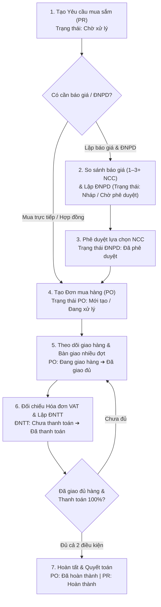

# TÀI LIỆU ĐẶC TẢ KIẾN TRÚC & CHỨC NĂNG HỆ THỐNG (SYSTEM ARCHITECTURE & FUNCTIONAL SPECIFICATION)

**Tên hệ thống:** Hệ thống Quản lý Mua hàng Nội bộ — Phenikaa Pharma (`bang-tong-hop-mua-hang` / `SCMH`)  
**Phiên bản ứng dụng:** `1.1.2` (`package.json`)  
**Nền tảng vận hành:** Webapp (Cloudflare Workers + Vinext/Next.js) & Mobile App Android (Capacitor + OTA Updater)  

---

## 1. TỔNG QUAN DỰ ÁN & KIẾN TRÚC KỸ THUẬT (SYSTEM ARCHITECTURE)

### 1.1. Mục tiêu hệ thống
Hệ thống **SCMH (Supply Chain & Mua Hàng)** giải quyết bài toán nghiệp vụ quản lý mua sắm nội bộ khép kín (End-to-End Procurement) cho **Công ty Cổ phần Dược phẩm Phenikaa (Phenikaa Pharma)**, bao gồm toàn bộ vòng đời chứng từ:
1. Tiếp nhận **Yêu cầu mua sắm (PR - Purchase Request)** từ các phòng ban, kèm bản scan gốc hoặc import danh mục hàng hóa từ Excel.
2. **So sánh báo giá (Compare)** và lập **Đề nghị phê duyệt lựa chọn Nhà cung cấp (ĐNPD)** từ 1 đến 3+ nhà cung cấp với cơ chế tính toán tự động trước/sau VAT.
3. Phát hành **Đơn mua hàng (PO - Purchase Order)** và quản lý **Hợp đồng (Contract)**, theo dõi tiến độ giao hàng và checklist chứng từ đính kèm (`po_docs` + lưu trữ Cloudflare R2).
4. Kiểm đếm **Bàn giao & Nghiệm thu (Handover)** nhiều đợt theo PO gốc, phát hiện hàng không đạt và xuất **Biên bản bàn giao (02 bản)**.
5. Lập **Đề nghị thanh toán (ĐNTT - Mẫu 01-TT)**, đối chiếu hóa đơn GTGT, theo dõi công nợ đã thanh toán/còn lại và tự động đồng bộ trạng thái hoàn thành ngược về PO/PR.
6. Tích hợp **Radar cảnh báo quy trình (`workflowRadar`)**, **Sổ tay công việc thông minh (`SmartTodoPanel`)** đồng bộ D1, **Kho lưu trữ hồ sơ (`DataVault`)**, **CamScanner Cloud**, **Telegram Bot (`@Pnksc_bot`)** và **Offline-First Sync** cho ứng dụng Android.

---

### 1.2. Công nghệ sử dụng (Tech Stack)

#### Frontend (Web & Mobile Native)
- **Framework cốt lõi:** `Next.js 16.2.6` (App Router) kết hợp `React 19.2.6`, `TypeScript 5.9.3`, biên dịch qua `Vinext 0.0.50` trên nền `Vite 8.0.13` và `@cloudflare/vite-plugin 1.37.1`.
- **Mobile Native Wrapper:** `Capacitor 8.5.3` (`@capacitor/android`, `@capacitor/app`, `@capacitor/core`, `@capacitor/network`) đóng gói APK (`com.phenikaa.procurement` - *Phenikaa Mua Hàng*), hỗ trợ cập nhật từ xa OTA qua `@capgo/capacitor-updater 8.54.0` và proxy `/api/*` tới Worker `https://pnk.sc-pnk.workers.dev` kèm `Authorization: Bearer <token>`.
- **UI & CSS:** Hệ thống CSS thuần đa chủ đề theo phong cách **MISA AMIS** (`theme-misa.css`, hỗ trợ Light/Dark mode qua `localStorage["scm_misa_mode"]`) và **Enterprise Stitch v2** (`design-system.css`, `stitch-v2-enterprise.css`), tách riêng CSS theo phân hệ (`dashboard.css`, `approval.css`, `po.css`, `payment.css`, `mobile.css`...). Icon sử dụng `lucide-react 1.61.0`. Font chữ: `Roboto`, `Manrope`, `Geist`, `JetBrains Mono`, và `Times New Roman` chuyên dụng cho mẫu in.
- **Quản lý State & Đồng bộ:**
  - Centralized React State trong `app/ProcurementApp.tsx` đồng bộ với Cloudflare D1 qua `/api/state` (cơ chế **Optimistic Concurrency Control** bằng header `x-expected-version` và phân tách `purchaseHistory` sang partition `:history` để tránh tràn giới hạn kích thước dòng SQLite).
  - Hỗ trợ đồng bộ đa tab trình duyệt (`app/utils/tabSync.ts`) và **Offline-First** (`app/utils/offlineSync.ts`, `app/hooks/useOfflineSync.ts`) lưu hàng đợi hành động và bản sao lưu cục bộ khi mất mạng.
- **Xử lý Bảng, File & Biểu mẫu In ấn:**
  - `xlsx 0.18.5`: Đọc/import danh mục hàng hóa PR từ file Excel.
  - `pdf-lib 1.17.1` & `pdfjs-dist 3.11.174`: Nén/xử lý PDF phía client trước khi upload (`app/utils/compressPdf.ts`, `compressImage.ts`, `compressUploadFile.ts`).
  - **In ấn WYSIWYG:** Sử dụng `ReactDOM.createPortal` gắn trực tiếp vào `document.body` (`#approvalPrintPortal`, `#paymentPrintPortal`), cô lập hoàn toàn giao diện ứng dụng khi `@media print` kích hoạt, kết hợp `@page` CSS chuẩn A4 Portrait/Landscape.

#### Backend, Database & Lưu trữ
- **Runtime & API:** **Cloudflare Workers** (`worker/index.ts`) xử lý CORS cho Web & Capacitor (`capacitor://`, `ionic://`), tối ưu ảnh `/_vinext/image`, định tuyến App Router API (`app/api/*`) và chạy **Cron Trigger** (`30 1 * * *`) gửi bản tin nhắc việc qua Telegram Bot.
- **Cơ sở dữ liệu:** **Cloudflare D1 (SQLite)** kết nối qua `Drizzle ORM 0.45.2` (`db/index.ts`, `db/schema.ts`) và truy vấn SQL trực tiếp qua `env.DB.prepare(...)`.
- **Lưu trữ File (Object Storage):** **Cloudflare R2** (`mua-hang-files`, binding `BUCKET` / `R2_BUCKET`) lưu trữ bản scan PR, hóa đơn VAT, biên bản bàn giao, hợp đồng, bản sao lưu Gzip (`snapshots/*.json.gz`), file cài đặt APK (`apk/*.apk`) và gói OTA (`updates/v*.zip`).
- **Xác thực & Phân quyền (`app/auth.ts`):**
  - Mật khẩu băm bằng **PBKDF2 (SHA-256, 50.000 iterations, salt ngẫu nhiên 16 bytes)**.
  - Phiên đăng nhập (Session) dùng token ngẫu nhiên 32 bytes, lưu dạng băm `SHA-256` trong bảng `sessions` (thời hạn **12 giờ**), truyền qua Cookie `mh_session` hoặc Header `Authorization: Bearer <token>`.
  - Phân quyền 3 cấp (`AppUser.role`): `"master"` (quản trị tối cao, bootstrap từ `MASTER_ADMIN_ID` / `MASTER_ADMIN_PASSWORD`), `"admin"` (quản trị hệ thống, xem tất cả workspace/audit/snapshot), và `"user"` (chỉ thao tác trên workspace của chính mình).

---

### 1.3. Sơ đồ cây thư mục dự án

```text
d:\SCMH\
├── wrangler.jsonc                # Cấu hình Cloudflare Worker, D1 (mua-hang-db), R2 (mua-hang-files), Cron Trigger
├── package.json                  # Khai báo dependencies và scripts build/deploy/migrate/test
├── capacitor.config.json         # Cấu hình ứng dụng Android Capacitor & Capgo OTA Updater
├── drizzle.config.ts             # Cấu hình Drizzle Kit cho D1 migrations
├── worker/
│   └── index.ts                  # Entry point Cloudflare Worker: CORS, Image Optimization, Vinext Router, Cron Scheduled
├── db/
│   ├── index.ts                  # Khởi tạo Drizzle ORM instance từ binding env.DB
│   └── schema.ts                 # Định nghĩa bảng hệ thống và bảng nghiệp vụ (Drizzle SQLite schema)
├── drizzle/                      # Các file SQL migration (0000..0002)
├── database/                     # Script SQL khởi tạo (setup.sql) và dọn dữ liệu mẫu
├── public/                       # Tài nguyên tĩnh: logo Phenikaa Pharma, file mẫu Excel PR, QR tải APK
└── app/
    ├── layout.tsx                # Root layout, nạp font chữ và script khởi tạo theme MISA Light/Dark
    ├── page.tsx                  # Server Component kiểm tra session -> render ProcurementApp hoặc LoginForm
    ├── native-entry.tsx          # Entry point riêng cho bản Android APK (fetch interceptor + ErrorBoundary)
    ├── ProcurementApp.tsx        # Thành phần trung tâm quản lý toàn bộ state, điều hướng view và logic lưu D1
    ├── types.ts                  # Toàn bộ TypeScript types & helper nghiệp vụ (PO code, VAT, total, contract info)
    ├── auth.ts                   # Xác thực PBKDF2, quản lý Session, phân quyền requireUser/requireAdmin, Audit Log
    ├── state-store.ts            # Quản lý phân vùng workspace (procurement:<userId>) và gộp dữ liệu đa workspace
    ├── share-file.ts             # Tạo và xác thực token chia sẻ file công khai (bảng file_share_links)
    ├── telegram.ts               # Logic Trợ lý Telegram Bot (@Pnksc_bot) và hàm runScheduledBriefing cho Cron
    ├── payment-utils.ts          # Hằng số BANK_SUGGESTIONS, PAID_STATUSES, DEFAULT_PAYMENT_TEMPLATE
    ├── seed.ts                   # Dữ liệu khởi tạo mặc định (items0, suppliers0, prs0, pos0...)
    ├── *.css                     # Stylesheet phân tách theo module (globals, theme-misa, payment, approval, po, mobile...)
    ├── api/                      # Toàn bộ REST API endpoints (Next.js Route Handlers trên Worker)
    │   ├── auth/                 # login, logout, verify-password
    │   ├── state/                # GET/PUT toàn bộ trạng thái ứng dụng & partition :history
    │   ├── todos/                # CRUD & bulk sync danh sách công việc cá nhân (personal_todos)
    │   ├── files/                # Upload, liệt kê, stream & xóa file trên R2 + bảng files
    │   ├── upload-scan/          # Upload/xem bản scan PR (pr-scans/ trên R2)
    │   ├── share-file/           # Tạo link chia sẻ & stream file công khai không cần đăng nhập
    │   ├── camscanner/           # Tích hợp CamScanner Cloud (login QR, duyệt thư mục, tìm kiếm, preview, import R2)
    │   ├── app-version/          # Quản lý phiên bản OTA & tải file ZIP/APK từ R2
    │   ├── telegram/webhook/     # Tiếp nhận Webhook từ Telegram & kích hoạt test Cron
    │   ├── purchase-history-seed/# Trả dữ liệu lịch sử mua hàng mẫu T1-T7/2026
    │   └── admin/                # audit-logs, cleanup (dọn rác R2), snapshots (sao lưu/khôi phục Gzip), usage
    ├── components/               # Các màn hình nghiệp vụ, modal, bảng thông minh và mẫu in
    ├── hooks/                    # useOfflineSync.ts, useOtaUpdate.ts
    ├── utils/                    # Các module thuần nghiệp vụ: workflowRadar, paymentSync, handoverBatches, docFlow, approvalSamples, departments, excel, compress*...
    └── share/file/[token]/       # Trang xem trước & tải file được chia sẻ công khai
```

---

## 2. THIẾT KẾ CƠ SỞ DỮ LIỆU (DATABASE SCHEMA - CLOUDFLARE D1)

Hệ thống sử dụng **mô hình lưu trữ lai (Hybrid Persistence)** trên Cloudflare D1:
1. **Lưu trữ State tập trung theo Workspace (`app_state`):** Toàn bộ chứng từ nghiệp vụ (`prs`, `pos`, `approvalRequests`, `paymentRequests`, `paymentHandovers`, `suppliers`, `products`, `quotes`, `trash`...) được đóng gói dạng JSON trong bảng `app_state` với khóa `procurement:<userId>` (và phân vùng `procurement:<userId>:history` cho `purchaseHistory` để tránh vượt giới hạn kích thước dòng SQLite).
2. **Các bảng quan hệ (Relational Tables trong `db/schema.ts` & Runtime Tables):** Phục vụ xác thực, lưu trữ metadata file R2, chia sẻ link, công việc cá nhân, cấu hình hệ thống, audit log và phục hồi dữ liệu cũ (Recovery Migration).

### 2.1. Nhóm bảng Hệ thống, Xác thực & Tích hợp

| Tên bảng | Tên cột | Kiểu dữ liệu | Khóa (PK/FK) | Ý nghĩa nghiệp vụ |
| :--- | :--- | :--- | :--- | :--- |
| **`app_state`** | `id` | `TEXT` | **PK** | Định danh workspace (`procurement:<userId>` hoặc `procurement:<userId>:history`) |
| | `payload` | `TEXT` | NOT NULL | Chuỗi JSON chứa toàn bộ state nghiệp vụ hoặc lịch sử mua hàng |
| | `updated_at` | `TEXT` | NOT NULL | Thời điểm cập nhật cuối (ISO 8601) |
| | `version` | `INTEGER` | DEFAULT 1 | Số phiên bản phục vụ kiểm tra xung đột (Optimistic Concurrency Control) |
| **`users`** | `id` | `TEXT` | **PK** | UUID người dùng |
| | `username` | `TEXT` | UNIQUE | Tên đăng nhập |
| | `display_name` | `TEXT` | NOT NULL | Tên hiển thị |
| | `password_hash` | `TEXT` | NOT NULL | Mã băm PBKDF2-SHA256 |
| | `password_salt` | `TEXT` | NOT NULL | Salt ngẫu nhiên 16 bytes (hex) |
| | `role` | `TEXT` | NOT NULL | Vai trò: `master`, `admin`, `user` |
| | `active` | `INTEGER` | DEFAULT 1 | Trạng thái hoạt động (`1` = kích hoạt, `0` = khóa) |
| | `must_change_password` | `INTEGER` | DEFAULT 0 | Bắt buộc đổi mật khẩu ở lần đăng nhập tới |
| | `created_at`, `updated_at` | `TEXT` | NOT NULL | Thời gian tạo và cập nhật |
| **`sessions`** | `token_hash` | `TEXT` | **PK** | Mã băm SHA-256 của session token |
| | `user_id` | `TEXT` | **FK** → `users.id` | ID người dùng sở hữu phiên (`ON DELETE CASCADE`) |
| | `created_at`, `expires_at` | `TEXT` | NOT NULL | Thời điểm tạo và hết hạn (mặc định +12 giờ) |
| **`files`** | `id` | `TEXT` | **PK** | UUID tệp đính kèm |
| | `entity_type` | `TEXT` | NOT NULL | Loại chứng từ (`po`, `pr`, `contract`, `general`...) |
| | `entity_id` | `TEXT` | NOT NULL | ID chứng từ liên kết |
| | `file_name` | `TEXT` | NOT NULL | Tên file gốc |
| | `object_key` | `TEXT` | NOT NULL | Đường dẫn key trên Cloudflare R2 |
| | `content_type` | `TEXT` | NOT NULL | MIME type (`application/pdf`, `image/jpeg`...) |
| | `size` | `INTEGER` | NOT NULL | Dung lượng file (bytes) |
| | `uploaded_at` | `TEXT` | NOT NULL | Thời điểm tải lên |
| | `owner_user_id`, `document_type`, `expires_at`, `status`, `note` | `TEXT` | Nullable | Các cột mở rộng quản lý vòng đời & phân loại tài liệu trong Kho hồ sơ (`DataVault`) |
| **`file_share_links`** | `token` | `TEXT` | **PK** | Token chia sẻ (`sfl_` + 32 ký tự hex) |
| | `file_url`, `file_name`, `file_type` | `TEXT` | NOT NULL | Đường dẫn R2/API, tên và định dạng file |
| | `entity_type`, `entity_code`, `owner_user_id` | `TEXT` | Nullable | Thông tin chứng từ gốc và người tạo link |
| | `file_size`, `view_count` | `INTEGER` | DEFAULT 0 | Dung lượng và số lượt xem |
| | `created_at`, `expires_at` | `TEXT` | NOT NULL | Thời gian tạo và hết hạn (mặc định +60 ngày) |
| **`share_links`** | `token` | `TEXT` | **PK** | Token chia sẻ snapshot/trạng thái hệ thống |
| | `label`, `created_at`, `expires_at` | `TEXT` | NOT NULL | Nhãn, ngày tạo, ngày hết hạn |
| | `revoked_at`, `last_viewed_at`, `view_count` | `TEXT` / `INTEGER` | Nullable | Theo dõi thu hồi và lượt truy cập |
| **`audit_logs`** | `id` | `INTEGER` | **PK** (Auto) | ID tự tăng |
| | `action`, `entity_type`, `entity_id`, `created_at` | `TEXT` | NOT NULL | Hành động (`LOGIN`, `CREATE_SNAPSHOT`, `RESTORE_SNAPSHOT`, `DELETE_SNAPSHOT`...) |
| **`personal_todos`** | `id` | `TEXT` | **PK** | ID công việc cá nhân |
| | `user_id` | `TEXT` | DEFAULT `'admin'` | Chủ sở hữu công việc |
| | `content` | `TEXT` | NOT NULL | Nội dung công việc (hỗ trợ tag `@PO`, `#PR`, `@DNPD`, `@NCC`) |
| | `is_completed`, `is_priority`, `is_deleted` | `INTEGER` | DEFAULT 0 | Cờ hoàn thành, ưu tiên (`!gấp`), xóa mềm |
| | `tags`, `due_date`, `subtasks`, `note` | `TEXT` | Nullable | Nhãn, hạn chót, JSON danh sách việc con, ghi chú |
| | `created_at`, `updated_at` | `TEXT` | Nullable | Thời gian tạo và cập nhật |
| **`system_configs`** | `key` | `TEXT` | **PK** | Khóa cấu hình (vd: `app_version` cho OTA Update) |
| | `value`, `updated_at` | `TEXT` | NOT NULL | Giá trị JSON cấu hình và thời gian cập nhật |
| **`camscanner_tokens`** | `user_key` | `TEXT` | **PK** | Khóa người dùng |
| | `token`, `cs_user_id`, `expires_at`, `updated_at` | `TEXT` / `INTEGER` | NOT NULL / Nullable | Access token phiên đăng nhập CamScanner Cloud |

### 2.2. Nhóm bảng Nghiệp vụ (`db/schema.ts`)

| Tên bảng | Tên cột chính | Kiểu dữ liệu | Khóa (PK/FK) | Ý nghĩa nghiệp vụ |
| :--- | :--- | :--- | :--- | :--- |
| **`suppliers`** | `id` | `INTEGER` | **PK** | ID Nhà cung cấp |
| | `workspace_id`, `code`, `name` | `TEXT` | NOT NULL | Mã workspace, mã NCC (`NCC-XXX`), tên đầy đủ NCC |
| | `bank_account`, `bank`, `address`, `contact`, `phone` | `TEXT` | Nullable | Số tài khoản, ngân hàng, địa chỉ, người liên hệ, SĐT |
| **`products`** | `id` | `INTEGER` | **PK** | ID Vật tư / Hàng hóa |
| | `workspace_id`, `code`, `name` | `TEXT` | NOT NULL | Mã workspace, mã vật tư (`VT-001`), tên vật tư |
| | `category`, `desc`, `spec`, `unit`, `estimate` | `TEXT` / `REAL` | Nullable | Nhóm hàng, mô tả, quy cách kỹ thuật, ĐVT, đơn giá dự kiến |
| **`prs`** | `id` | `INTEGER` | **PK** | ID Yêu cầu mua sắm (PR) |
| | `workspace_id`, `number` | `TEXT` | NOT NULL | Mã workspace, số PR (`PR-2026-XXXX`) |
| | `date`, `department`, `purpose`, `status`, `note`, `scan_file_url` | `TEXT` | Nullable | Ngày lập, phòng ban đề xuất, mục đích, trạng thái, ghi chú, link scan R2 |
| **`pr_items`** | `id` | `INTEGER` | **PK** (Auto) | ID dòng hàng hóa trong PR |
| | `pr_id` | `INTEGER` | **FK** → `prs.id` | Liên kết tới PR (`ON DELETE CASCADE`) |
| | `original_id`, `code`, `category`, `name`, `desc`, `spec`, `unit`, `qty`, `estimate` | `INTEGER`/`TEXT`/`REAL` | Nullable | Thông tin vật tư, số lượng yêu cầu và đơn giá dự kiến |
| **`quotes`** | `pr_id`, `supplier_id` | `INTEGER` | NOT NULL | ID PR và ID NCC báo giá |
| | `price`, `note`, `price_mode`, `vat_rate` | `TEXT` | Nullable | Đơn giá chào, ghi chú, chế độ giá (`before-vat`/`after-vat`), thuế suất |
| **`pos`** | `id` | `INTEGER` | **PK** | ID Đơn mua hàng (PO) |
| | `workspace_id`, `number` | `TEXT` | NOT NULL | Mã workspace, số PO (`<SHORTNAME>-<DDMMYYYY>`) |
| | `pr_number`, `supplier_id`, `created_date`, `expected_date`, `status`, `note`, `contract_note` | `TEXT`/`INTEGER` | Nullable | Số PR gốc, ID NCC, ngày tạo, hạn giao, trạng thái, ghi chú hợp đồng |
| **`po_items`** | `id` | `INTEGER` | **PK** (Auto) | ID dòng hàng hóa trong PO |
| | `po_id` | `INTEGER` | **FK** → `pos.id` | Liên kết tới PO (`ON DELETE CASCADE`) |
| | `original_id`, `code`, `category`, `name`, `desc`, `spec`, `unit`, `qty`, `estimate`, `price` | `INTEGER`/`TEXT`/`REAL` | Nullable | Thông tin hàng hóa, số lượng đặt và đơn giá chốt |
| | `delivery_status`, `delivered_qty`, `delivery_date` | `TEXT` / `REAL` | Nullable | Trạng thái giao (`Chưa giao`/`Giao một phần`/`Đã giao`), SL đã giao, ngày giao |
| **`po_allocations`** | `id` | `INTEGER` | **PK** (Auto) | ID phân bổ dòng PO về dòng PR gốc |
| | `po_item_id` | `INTEGER` | **FK** → `po_items.id` | Liên kết tới dòng PO (`ON DELETE CASCADE`) |
| | `pr_id`, `pr_number`, `pr_item_id`, `qty` | `INTEGER`/`TEXT`/`REAL` | Nullable | Truy vết số lượng phân bổ từ PR gốc (hỗ trợ gộp nhiều PR vào 1 PO) |
| **`po_docs`** | `id` | `INTEGER` | **PK** | ID đầu mục chứng từ của PO |
| | `po_id` | `INTEGER` | **FK** → `pos.id` | Liên kết tới PO (`ON DELETE CASCADE`) |
| | `name`, `status`, `note` | `TEXT` | Nullable | Tên chứng từ (`Hợp đồng`, `Hóa đơn VAT`...), trạng thái (`Đã đủ`/`Còn thiếu`/`Chờ bổ sung`) |
| **`po_payments`** | `id` | `INTEGER` | **PK** | ID đợt thanh toán của PO |
| | `po_id` | `INTEGER` | **FK** → `pos.id` | Liên kết tới PO (`ON DELETE CASCADE`) |
| | `phase`, `percent`, `amount`, `status`, `date` | `TEXT` / `REAL` | Nullable | Tên đợt, tỷ lệ %, số tiền, trạng thái (`Chưa thanh toán`/`Đang xử lý`/`Đã thanh toán`), ngày hẹn |
| **`purchase_history`** | `id` | `TEXT` | **PK** | ID bản ghi lịch sử mua hàng |
| | `workspace_id`, `warehouse_code`, `warehouse_name`, `item_code`, `item_name`, `accounting_date`, `document_date`, `document_no`, `invoice_date`, `invoice_no`, `description`, `unit`, `unit_price`, `quantity`, `value`, `supplier_code`, `supplier_name`, `supplier_id`, `department` | `TEXT`/`REAL`/`INTEGER` | Nullable | Dữ liệu lịch sử giá nhập kho & hóa đơn (dùng tham chiếu giá vật tư, lịch sử NCC) |
| **`trash_items`** | `id` | `TEXT` | **PK** | ID bản ghi trong thùng rác |
| | `workspace_id`, `type`, `label`, `deleted_at`, `expires_at`, `data` | `TEXT` | Nullable | Loại (`PR`, `PO`, `CONTRACT`, `APPROVAL`, `HANDOVER`, `PAYMENT`), thời hạn 30 ngày, JSON khôi phục |

> **Lưu ý về dữ liệu mở rộng trong `app_state.payload`:** Các thực thể `approvalRequests` (ĐNPD), `paymentRequests` (ĐNTT), `paymentGroups`, `paymentBeneficiaries`, `paymentHandovers` (Chi tiết bàn giao từng đợt) và `paymentTemplate` (Mẫu in 01-TT) được lưu trữ trực tiếp dưới dạng mảng/đối tượng JSON trong `app_state.payload` (xem `StoredState` tại `app/types.ts`).

### 2.3. Mối quan hệ liên kết dữ liệu (Relationships)
- **`users` 1 — N `sessions`**: Một người dùng có thể có nhiều phiên đăng nhập đồng thời (Web + Mobile), xóa user sẽ cascade xóa session.
- **`prs` 1 — N `pr_items`**: Một PR gồm nhiều dòng hàng hóa yêu cầu.
- **`prs` 1 — N `approvalRequests` (ĐNPD)**: Một PR có thể phát sinh một hoặc nhiều ĐNPD (qua `prId` / `prNumber`), và một ĐNPD có thể sinh ra từ luồng So sánh báo giá (`compare`), trực tiếp từ PR (`pr`), hoặc tạo thủ công (`manual`).
- **`approvalRequests` 1 — 1 `pos` (PO)**: ĐNPD sau khi phê duyệt tạo ra PO liên kết hai chiều qua `linkedPoId` / `linkedPoNumber`.
- **`prs` N — N `pos` (qua `po_allocations`)**: Một PO có thể gộp hàng hóa từ nhiều PR khác nhau, và một PR có thể tách thành nhiều PO cho các nhà cung cấp khác nhau; bảng `po_allocations` lưu vết `prId`, `prItemId`, `qty`.
- **`suppliers` 1 — N `pos` / `quotes` / `purchase_history`**: Mỗi PO và mỗi dòng báo giá gắn với một nhà cung cấp (`supplierId`).
- **`pos` 1 — N `po_items` / `po_docs` / `po_payments`**: Một PO quản lý danh sách hàng đặt, checklist hồ sơ chứng từ và các đợt thanh toán.
- **`pos` 1 — N `paymentHandovers` (theo `source_number` & `batch_id`)**: Một PO có thể giao nhận nhiều đợt bàn giao (`Đợt 1`, `Đợt 2`...), mỗi đợt chứa nhiều dòng kiểm đếm gắn với `po_item_id`.
- **`po_payments` 1 — 1 `paymentRequests` (qua `paymentRequestId`)**: Mỗi đợt thanh toán trên PO liên kết hai chiều với một Giấy đề nghị thanh toán (ĐNTT).

---

## 3. LƯU ĐỒ NGHIỆP VỤ & LUỒNG CÔNG VIỆC (WORKFLOW & STATE MACHINE)

### 3.1. Sơ đồ quy trình mua hàng khép kín (Mermaid Flowchart)



### 3.2. Chi tiết chuyển trạng thái (Status Transitions) & Kế thừa dữ liệu tự động

1. **Bước 1 — Tạo PR (`Chờ xử lý`):**
   - Người dùng nhập thông tin chung (`number`, `date`, `department`, `purpose`) và danh sách vật tư (`items`). Các mã hàng mới được tự động thêm vào danh mục `products`.
2. **Bước 2 — Chuyển từ PR sang So sánh báo giá & ĐNPD (`Nháp` ➔ `Chờ phê duyệt`):**
   - **Kế thừa từ PR sang ĐNPD (`createApprovalFromPR` / `createApprovalFromCompare`):**
     - `prId`, `prNumber`, `noteRef` kế thừa từ `pr.id`, `pr.number`.
     - `section1Title` tự động sinh theo phòng ban PR: `"Theo yêu cầu mua hàng phục vụ công việc của phòng [department]. Phòng Cung Ứng đã tìm kiếm, đánh giá và đề xuất phương án như sau:"`.
     - Toàn bộ `pr.items` được chuyển thành `ApprovalItemRow[]` (`itemCode`, `itemName`, `spec`, `qty`, `unit`).
     - Nếu tạo từ màn hình So sánh báo giá (`createApprovalFromCompare`), đơn giá báo của từng NCC trong `quotesByPr[pr.id]` được nạp sẵn vào `supplierQuotes`, hệ thống tự chấm điểm NCC có nhiều mức giá thấp nhất (`countBest`) và tổng tiền > 0 để đánh dấu `isSelected: true`.
3. **Bước 3 — Phê duyệt ĐNPD & Chuyển sang tạo PO (`Đã phê duyệt` ➔ `Đã tạo PO`):**
   - **Kế thừa từ ĐNPD sang PO (`handleCreatePOFromApproval`):**
     - Lấy NCC được chọn (`isSelected === true`), tự động đối chiếu hoặc tạo mới bản ghi trong `suppliers`.
     - Chuyển đổi `req.rows` và báo giá của NCC được chọn thành `POItem[]`: kế thừa `code`, `name` (ưu tiên `quotedProduct`/`origin` nếu bật cột mở rộng), `spec`, `unit`, `qty`, `price = unitPrice`, `vatRate` (mặc định `10%` hoặc theo `req.vatRate`), khởi tạo `deliveryStatus = "Chưa giao"`, `deliveredQty = 0`.
     - Tự động sinh số PO duy nhất qua `generatePOCode(targetSupplier, todayDate, pos, trash)`.
     - Tự động tạo 1 đợt thanh toán `100%` trong `po.payments` với giá trị `calcPOTotal(po)` và điều kiện `"advance"` hoặc `"post"` dựa trên từ khóa `"trước"` trong `req.paymentTerms`.
     - Cập nhật ngược lại ĐNPD: `status = "Đã tạo PO"`, `linkedPoId = newPO.id`, `linkedPoNumber = newPO.number`.
   - **Nếu tạo PO từ Giỏ hàng So sánh (`createPO`):** Gộp các dòng `POCartLine` cùng NCC + mã + quy cách + ĐVT + đơn giá, lưu `POAllocation[]` trỏ về `prId` và `prItemId`, đồng thời cập nhật `PR.status` thành `"Đã tạo đủ PO"` hoặc `"Đã tạo PO một phần"`.
4. **Bước 4 — Bàn giao & Nghiệm thu nhiều đợt (`Chưa giao` ➔ `Giao một phần` ➔ `Đã giao`):**
   - Khi tạo hoặc cập nhật đợt bàn giao trên PO (`updatePOHandoverBatch` / `HandoverManagement`):
     - Hệ thống tính `deliveredQty` cộng dồn từ tất cả các đợt (`paymentHandovers` + `deliveryHistory`), chặn không cho vượt quá `qty` đặt hàng trên PO.
     - Cập nhật `POItem.deliveryStatus`: `"Đã giao"` nếu `deliveredQty >= qty`, `"Giao một phần"` nếu `deliveredQty > 0`, ngược lại `"Chưa giao"`.
     - Cập nhật `PO.status`: `"Đã giao đủ"` (`isCompleted: true`) nếu toàn bộ dòng hàng đã giao đủ; `"Đang giao hàng"` nếu có ít nhất 1 dòng đã giao một phần.
5. **Bước 5 — Thanh toán & Quyết toán (`Chưa thanh toán` ➔ `Đã thanh toán` ➔ `PO: Đã hoàn thành`):**
   - Khi tạo ĐNTT từ một đợt thanh toán trên PO (`handleCreateFromPO`), ĐNTT kế thừa `payee_name`, `address`, `account_no`, `bank` từ `suppliers`, số hóa đơn từ `po.payments[].invoiceNo` và tự sinh diễn giải chuẩn qua `buildPOPaymentDescription(po, payment)`.
   - Khi ĐNTT được đánh dấu hoàn thành (`syncPaymentCompletionToPO`), hệ thống tự động cập nhật đợt thanh toán tương ứng trên PO thành `"Đã thanh toán"`. Nếu **toàn bộ các đợt thanh toán trên PO đã thanh toán** VÀ **toàn bộ dòng hàng đã giao đủ (`deliveryStatus === "Đã giao"`)**, PO tự động chuyển sang trạng thái `"Đã hoàn thành"` (`isCompleted: true`). Nếu hủy hoàn thành ĐNTT, PO tự động lùi về `"Đang thực hiện"`.

---

## 4. CHI TIẾT CÁC PHÂN HỆ & CHỨC NĂNG (MODULES & FEATURES)

### 4.1. Trang chủ (`Dashboard.tsx` & `WorkflowPipelineCard.tsx`)
- **Kiến trúc giao diện:** Thiết kế dạng **Action Workspace 2 cột** (`dashboard-action-grid`), tập trung vào xử lý công việc theo thời gian thực thay vì biểu đồ tĩnh:
  - **Thanh tác vụ nhanh (Topbar):** 6 nút khởi tạo nhanh (`Tạo PR`, `Tạo ĐNPD`, `Tạo PO`, `Tạo ĐNTT`, `Tạo Bàn giao`) và nút `Tra cứu` (`Ctrl + K` mở `GlobalSpotlightModal` tìm kiếm xuyên suốt PR/ĐNPD/PO/Hợp đồng/NCC/Vật tư).
  - **Dải Radar cảnh báo (`radar-attention-strip`):** Tính toán qua `buildWorkflowRadar()` trong `app/utils/workflowRadar.ts` với 4 bộ lọc đếm số lượng trực tiếp:
    1. `Tất cả đang theo dõi` (`totalActionable`)
    2. `Quá hạn gấp / Hàng lỗi` (`overdue`): PR chờ > 7 ngày chưa hỏi giá; ĐNPD chờ duyệt >= 7 ngày; PO quá hạn `expectedDate`; Bàn giao có `quantity_fail > 0`; ĐNTT quá `due_date`.
    3. `Sắp đến hạn (≤ 3 ngày)` (`dueSoon`): PR/ĐNPD mở >= 3 ngày; PO còn <= 3 ngày tới hạn giao hoặc có đợt thanh toán đến hạn <= 3 ngày; Bàn giao chưa đạt 100%; ĐNTT đến hạn <= 3 ngày.
    4. `Thiếu chứng từ / Treo bước` (`missingDocs`): PR thiếu `scan_file_url`; ĐNPD đã duyệt nhưng chưa lên PO; PO/Hợp đồng có chứng từ chưa `"Đã đủ"`; Bàn giao thiếu `handover_scan_url`; ĐNTT thiếu `invoice_no`, thiếu `invoice_scan_url` hoặc có `doc_supplement`.
  - **Cột trái (`WorkflowPipelineCard`):** 5 tab tương ứng 5 giai đoạn (`1. PR`, `2. ĐNPD`, `3. PO & Giao hàng`, `4. Bàn giao`, `5. ĐNTT`) có chấm trạng thái đỏ/vàng. Cho phép sửa ghi chú trực tiếp (`InlineNoteCell`), sửa số hóa đơn nhanh, đẩy việc sang Sổ tay To-Do (`onQuickRemindTodo`), và xác nhận hoàn tất/hoàn tác thanh toán.
  - **Cột phải (`SmartTodoPanel`):** Sổ tay công việc cá nhân đồng bộ D1 (`/api/todos`), hỗ trợ nhập nhanh bằng NLP (`!gấp` ➔ ưu tiên cao; `hôm nay`, `ngày mai`, `tuần sau` ➔ tự gán `dueDate`), gắn thẻ liên kết chứng từ (`@PO-...`, `#PR-...`, `@DNPD-...`, `@NCC-...` bấm vào mở thẳng chứng từ), chia nhóm `Quá hạn` / `Hôm nay` / `Sắp tới` / `Đã xong`, kèm danh sách việc con (`subtasks`) và ghi chú.

### 4.2. Quản lý Yêu cầu mua sắm (`PRList.tsx`, `CreatePRCatalog.tsx`)
- **Quy tắc sinh mã PR:** Tự động đề xuất theo mẫu `PR-${YYYY}-${String(prs.length + 1).padStart(4, "0")}` (ví dụ: `PR-2026-0001`).
- **Trường nhập liệu tạo/sửa PR:**
  - Thông tin chung: `number` (Mã PR, bắt buộc), `date` (Ngày lập, bắt buộc), `department` (Phòng ban đề xuất từ `getUnifiedDepartments()`, cho phép thêm mới phòng ban ngay tại dropdown), `purpose` (Mục đích mua sắm, bắt buộc), `note` (Ghi chú chung), `scan_file_url` (File scan PR gốc).
  - Bảng hàng hóa (`DraftItemsTable`): `code` (tự sinh `VT-XXX`), `category`, `name`, `desc`, `spec`, `unit`, `qty`, `estimate`, `amount` (`qty * estimate`). Hỗ trợ chọn nhanh từ danh mục `products` hoặc thêm dòng trống.
  - **Tự động lưu nháp (Auto-draft):** Lưu bản nháp vào IndexedDB (`pr_draft_form`) sau mỗi 2.5 giây ngừng gõ để khôi phục nếu mất kết nối/tải lại trang.
- **Import Excel & Scan:**
  - Nút tải file mẫu `/mau-nhap-danh-sach-hang-hoa-pr.xlsx` và import file `.xlsx/.xls` (tự động nhận diện dòng tiêu đề theo từ khóa tiếng Việt/Anh và chuẩn hóa số lượng/đơn giá qua `excelNumber`).
  - Hỗ trợ kéo thả upload PDF/ảnh (`compressUploadFile` ➔ `POST /api/upload-scan`), hoặc lấy trực tiếp từ **CamScanner Cloud** (`CamScannerCloudModal`), xem trước qua `PRScanPreviewModal`.
- **Bộ lọc & Thao tác trên Danh sách PR (`PRList.tsx`):**
  - Thống kê KPI: Tổng PR & tổng dự toán, số PR đang xử lý, số PR đã hoàn thành (%).
  - Bộ lọc: Trạng thái (`Tất cả`, `Đang xử lý`, `Đã hoàn thành`), phòng ban, từ khóa tìm kiếm (mã PR, phòng ban, mục đích, tên hàng), nút bật/tắt hiển thị PR đã ẩn (`scmh_pr_show_hidden`).
  - Thao tác dòng: Đánh dấu hoàn thành, mở chi tiết/so sánh báo giá, tạo bàn giao, xem/in/upload scan, ẩn/hiện, xóa vào thùng rác, và xem chuỗi liên kết chứng từ (`DocFlowLinks`).

### 4.3. Đề nghị phê duyệt lựa chọn NCC (`ApprovalManagement.tsx`, `approvalSamples.ts`)
- **3 nguồn khởi tạo:** Từ màn hình So sánh báo giá (`compare`), từ PR có sẵn (`pr`), hoặc tạo thủ công (`manual`).
- **Cơ chế thêm/bớt NCC (1 đến 3+ NCC):**
  - Mặc định hỗ trợ so sánh 1–3 NCC (có thể thêm nhiều hơn qua `handleAddSupplierColumn`, chọn từ danh mục `suppliers` hoặc tạo cột NCC mới).
  - Ràng buộc tối thiểu **1 NCC** (`supplierColumns.length <= 1` sẽ chặn xóa). Khi xóa NCC đang được chọn, hệ thống tự động chuyển lựa chọn sang NCC đầu tiên còn lại.
  - Khi số NCC `>= 3`, hệ thống tự động chuyển khổ giấy in sang **A4 Ngang (`landscape`)**.
- **Thuật toán tính toán tự động trước/sau VAT:**
  - `computeSupplierTotal(req, colId)`: Duyệt qua từng dòng hàng hóa, xác định số lượng hiệu lực `effQty = showSupplierQty ? line.qty : row.qty`, tính `unitPrice > 0 ? unitPrice * effQty : line.amount` và cộng tổng tiền hàng trước VAT (`subtotal`).
  - `computeSupplierVatAmount(req, colId)`: Nếu `vatMode === "with_vat"` và `vatCalculationType !== "already_included"`, tính `Math.round(subtotal * (vatRate / 100))` (hỗ trợ thuế suất `10%`, `8%`, `5%`, `0%`, hoặc `"included"` — Đã bao gồm VAT).
  - `computeSupplierFinalTotal(req, colId)`: `subtotal + vatAmount` (tổng giá trị đề xuất phê duyệt).
- **Lý do mẫu, Điều kiện giao hàng & Thanh toán:**
  - Tích hợp sẵn các bộ mẫu chọn nhanh (Presets) cho **Điều kiện giao hàng** (`DELIVERY_TERM_PRESETS`), **Điều kiện thanh toán** (`PAYMENT_TERM_PRESETS`: 100% trước giao hàng, 100% sau 30 ngày, 30%/70%), **Lý do lựa chọn NCC** (`REASON_PRESETS`), và cho phép thêm dòng đánh giá tùy biến (`customEvaluationRows`).
  - Lưu mặc định tên 3 người ký (`scmh_default_approval_signers` trong `localStorage`) và hỗ trợ thêm người ký tùy chỉnh (`customSigners`).

### 4.4. Quản lý Đơn mua hàng (`POList.tsx`, `PODetail.tsx`, `DocumentManager.tsx`, `ContractManagement.tsx`)
- **Quy trình lập PO & Sinh mã tự động:**
  - Lập trực tiếp từ ĐNPD đã duyệt (`handleCreatePOFromApproval`), từ Giỏ hàng So sánh báo giá (`createPO`), lập PO trực tiếp trong `POList`, hoặc lập Hợp đồng kinh tế trong `ContractManagement`.
  - Mã PO tự động sinh theo `generatePOCode(supplier, createdDate, existingPOs, trash)`: dạng `<SHORTNAME>-<DDMMYYYY>` (vd: `PHUCVINH-26102026`). Nếu trùng mã trong danh sách PO hiện hành hoặc Thùng rác, tự động gắn hậu tố tăng dần `-02`, `-03`...
- **Theo dõi trạng thái đơn hàng:**
  - Trạng thái PO: `Mới tạo`, `Đang xử lý`, `Đang thực hiện`, `Đang giao hàng`, `Đã giao đủ`, `Đã hoàn thành`.
  - Hiển thị tiến độ giao hàng (`calcPODeliveryStats`) và tiến độ thanh toán (`paid / total`).
- **Quản lý hồ sơ chứng từ đính kèm (`po_docs` & R2):**
  - Checklist `po.docs` theo dõi trạng thái từng loại giấy tờ (`Đã đủ`, `Còn thiếu`, `Chờ bổ sung`): *Hợp đồng, PO xác nhận, Hóa đơn VAT, Biên bản giao nhận, CO/CQ, Báo giá*. Thông tin hợp đồng (`contractNumber`, `contractDate`) tự động đồng bộ với PO qua `getPOContractInfo`.
  - Thành phần `<DocumentManager entityType="po" entityId={String(po.id)} />` cho phép upload file (tối đa **25 MB**, tự động nén ảnh/PDF qua `compressUploadFile`) lên **Cloudflare R2** (`POST /api/files`), lưu metadata vào bảng `files`, xem trực tiếp (`GET /api/files/[id]`), xóa file, hoặc tạo link chia sẻ công khai có thời hạn (`POST /api/share-file`).

### 4.5. Bàn giao & Thanh toán (`HandoverManagement.tsx`, `POHandoverBatchSection.tsx`, `PaymentManagement.tsx`, `paymentSync.ts`)
- **Cơ chế kiểm đếm giao nhận nhiều đợt theo PO gốc (`handoverBatches.ts`):**
  - Các dòng bàn giao (`PaymentHandoverItem`) được gom nhóm theo `batch_id` (hoặc khóa legacy `ngày + bộ phận + người giao + người nhận`) thành các đợt tuần tự (`Đợt 1`, `Đợt 2`...) qua `getPODeliveryBatches()`.
  - Với mỗi mặt hàng, hệ thống tính `deliveredFromOtherBatches` (tổng SL đạt ở các đợt khác) và giới hạn `maxAllowedInThisBatch = Math.max(0, quantityOrdered - deliveredFromOtherBatches)` để **chống giao vượt số lượng PO gốc**.
  - Khi nhập `SL chứng từ (quantity_doc)` và `SL Đạt (quantity_pass)`, hệ thống tự động tính `SL Không đạt (quantity_fail) = Math.max(0, docQty - passQty)`.
  - Mọi thay đổi ở đợt bàn giao tự động cập nhật ngược `deliveredQty`, `deliveryStatus`, `deliveryHistory` trên `POItem` và trạng thái tổng của `PO`.
- **Đối chiếu hóa đơn VAT & Quản lý Đề nghị thanh toán (ĐNTT):**
  - Mỗi đợt thanh toán trên PO (`po.payments`) có điều kiện `advance` (Tạm ứng), `post` (Sau giao hàng), hoặc `other`. Nếu là `post`, hệ thống yêu cầu/cảnh báo bổ sung **Số hóa đơn VAT (`invoiceNo`)**, ngày hóa đơn và bản scan hóa đơn (`invoiceScanUrl`).
  - Hỗ trợ **đồng bộ hai chiều** thông tin hóa đơn giữa `PO.payments[]` và `PaymentRequestEntry` (kể cả trường hợp 1 ĐNTT gộp nhiều hóa đơn trong mảng `lines: PaymentDetailLine[]`, tự động cộng tổng `amount` và nối chuỗi `invoice_no`).
  - **Tính toán giá trị đã thanh toán & công nợ còn lại:**
    - Tổng giá trị PO: `total = calcPOTotal(po)` = $\sum \text{round}(\text{qty} \times \text{price} \times (1 + \text{vatRate}/100))$.
    - Đã thanh toán: `paid = sum(po.payments)` với các đợt có `status === "Đã thanh toán"`.
    - Công nợ còn lại: `Math.max(0, total - paid)`.
    - Trên tab Nhóm hợp đồng (`ContractManagement`), hệ thống đối chiếu `PaymentGroup.total_amount` với tổng các ĐNTT đã chi (`PAID_STATUSES`) và đang chờ chi để hiển thị ngân sách còn lại.

### 4.6. Danh mục & Cài đặt hệ thống
- **Danh mục (`CatalogManagement.tsx`):** Gồm 2 tab chính tích hợp KPI strip:
  - **Nhà cung cấp (`SupplierManagement.tsx`):** Danh bạ NCC, tìm kiếm/lọc (`Tất cả`, `Đang giao dịch`, `Đã có STK`), sửa nhanh thông tin ngân hàng (gợi ý `BANK_SUGGESTIONS`), xem chi tiết lịch sử mua hàng và top mặt hàng cung cấp.
  - **Vật tư / Hàng hóa (`ProductCatalog.tsx`):** Danh mục vật tư chuẩn, theo dõi biến động giá nhập gần nhất so với giá dự kiến (% tăng/giảm), xem lịch sử giá theo từng lần nhập (`purchaseHistory` + `pos`), tạo nhanh PR từ danh mục.
- **Phòng ban (`app/utils/departments.ts`):** Danh sách gốc (`TT ĐSH`, `Phòng QA`, `QC`, `RD`, `IT`, `Sản xuất`, `Cung ứng`, `Kế toán`, `Kho`) kết hợp danh sách tùy biến lưu tại `localStorage["scm_unified_departments_v1"]` và phát sự kiện `scm_departments_updated` đồng bộ toàn app.
- **Kho hồ sơ (`DataVault.tsx`):** Tổng hợp toàn bộ file scan từ PR, PO, Hóa đơn, Bàn giao, ĐNTT, file R2 và CamScanner Cloud vào một giao diện tra cứu tập trung.
- **Thùng rác (`TrashPage.tsx`):** Lưu trữ các bản ghi đã xóa mềm (`PR`, `PO`, `CONTRACT`, `APPROVAL`, `HANDOVER`, `PAYMENT`) trong **30 ngày**, hỗ trợ tìm kiếm, khôi phục nguyên trạng hoặc xóa vĩnh viễn.
- **Cài đặt & Quản trị (`SettingsModal.tsx`, `AdminSettings.tsx`):**
  - Chuyển đổi giao diện **MISA Light / Dark Mode**.
  - Quản lý mẫu in (`PrintTemplatesManagement.tsx`).
  - Sao lưu & Khôi phục điểm thời gian (`Snapshots` nén Gzip trên R2).
  - Nhật ký kiểm tra hệ thống (`Audit Logs`).
  - Kiểm tra phiên bản ứng dụng, tải file cài đặt **Android APK**, quét QR và kích hoạt cập nhật **OTA**.

---

## 5. ĐẶC TẢ HỆ THỐNG BIỂU MẪU IN ẤN (PRINT TEMPLATES & WYSIWYG RULES)

Toàn bộ biểu mẫu sử dụng cơ chế **Print Portal Isolation** (`#approvalPrintPortal` và `#paymentPrintPortal` gắn vào `document.body` qua `createPortal`): ở chế độ màn hình (`@media screen`), portal bị ẩn; khi in (`@media print`), toàn bộ UI ứng dụng (`.app`, modal, nút FAB...) bị ẩn hoàn toàn, chỉ hiển thị nội dung trong portal với quy tắc `break-inside: avoid` cho các dòng bảng (`tr`), khối tổng cộng và khối chữ ký.

### 5.1. Phiếu Đề nghị phê duyệt lựa chọn NCC (ĐNPD — `ApprovalManagement.tsx`)
- **Khổ giấy & Font:** A4 (`portrait` hoặc tự động `landscape` khi `>= 3` NCC), lề `5mm 6mm`, font `Times New Roman` `10pt`, `table-layout: fixed !important`, chiều rộng `100%`.
- **Header (`.phenikaa-header-table`):** Bảng 2 cột không viền hoặc viền mảnh chứa **Logo Phenikaa Pharma** (`PHENIKAA_PHARMA_LOGO_BASE64`, `max-height: 40px`) bên trái và tiêu đề **`ĐỀ NGHỊ PHÊ DUYỆT LỰA CHỌN NCC`** (`14pt`, in đậm) bên phải.
- **Thông tin chung (`.phenikaa-meta-lines`):** 4 dòng thông tin: `Số PR` (`requestNumber`), `Ngày` (`createdDate`), `Đơn vị lập biểu mẫu` (`department`), `Căn cứ theo PR số` (`prNumber` / `noteRef`), tiếp theo là đoạn dẫn `section1Title`.
- **Cấu trúc bảng dữ liệu chi tiết & Cơ chế co giãn động (`computeApprovalColumnWidths`):**
  - 4 cột cố định bên trái (`STT`, `Hàng hóa`, `SL`, `ĐVT`) + `N` nhóm cột Nhà cung cấp. Mỗi nhóm NCC gồm 2–4 cột con tùy cấu hình (`Mặt hàng NCC báo` / `Xuất xứ`, `Đơn giá`, `SL NCC`, `Thành tiền`).
  - **Tỷ lệ phân bổ độ rộng theo số NCC (tổng luôn đạt `100.00%`, sai số làm tròn dồn vào cột `Hàng hóa`):**
    - `1 NCC`: 4 cột trái chiếm `42–54%`, cột NCC chiếm `46–58%`.
    - `2 NCC`: 4 cột trái `[4.0%, 22.0%, 5.0%, 5.0%]` (36%), mỗi NCC `32.0%`.
    - `3 NCC`: 4 cột trái `[3.5%, 18.5%, 4.0%, 4.0%]` (30%), mỗi NCC `23.33%`.
    - `≥ 4 NCC`: 4 cột trái `[3.0%, 15.0%, 4.0%, 4.0%]` (26%), mỗi NCC `74.0% / N`.
  - Hỗ trợ kéo thả trực tiếp biên cột trên giao diện xem trước (`customColWidths` / `columnWidths`) hoặc chọn preset (`balanced`, `long_item`, `large_amount`).
- **Quy tắc chống ngắt dòng số tiền (Money Anti-Wrap):**
  - Tất cả các ô đơn giá, thành tiền, tổng cộng (`.cell-right`, `.cell-sub-price`, `.cell-sub-amount`, `.total-amount-cell`) bắt buộc áp dụng `white-space: nowrap !important`, `word-break: normal !important`, `font-variant-numeric: tabular-nums !important`, căn phải (`text-align: right`).
  - Cỡ chữ tự động co theo số lượng NCC khi in: `9.5pt` (1 NCC), `8.5pt` (2 NCC), `7.5pt` + `letter-spacing: -0.3px` (≥ 3 NCC).
- **Điều khoản & Chữ ký chân trang (`.phenikaa-sign-table`):**
  - Mục II hiển thị: Nhà cung cấp đề xuất, Thời gian giao hàng, Điều kiện thanh toán, Các tiêu chí đánh giá thêm và Lý do lựa chọn NCC.
  - Khối chữ ký chia đều `100% / (3 + customSigners.length)` cột: `Lãnh đạo phê duyệt` ➔ `Người ký tùy chỉnh (nếu có)` ➔ `Trưởng bộ phận` ➔ `Người đề nghị`, khoảng trống ký cao `signSpaceHeight` (mặc định `96px`).

### 5.2. Đơn mua hàng (PO — `PODetail.tsx`)
- Hiện tại hệ thống **chưa có mẫu in riêng cho PO**; trên màn hình chi tiết PO (`PODetail.tsx`), nút in (`Printer`) liên kết trực tiếp để in **Giấy đề nghị thanh toán (Mẫu 01-TT)** tương ứng với từng đợt thanh toán của PO.

### 5.3. Biên bản bàn giao, nghiệm thu vật tư, hàng hóa (`HandoverPrintPreviewModal.tsx` & `PrintTemplatesManagement.tsx`)
- **Quy cách bản in:** Luôn xuất tự động **02 bản** giống nhau (`[1, 2]`), khổ A4 Portrait (`width: 780px`, `padding: 38px 48px`), font `Times New Roman` `15px`.
- **Header (`.hb-box`):** Khung viền `1.5px solid #000` chia 2 cột (`table-layout: fixed`):
  - Cột trái (`41%`): Logo **Phenikaa Pharma** (`170px × 40px`).
  - Cột phải (`59%`): **`BIÊN BẢN BÀN GIAO, NGHIỆM THU VẬT TƯ, HÀNG HÓA`** (`16.5px`, in đậm) và dòng phụ **`(Không qua kho)`** (`14.5px`, in đậm). Không có mã biểu mẫu.
- **Thông tin chung (`.hb-info`):** Ngày tháng năm, địa điểm (*Công ty CP Dược phẩm Phenikaa — Lô đất CN2-10, KCN Công nghệ cao 2, KCNC Hòa Lạc, Xã Hòa Lạc, TP Hà Nội*), thông tin **Người giao hàng** (`Phòng Cung ứng`) và **Người nhận hàng** (Bộ phận nhận hàng).
- **Bảng dữ liệu chi tiết (`.hb-table`, sắp xếp theo thứ tự dòng của PO gốc):**
  - 7 cột (`table-layout: fixed`): `STT` (`38px`) | `Tên hàng hóa - Quy cách` (co giãn tự động, cho phép xuống dòng `word-break: break-word`) | `ĐVT` (`55px`) | `SL theo chứng từ` (`85px`) | `SL kiểm tra Đạt` (`80px`, chữ xanh `#16a34a` đậm) | `SL kiểm tra K.Đạt` (`80px`, chữ đỏ `#dc2626` nếu > 0) | `Ghi chú` (`95px`).
  - Hàng chân bảng (`tfoot`): Tổng hợp `TỔNG CỘNG (N mặt hàng)`, tổng SL chứng từ, tổng SL Đạt, tổng SL Không đạt.
- **Điều khoản & Chữ ký (`.hb-footer`):**
  - Dòng kết luận chuẩn: *"Biên bản này được lập thành 02 bản có giá trị pháp lý như nhau, 01 bản giao cho người giao hàng; 01 bản giao cho người nhận hàng."*
  - 2 cột chữ ký cân đối (`width: 42%`): **Người giao hàng** và **Người nhận hàng** (`(Ký, ghi rõ họ tên)` + họ tên bên dưới, khoảng trống ký `55px`).

### 5.4. Giấy đề nghị thanh toán bằng chuyển khoản — Mẫu 01-TT (`PaymentPrintSheet.tsx` & `PaymentPrintPreviewModal.tsx`)
- **Khổ giấy & Font:** A4 Portrait (`margin: 15mm 16mm`), khung `.paper` rộng `760px`, cao tối thiểu `1040px`, font `Times New Roman` `15.5px`, `line-height: 1.4`. Nếu ở trạng thái nháp (`isDraft`), hiển thị watermark xoay `-30deg`: *"BẢN NHÁP – CHƯA XÁC NHẬN TIỀN TỆ"*.
- **Header:** Không có logo.
  - Trái: Tên công ty (`CÔNG TY CỔ PHẦN DƯỢC PHẨM PHENIKAA`, `14.5px`, đậm, gạch chân).
  - Phải: Mã biểu mẫu (`Mẫu số 01 – TT`, `14px`, đậm).
  - Giữa: Tiêu đề **`GIẤY ĐỀ NGHỊ THANH TOÁN BẰNG CHUYỂN KHOẢN`** (`19.5px`, đậm).
  - Kính gửi: *Ban Lãnh đạo Công ty*, *Phòng Tài chính - Kế toán*.
- **Thông tin chung:**
  - Họ tên người đề nghị (mặc định chuẩn hóa thành `Trần Hải Hà` nếu trống/chung chung) và Bộ phận (`Phòng Cung Ứng`).
  - Lưới thông tin thụ hưởng (`grid-template-columns: 170px 1fr`): Đơn vị thụ hưởng (tự tra cứu tên đầy đủ từ `suppliers`), Địa chỉ, Số tài khoản, Ngân hàng, Nội dung thanh toán (`cleanDesc` chuẩn hóa diễn giải), Thời hạn chuyển tiền.
- **Bảng kê thanh toán (`table-layout: fixed`, 5 cột):**
  1. `TT`: `36px` (căn giữa).
  2. `Số hóa đơn (nếu có)`: `170px` (căn giữa, cho phép xuống dòng `overflow-wrap: anywhere`).
  3. `Tên hàng hóa/dịch vụ`: Co giãn phần diện tích còn lại (`auto`), căn trái.
  4. `Số tiền`: `135px` — **Chống ngắt dòng tuyệt đối:** `white-space: nowrap !important`, `text-align: right`, `font-variant-numeric: tabular-nums`, `overflow: hidden`.
  5. `Ghi chú`: `90px` (`cleanNote` tự động lọc bỏ các cụm từ thừa).
  - Hàng tổng cộng (`tr.sum`): Gộp 3 cột đầu (`Tổng cộng`), cột 4 hiển thị tổng tiền chống ngắt dòng, cột 5 hiển thị đơn vị tiền tệ (`VND`/`USD`/`EUR`).
- **Phần chữ ký & Chứng từ đi kèm:**
  - Số tiền bằng chữ (`moneyWords`, in nghiêng đậm).
  - Chứng từ đi kèm (cho phép tick chọn nhanh trong `PaymentPrintPreviewModal`: *Hợp đồng/PO, BBBG nghiệm thu, Hóa đơn GTGT, Báo giá, ĐNTT, CO/CQ* hoặc nhập thêm).
  - Ngày tháng năm góc phải (`Hà Nội, ngày ... tháng ... năm ...`).
  - Khối chữ ký 4 cột đều nhau (`grid-template-columns: repeat(4, 1fr)`), chiều cao vùng ký tùy chỉnh (`60px–300px`, mặc định `130px`): **Lãnh đạo phê duyệt** (`Đinh Anh Hào`) | **Kế toán trưởng** (`Nguyễn Thị Nga`) | **Trưởng bộ phận** (`Lưu Thị Thanh Xuân`) | **Người đề nghị TT**.

---

## 6. DANH SÁCH API ENDPOINTS

Tất cả API được phục vụ bởi Cloudflare Worker qua Next.js App Router (`app/api/*`). Các route nghiệp vụ yêu cầu xác thực qua Cookie `mh_session` hoặc Header `Authorization: Bearer <token>`.

| Method | Endpoint URL | Payload đầu vào | Dữ liệu trả về |
| :--- | :--- | :--- | :--- |
| **POST** | `/api/auth/login` | `{ password: string }` | `{ user: AppUser, token: string }` (kèm Set-Cookie `mh_session`) |
| **POST** | `/api/auth/logout` | *(Không)* | `{ ok: true }` (xóa session D1 & cookie) |
| **POST** | `/api/auth/verify-password` | `{ password: string }` | `{ ok: true }` (xác thực lại mật khẩu cho thao tác nhạy cảm) |
| **GET** | `/api/state` | Query: `?workspace=<userId>` | `{ data: StoredState, updatedAt, version, workspaceId }` |
| **PUT** | `/api/state` | Body: `StoredState` JSON<br/>Headers: `x-expected-version`, `x-force-save` | `{ ok: true, version, updatedAt }` hoặc `409 CONFLICT` kèm `currentData` |
| **GET** | `/api/todos` | *(Auth Cookie/Bearer)* | `{ todos: TodoItem[] }` (`is_deleted = 0`) |
| **POST** | `/api/todos` | `{ id?, text\|content, completed?, priority?, tags?, dueDate?, subtasks?, note? }` | `{ success: true, todo }` |
| **PUT** | `/api/todos` | Bulk: `{ todos: TodoItem[] }` hoặc Single: `{ id, ...fields }` | `{ success: true, count? }` |
| **DELETE** | `/api/todos` | Query/Body: `id`, `clearCompleted=true`, hoặc `clearAll=true` | `{ success: true, message }` |
| **GET** | `/api/files` | Query: `?entityType=...&entityId=...&workspace=...` | `{ files: FileMetadata[] }` |
| **POST** | `/api/files` | `multipart/form-data`: `file` (≤25MB), `entityType`, `entityId`, `workspaceId`, `documentType`, `expiresAt`, `status`, `note` | `{ ok: true, id, fileName, uploadedAt }` |
| **GET** | `/api/files/[id]` | Path param: `id` | Stream binary file trực tiếp từ R2 với `Content-Disposition: inline` |
| **DELETE** | `/api/files/[id]` | Path param: `id` | `{ ok: true }` (xóa cả object trên R2 và bản ghi D1) |
| **GET** | `/api/upload-scan` | Query: `?key=<r2_key>` | Stream binary bản scan PR từ R2 |
| **POST** | `/api/upload-scan` | `multipart/form-data`: `file` (≤15MB, pdf/png/jpg/webp), `pr_code`, `prId?` | `{ ok: true, scan_file_url, url, key, fileName, size, contentType }` |
| **POST** | `/api/share-file` | `{ fileUrl, fileName, fileType?, entityType?, entityCode?, fileSize? }` | `{ ok: true, token, shareUrl, expiresAt }` |
| **GET** | `/api/share-file` | Query: `?token=<token>` | Thông tin metadata file được chia sẻ (công khai) |
| **GET** | `/api/share-file/stream` | Query: `?token=<token>&download=1?` | Stream/tải file công khai qua token (công khai) |
| **GET** | `/api/camscanner` | Query: `?action=status\|poll\|preview` (`&code=...` / `&csDocId=...`) | Trạng thái kết nối CamScanner, kết quả poll đăng nhập, hoặc stream PDF xem trước |
| **POST** | `/api/camscanner` | `{ action: "login-code"\|"logout"\|"dirs"\|"search"\|"import", ... }` | Mã QR đăng nhập, cây thư mục, kết quả tìm kiếm, hoặc import file từ CamScanner vào R2 |
| **GET** | `/api/app-version` | *(Công khai)* | `{ latestVersion, versionName, buildNumber, buildDate, minSupportedVersion, downloadUrl, checksum, releaseNotes }` |
| **POST** | `/api/app-version` | *(Admin)* `multipart/form-data` (file ZIP OTA) hoặc JSON cấu hình version | `{ success: true, latestVersion, ... }` |
| **GET** | `/api/app-version/download` | Query: `?version=x.x.x&type=apk` (hoặc mặc định ZIP OTA) | Stream file `.apk` hoặc `updates/v*.zip` từ R2 |
| **GET** | `/api/purchase-history-seed` | *(Auth)* | JSON dữ liệu lịch sử mua hàng mẫu T1–T7/2026 |
| **GET** | `/api/telegram/webhook` | Query: `?action=test_cron` (Admin) hoặc không tham số | Trạng thái webhook `@Pnksc_bot` hoặc kích hoạt gửi bản tin Cron |
| **POST** | `/api/telegram/webhook` | Telegram `Update` JSON (Header `X-Telegram-Bot-Api-Secret-Token` nếu cấu hình) | `{ ok: true }` |
| **GET** | `/api/admin/usage` | *(Admin)* | Thống kê dung lượng D1, R2 (theo nhóm file), số user và kết quả dọn rác tự động |
| **GET / POST** | `/api/admin/cleanup` | *(Admin)* | Quét và xóa file thừa trên R2 (`cs-preview-cache/`, `backups/`, `docs/`, OTA cũ) |
| **GET** | `/api/admin/snapshots` | *(Admin)* | `{ snapshots: SnapshotMetadata[] }` |
| **POST** | `/api/admin/snapshots` | *(Admin)* `{ action: "create", label? }` hoặc `{ action: "restore", key }` | Tạo bản sao lưu Gzip toàn bộ `app_state` lên R2 hoặc khôi phục lại D1 |
| **DELETE** | `/api/admin/snapshots` | *(Admin)* Query: `?key=<r2_key>` | `{ ok: true }` |
| **GET** | `/api/admin/audit-logs` | *(Admin)* Query: `?limit=50` (10–200) | `{ logs: AuditLog[] }` |
| **POST** | `/api/admin/audit-logs` | *(Admin)* `{ action: "cleanup_sessions" }` | `{ ok: true, deletedCount }` |
