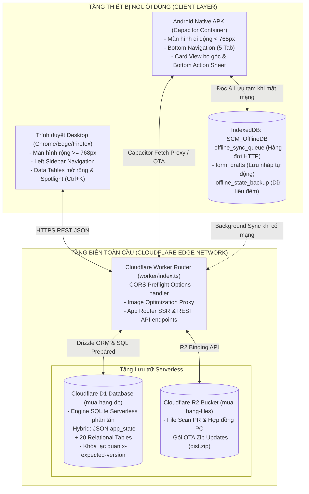
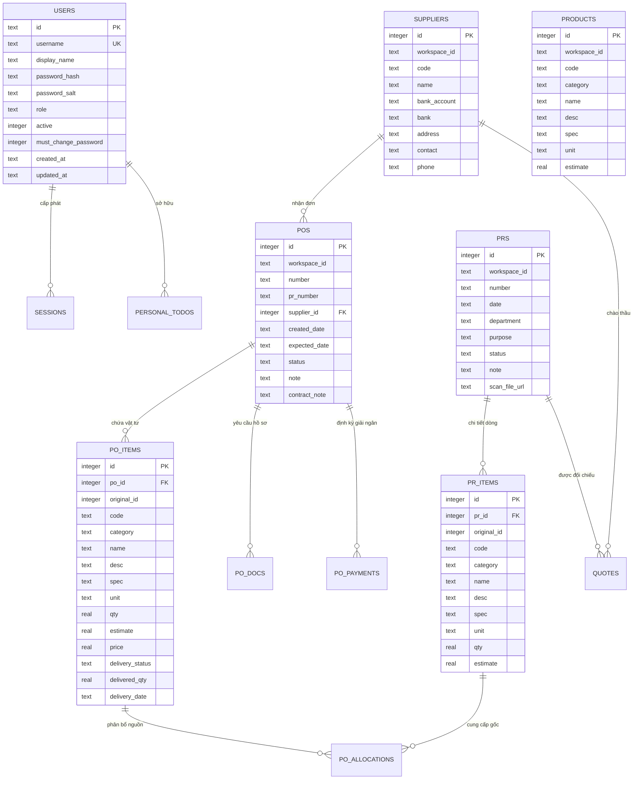
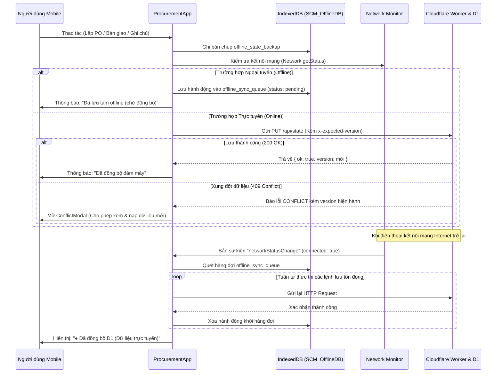

# ĐẶC TẢ KỸ THUẬT VÀ KIẾN TRÚC TOÀN DIỆN HỆ THỐNG PHENIKAA SCMH
### (SYSTEM ARCHITECTURE & BUSINESS SPECIFICATION)

> **Tài liệu bàn giao kiến trúc kỹ thuật, lược đồ cơ sở dữ liệu và quy trình nghiệp vụ toàn vẹn**  
> **Dự án:** Hệ thống Quản lý Mua sắm & Cung ứng Doanh nghiệp (Phenikaa Procurement Management System - SCMH)  
> **Mã dự án:** `SCMH-CORE-2026`  
> **Phiên bản hệ thống:** `v1.1.2 Stable`  
> **Mục tiêu tài liệu:** Cung cấp đặc tả kỹ thuật đạt mức độ hoàn thiện 100% về kiến trúc phần mềm, cấu trúc dữ liệu, các câu lệnh DDL cơ sở dữ liệu Cloudflare D1, toàn bộ endpoint RESTful API, các thuật toán và công thức tính toán tài chính, bàn giao, thanh toán. Tài liệu này đóng vai trò kim chỉ nam độc lập, cho phép bất kỳ kỹ sư phần mềm hoặc hệ thống AI nào có thể lập trình tái tạo lại toàn bộ hệ thống từ đầu mà không cần tham chiếu đến mã nguồn cũ.

---

# MỤC LỤC CHI TIẾT

- [CHƯƠNG 1: TỔNG QUAN HỆ THỐNG & TECH STACK](#chương-1-tổng-quan-hệ-thống--tech-stack)
  - [1.1. Mục tiêu và phạm vi ứng dụng](#11-mục-tiêu-và-phạm-vi-ứng-dụng)
  - [1.2. Kiến trúc giải pháp tổng thể](#12-kiến-trúc-giải-pháp-tổng-thể)
  - [1.3. Chi tiết Tech Stack](#13-chi-tiết-tech-stack)
  - [1.4. Kiến trúc Định tuyến (Routing Architecture)](#14-kiến-trúc-định-tuyến-routing-architecture)
- [CHƯƠNG 2: LƯỢC ĐỒ CƠ SỞ DỮ LIỆU ĐẦY ĐỦ (DATABASE D1 SCHEMA)](#chương-2-lược-đồ-cơ-sở-dữ-liệu-đầy-đủ-database-d1-schema)
  - [2.1. Danh mục và Mô hình Quan hệ Thực thể (ERD)](#21-danh-mục-và-mô-hình-quan-hệ-thực-thể-erd)
  - [2.2. Đặc tả Chi tiết 23 Bảng Cơ sở Dữ liệu D1](#22-đặc-tả-chi-tiết-23-bảng-cơ-sở-dữ-liệu-d1)
- [CHƯƠNG 3: ĐẶC TẢ CHI TIẾT TẤT CẢ ENDPOINT API (RESTFUL API SPECIFICATION)](#chương-3-đặc-tả-chi-tiết-tất-cả-endpoint-api-restful-api-specification)
  - [3.1. Bảng Tổng hợp Toàn bộ Route API](#31-bảng-tổng-hợp-toàn-bộ-route-api)
  - [3.2. Đặc tả Chi tiết Request / Response & Logic Xử lý Ngầm](#32-đặc-tả-chi-tiết-request--response--logic-xử-lý-ngầm)
- [CHƯƠNG 4: CHI TIẾT CÁC LUỒNG NGHIỆP VỤ CỐT LÕI (CORE BUSINESS WORKFLOWS)](#chương-4-chi-tiết-các-luồng-nghiệp-vụ-cốt-lõi-core-business-workflows)
  - [4.1. Luồng 1: Yêu cầu Mua sắm (PR) & Quản lý Danh mục Hàng hóa](#41-luồng-1-yêu-cầu-mua-sắm-pr--quản-lý-danh-mục-hàng-hóa)
  - [4.2. Luồng 2: Đề nghị Phê duyệt (ĐNPD) & Ma trận Đánh giá Báo giá NCC](#42-luồng-2-đề-nghị-phê-duyệt-đnpd--ma-trận-đánh-giá-báo-giá-ncc)
  - [4.3. Luồng 3: Phát hành Đơn Mua Hàng (PO) & Thuật toán Sinh mã Duy nhất](#43-luồng-3-phát-hành-đơn-mua-hàng-po--thuật-toán-sinh-mã-duy-nhất)
  - [4.4. Luồng 4: Quy trình Bàn giao & Nghiệm thu Hàng hóa (Delivery & Inspection)](#44-luồng-4-quy-trình-bàn-giao--nghiệm-thu-hàng-hóa-delivery--inspection)
  - [4.5. Luồng 5: Đề nghị Thanh toán (ĐNTT) & Đồng bộ Trạng thái Giải ngân 2 Chiều](#45-luồng-5-đề-nghị-thanh-toán-đntt--đồng-bộ-trạng-thái-giải-ngân-2-chiều)
  - [4.6. Luồng 6: Dashboard Dòng tiền, Hạn mức & Công việc Cá nhân (Todo List)](#46-luồng-6-dashboard-dòng-tiền-hạn-mức--công-việc-cá-nhân-todo-list)
- [CHƯƠNG 5: KIẾN TRÚC GIAO DIỆN & DANH MỤC COMPONENT (UI/UX ARCHITECTURE)](#chương-5-kiến-trúc-giao-diện--danh-mục-component-uiux-architecture)
  - [5.1. Cấu trúc Layout: Desktop vs Mobile](#51-cấu-trúc-layout-desktop-vs-mobile)
  - [5.2. Danh sách Component và Vai trò Chi tiết](#52-danh-sách-component-và-vai-trò-chi-tiết)
  - [5.3. Quy chuẩn In ấn Chứng từ Khổ A4 (@media print)](#53-quy-chuẩn-in-ấn-chứng-từ-khổ-a4-media-print)
- [CHƯƠNG 6: CƠ CHẾ NÂNG CAO (ADVANCED ENGINE)](#chương-6-cơ-chế-nâng-cao-advanced-engine)
  - [6.1. Kiến trúc Ngoại tuyến (Offline-First Architecture)](#61-kiến-trúc-ngoại-tuyến-offline-first-architecture)
  - [6.2. Cơ chế Cập nhật từ xa (Over-The-Air - OTA Update)](#62-cơ-chế-cập-nhật-từ-xa-over-the-air---ota-update)
  - [6.3. Global Capacitor Fetch Proxy](#63-global-capacitor-fetch-proxy)
- [CHƯƠNG 7: XỬ LÝ LỖI, BẢO VỆ GIAO DIỆN & TƯƠNG THÍCH ANDROID](#chương-7-xử-lý-lỗi-bảo-vệ-giao-diện--tương-thích-android)
  - [7.1. Danh mục Bẫy lỗi và Biện pháp Phòng ngừa Triệt để](#71-danh-mục-bẫy-lỗi-và-biện-pháp-phòng-ngừa-triệt-để)
  - [7.2. Cấu hình Cầu nối Android Native (Capacitor & Gradle)](#72-cấu-hình-cầu-nối-android-native-capacitor--gradle)
- [CHƯƠNG 8: HƯỚNG DẪN CÀI ĐẶT & TRIỂN KHAI TỪ ĐẦU (SETUP & DEPLOYMENT GUIDE)](#chương-8-hướng-dẫn-cài-đặt--triển-khai-từ-đầu-setup--deployment-guide)
  - [8.1. Khởi tạo Dự án & Cài đặt Môi trường](#81-khởi-tạo-dự-án--cài-đặt-môi-trường)
  - [8.2. Cấu hình Dịch vụ Đám mây Cloudflare (Worker, D1, R2)](#82-cấu-hình-dịch-vụ-đám-mây-cloudflare-worker-d1-r2)
  - [8.3. Lệnh Vận hành, Biên dịch Web & Đóng gói APK Di động](#83-lệnh-vận-hành-biên-dịch-web--đóng-gói-apk-di-động)

---

# CHƯƠNG 1: TỔNG QUAN HỆ THỐNG & TECH STACK

## 1.1. Mục tiêu và phạm vi ứng dụng

Hệ thống **Phenikaa SCMH (Supply Chain & Procurement Management Hub)** được thiết kế chuyên biệt để tự động hóa toàn diện chu trình mua sắm, kiểm soát hợp đồng kinh tế, theo dõi tiến độ giao hàng và dòng tiền thanh toán cho các phòng ban, viện nghiên cứu, nhà máy thuộc Tập đoàn Phenikaa.

Hệ thống số hóa chu trình nghiệp vụ khép kín theo mô hình chuỗi cung ứng chuẩn:
$$\mathbf{PR} \ (\text{Yêu cầu mua sắm}) \longrightarrow \mathbf{ĐNPD} \ (\text{Đề nghị phê duyệt / So sánh giá}) \longrightarrow \mathbf{PO} \ (\text{Đơn mua hàng / Hợp đồng}) \longrightarrow \mathbf{Delivery} \ (\text{Bàn giao \& Nghiệm thu}) \longrightarrow \mathbf{ĐNTT} \ (\text{Đề nghị thanh toán})$$

### Các chức năng cốt lõi:
1. **Kiểm soát định mức & dự toán PR:** Các phòng ban (RD, Cơ điện, QA, QC, Sản xuất, TT ĐSH...) lập yêu cầu mua sắm kèm quy cách kỹ thuật, số lượng, đơn vị tính, đơn giá dự toán và tệp scan chứng từ gốc.
2. **Ma trận so sánh giá nhiều nhà cung cấp (Vendor Evaluation Matrix):** Cho phép nhập đơn giá chào thầu của 2 đến 3 nhà cung cấp cho từng dòng vật tư; tự động tính thuế VAT (0%, 5%, 8%, 10%) theo 2 cơ chế trước thuế (`before-vat`) và sau thuế (`after-vat`), lựa chọn nhà cung cấp trúng thầu cho từng mặt hàng hoặc toàn bộ đơn thầu.
3. **Phát hành Đơn mua hàng (PO) tự động:** Thuật toán phân tách đơn hàng theo nhà cung cấp trúng thầu, tự sinh mã PO chuẩn hóa định dạng `{NCC}-{DDMMYYYY}` kèm hậu tố tự tăng (`-02`, `-03`...) chống trùng lặp tuyệt đối.
4. **Quản lý giao nhận nhiều đợt (Batch Delivery):** Theo dõi số lượng còn lại theo công thức toán học $Q_{\text{còn}} = \max(0, Q_{\text{đặt}} - Q_{\text{đã giao}})$, không cho phép giao vượt quá số lượng đặt mua, và bắt buộc bảo lưu thứ tự dòng hàng trùng khớp 100% với đơn PO gốc.
5. **Giải ngân & Theo dõi dòng tiền thực tế:** Lập phiếu Đề nghị thanh toán (ĐNTT) tự động trích xuất tài khoản ngân hàng NCC, quản lý thanh toán đa đợt (Tạm ứng, Đợt 1, Quyết toán), đồng bộ 2 chiều trạng thái thanh toán về PO và bảng điều khiển Dashboard (tự động ẩn khoản thanh toán sau 23:59:59 của ngày trả tiền).
6. **Sổ tay công việc cá nhân (Personal Todo):** Gắn thẻ thông minh `@PO`, `@PR`, `@NCC` chuyển hướng trực tiếp, đồng bộ thời gian thực với Cloudflare D1.

---

## 1.2. Kiến trúc giải pháp tổng thể

Hệ thống hoạt động trên kiến trúc kết hợp **Edge Computing + Offline-First + Hybrid Mobile Native**:



---

## 1.3. Chi tiết Tech Stack

| Thành phần | Công nghệ / Thư viện | Phiên bản | Vai trò kỹ thuật trong hệ thống |
| :--- | :--- | :--- | :--- |
| **Frontend Core** | **React** | `19.2.6` | Thư viện UI nền tảng, hỗ trợ React Server Components (RSC) và Actions |
| **Compiler & Server** | **Vinext** / **Vite** | `0.0.50` / `8.0.13` | Nền tảng biên dịch SSR/RSC chạy tối ưu trên Cloudflare Workers isolates |
| **Ngôn ngữ** | **TypeScript** | `5.9.3` | Định kiểu tĩnh toàn vẹn (End-to-End type safety) từ Database Schema đến React Props |
| **Styling & Theme** | **Tailwind CSS** + CSS Modules | v3 logic | Hệ thống utility classes, hỗ trợ Dark/Light mode, biến giao diện ERP |
| **Biểu tượng (Icons)** | **lucide-react** | `1.61.0` | Thư viện vector icon phong phú cho danh mục PO, PR, Bàn giao |
| **Xử lý Bảng tính** | **xlsx (SheetJS)** | `0.18.5` | Đọc / Ghi file Excel `.xlsx`, import danh mục hàng hóa và xuất biểu mẫu |
| **Đa ngôn ngữ** | **Custom i18n Hook** | Nội bộ | Hỗ trợ chuyển đổi 3 ngôn ngữ tức thời: Tiếng Việt (`vi`), Tiếng Anh (`en`), Tiếng Trung (`zh`) |
| **Serverless Runtime**| **Cloudflare Workers** | API 2026-05-22 | Môi trường thực thi phi máy chủ tại hơn 300 trung tâm dữ liệu toàn cầu (Cold-start $\approx 0\text{ms}$) |
| **Cơ sở dữ liệu** | **Cloudflare D1** | SQLite Edge | Cơ sở dữ liệu quan hệ SQL phân tán tại Edge, binding qua biến môi trường `env.DB` |
| **ORM & Migrations** | **Drizzle ORM / Drizzle Kit** | `0.45.2` / `0.31.10` | Định nghĩa schema, tạo migration SQL tự động và truy vấn type-safe |
| **Lưu trữ Tệp tin** | **Cloudflare R2** | S3-Compatible | Lưu trữ tệp scan phiếu PR, hợp đồng kinh tế và gói cập nhật ứng dụng di động |
| **Mobile Native Core**| **Capacitor Android** | `8.5.3` | Container đóng gói ứng dụng web thành ứng dụng Android Native thuần túy (APK) |
| **Mobile Plugins** | `@capacitor/app` | `8.1.2` | Quản lý vòng đời ứng dụng, bắt sự kiện nút Back cứng của Android |
| | `@capacitor/network` | `8.0.1` | Lắng nghe trạng thái kết nối mạng thực thời (`connected`, `connectionType`) |
| | `@capgo/capacitor-updater`| `8.54.0` | Cập nhật mã nguồn ứng dụng từ xa qua sóng mạng (OTA) không cần cài lại APK |

---

## 1.4. Kiến trúc Định tuyến (Routing Architecture)

Hệ thống áp dụng cơ chế định tuyến kép kết hợp giữa **Server Side Rendering (SSR)** cho đường dẫn tuyệt đối trên Web và **HashRouter (`window.location.hash`)** cho ứng dụng di động Android Native:

### 1. Nguyên tắc HashRouter trên Mobile:
- Chuỗi định tuyến có cấu trúc: `#view={VIEW_NAME}&id={RECORD_ID}&tab={TAB_NAME}`.
- **Lý do kỹ thuật bắt buộc:**
  * WebView của Android nạp ứng dụng từ tài nguyên cục bộ (`https://localhost/index.html` hoặc `capacitor://localhost/index.html`). Khi người dùng chuyển trang, nếu dùng HTML5 History API (`pushState`) mà không có cấu hình máy chủ cục bộ viết lại URL, WebView sẽ gửi yêu cầu tải file mới và gây lỗi trắng màn hình (`File Not Found`).
  * Hash navigation thay đổi vị trí hash mà không kích hoạt tải lại trang (`window.location.reload()`), bảo toàn 100% React State trong bộ nhớ.
  * Tương thích hoàn hảo với sự kiện `appBackButton` của Capacitor: Khi người dùng bấm nút Back vật lý trên điện thoại, hệ thống chỉ cần đọc lịch sử hash và lùi về màn hình trước đó thay vì bị thoát ứng dụng đột ngột.

### 2. Bản đồ Điều hướng Hệ thống:

```mermaid
graph TD
    RootRoute[Entry: ProcurementApp] --> DeviceCheck{Xác định Màn hình}
    
    DeviceCheck -->|Desktop: width >= 768px| DesktopLayout[Giao diện Desktop: Left Sidebar]
    DeviceCheck -->|Mobile: width < 768px| MobileLayout[Giao diện Di động: Top Bar + Bottom Nav]

    DesktopLayout --> D_Dash["Trang chủ (#view=dashboard)"]
    DesktopLayout --> D_PR["Yêu cầu PR (#view=prs)"]
    DesktopLayout --> D_Compare["So sánh giá (#view=compare)"]
    DesktopLayout --> D_PO["Đơn mua hàng (#view=po-list)"]
    DesktopLayout --> D_Contract["Hợp đồng (#view=contracts)"]
    DesktopLayout --> D_Pay["Đề nghị thanh toán (#view=payment)"]
    DesktopLayout --> D_Hand["Bàn giao hàng hóa (#view=handover)"]
    DesktopLayout --> D_Cat["Danh mục vật tư (#view=catalog)"]
    DesktopLayout --> D_Sup["Nhà cung cấp (#view=suppliers)"]
    DesktopLayout --> D_Hist["Lịch sử đơn giá (#view=history)"]
    DesktopLayout --> D_Trash["Thùng rác (#view=trash)"]

    MobileLayout --> M_Tab1["Tab 1: Trang chủ (#view=dashboard)"]
    MobileLayout --> M_Tab2["Tab 2: PR (#view=prs)"]
    MobileLayout --> M_Tab3["Tab 3: PO (#view=po-list)"]
    MobileLayout --> M_Tab4["Tab 4: Bàn giao (#view=handover)"]
    MobileLayout --> M_Tab5["Tab 5: Menu khác (Mở Bottom Action Sheet)"]

    M_Tab5 --> AS_Pay["Thanh toán (#view=payment)"]
    M_Tab5 --> AS_DNPD["Đề nghị phê duyệt (#view=compare)"]
    M_Tab5 --> AS_Sup["Nhà cung cấp (#view=suppliers)"]
    M_Tab5 --> AS_Cat["Danh mục hàng (#view=catalog)"]
    M_Tab5 --> AS_Contract["Hợp đồng (#view=contracts)"]
    M_Tab5 --> AS_Settings["Cài đặt (Mở Settings Modal & Mã QR)"]
    M_Tab5 --> AS_Spotlight["Tìm kiếm Spotlight (Ctrl+K)"]
    M_Tab5 --> AS_Trash["Thùng rác (#view=trash)"]
```



---

# CHƯƠNG 2: LƯỢC ĐỒ CƠ SỞ DỮ LIỆU ĐẦY ĐỦ (DATABASE D1 SCHEMA)

Hệ thống Phenikaa SCMH sử dụng kiến trúc lưu trữ lai (Hybrid Storage Model):
1. **Lớp Trạng thái Đồng bộ Cốt lõi (Document Store):** Bảng `app_state` lưu trữ toàn vẹn trạng thái dưới dạng JSON tài liệu có phân vùng (`main` và `:history`) nhằm phục vụ giao diện phản ứng nhanh (reactive UI), hỗ trợ Undo/Redo và đồng bộ đa thiết bị tức thời.
2. **Lớp Quan hệ Chuẩn hóa (Relational Tables):** Hệ thống đồng thời duy trì và đồng bộ hai chiều (Dual-Write) với 22 bảng SQLite trực thuộc để phục vụ báo cáo phân tích, truy vấn SQL độc lập và bảo đảm tính toàn vẹn dữ liệu.

## 2.1. Danh mục và Mô hình Quan hệ Thực thể (ERD)



---

## 2.2. Đặc tả Chi tiết 23 Bảng Cơ sở Dữ liệu D1

### 1. Bảng `app_state` (Trạng thái Ứng dụng & Phân vùng JSON)
Lưu trữ toàn bộ cây trạng thái hoạt động của từng Workspace. Để ngăn ngừa lỗi tràn giới hạn kích thước dòng của SQLite (`SQLITE_TOOBIG` khi vượt quá 1MB/dòng), dữ liệu lịch sử mua hàng được phân tách thành bản ghi riêng có hậu tố `:history`.
```sql
CREATE TABLE IF NOT EXISTS app_state (
  id TEXT PRIMARY KEY NOT NULL,
  payload TEXT NOT NULL,
  updated_at TEXT NOT NULL,
  version INTEGER DEFAULT 1 NOT NULL
);
```
- `id` (TEXT, PK): Khóa định danh trạng thái. Master workspace chính là `procurement:b7f7f770-898b-4e2d-983f-9e640a42950d`, phân vùng lịch sử là `procurement:b7f7f770-898b-4e2d-983f-9e640a42950d:history`.
- `payload` (TEXT, NOT NULL): Chuỗi JSON serialize chứa danh sách PR, PO, ĐNPD, ĐNTT, Bàn giao, Danh mục hàng, Nhà cung cấp.
- `updated_at` (TEXT, NOT NULL): Thời điểm cập nhật ISO 8601 (ví dụ: `2026-10-30T02:11:13.134Z`).
- `version` (INTEGER, NOT NULL, DEFAULT 1): Số hiệu phiên bản nguyên tử tăng dần phục vụ khóa lạc quan (Optimistic Concurrency Control).

---

### 2. Bảng `users` (Tài khoản Người dùng & Phân quyền)
Quản lý thông tin xác thực nhân sự trong hệ thống.
```sql
CREATE TABLE IF NOT EXISTS users (
  id TEXT PRIMARY KEY NOT NULL,
  username TEXT NOT NULL,
  display_name TEXT NOT NULL,
  password_hash TEXT NOT NULL,
  password_salt TEXT NOT NULL,
  role TEXT NOT NULL,
  active INTEGER DEFAULT 1 NOT NULL,
  must_change_password INTEGER DEFAULT 0 NOT NULL,
  created_at TEXT NOT NULL,
  updated_at TEXT NOT NULL
);
CREATE UNIQUE INDEX IF NOT EXISTS users_username_unique ON users (username);
```
- `id` (TEXT, PK): UUID định danh người dùng.
- `username` (TEXT, NOT NULL, UNIQUE): Tên đăng nhập (ví dụ: `bosmile`, `admin`, `nhanvien`).
- `display_name` (TEXT, NOT NULL): Họ và tên hiển thị đầy đủ (ví dụ: `Ban Quản trị`, `Nguyễn Văn A`).
- `password_hash` (TEXT, NOT NULL): Chuỗi mã băm Hex 256-bit tạo bởi thuật toán `PBKDF2` (SHA-256, 50,000 vòng lặp).
- `password_salt` (TEXT, NOT NULL): Chuỗi salt ngẫu nhiên 16 bytes tạo từ `crypto.getRandomValues`.
- `role` (TEXT, NOT NULL): Phân quyền: `master` (Quản trị tối cao), `admin` (Quản trị viên), `user` (Cán bộ mua sắm).
- `active` (INTEGER, DEFAULT 1): 1 là đang hoạt động, 0 là bị vô hiệu hóa.
- `must_change_password` (INTEGER, DEFAULT 0): Cờ yêu cầu đổi mật khẩu ở lần đăng nhập kế tiếp.

---

### 3. Bảng `sessions` (Phiên làm việc Xác thực)
Lưu vết phiên đăng nhập của người dùng qua trình duyệt hoặc thiết bị di động.
```sql
CREATE TABLE IF NOT EXISTS sessions (
  token_hash TEXT PRIMARY KEY NOT NULL,
  user_id TEXT NOT NULL,
  created_at TEXT NOT NULL,
  expires_at TEXT NOT NULL,
  FOREIGN KEY (user_id) REFERENCES users(id) ON DELETE CASCADE
);
```
- `token_hash` (TEXT, PK): Mã băm SHA-256 của token session lưu trong cookie HTTP-Only `scm_session`.
- `user_id` (TEXT, NOT NULL, FK $\rightarrow$ `users.id`): ID người dùng sở hữu phiên.
- `expires_at` (TEXT, NOT NULL): Hạn hết hạn của phiên làm việc (mặc định 30 ngày kể từ lúc tạo).

---

### 4. Bảng `suppliers` (Hồ sơ Nhà cung cấp & Ngân hàng)
Quản lý danh bạ đối tác cung ứng, phục vụ lập PO và tự động điền Đề nghị thanh toán.
```sql
CREATE TABLE IF NOT EXISTS suppliers (
  id INTEGER PRIMARY KEY NOT NULL,
  workspace_id TEXT NOT NULL,
  code TEXT NOT NULL,
  name TEXT NOT NULL,
  bank_account TEXT,
  bank TEXT,
  address TEXT,
  contact TEXT,
  phone TEXT
);
```
- `id` (INTEGER, PK): Mã số nguyên định danh duy nhất (sinh bởi hàm `makeId`).
- `workspace_id` (TEXT, NOT NULL): Mã workspace sở hữu nhà cung cấp này.
- `code` (TEXT, NOT NULL): Mã ký hiệu ngắn của nhà cung cấp (ví dụ: `21000080`, `VIETLAB`, `PHUCVINH`).
- `name` (TEXT, NOT NULL): Tên pháp nhân đầy đủ của NCC (ví dụ: `CÔNG TY TNHH THIẾT BỊ VÀ CÔNG NGHỆ CHÂU GIANG`).
- `bank_account` (TEXT): Số tài khoản ngân hàng thụ hưởng (ví dụ: `8821100313009`).
- `bank` (TEXT): Tên ngân hàng và chi nhánh (ví dụ: `MB Bank - CN Hà Nội`).
- `address`, `contact`, `phone`: Địa chỉ trụ sở, người liên hệ kinh doanh và số điện thoại.

---

### 5. Bảng `products` (Danh mục Hàng hóa & Dự toán Tham chiếu)
Danh mục quy cách vật tư chuẩn mực của tập đoàn để tra cứu nhanh khi tạo PR.
```sql
CREATE TABLE IF NOT EXISTS products (
  id INTEGER PRIMARY KEY NOT NULL,
  workspace_id TEXT NOT NULL,
  code TEXT NOT NULL,
  category TEXT,
  name TEXT NOT NULL,
  desc TEXT,
  spec TEXT,
  unit TEXT,
  estimate REAL
);
```
- `id` (INTEGER, PK): Mã định danh số nguyên.
- `code` (TEXT, NOT NULL): Mã nội bộ hàng hóa (ví dụ: `VT-001`, `300600476`).
- `category` (TEXT): Nhóm hàng hóa (`Hóa chất`, `Vật tư tiêu hao`, `Thiết bị`, `Phụ tùng`).
- `name` (TEXT, NOT NULL): Tên chi tiết của mặt hàng (ví dụ: `Card Mạng không dây PCIe TP-Link Archer TX20E`).
- `spec` (TEXT): Thông số kỹ thuật, quy cách đóng gói (ví dụ: `Wi-Fi 6, 2 ăng-ten ngầm`).
- `unit` (TEXT): Đơn vị tính (`Cái`, `Hộp`, `Lọ`, `Túi 500 cái`, `Lít`).
- `estimate` (REAL): Đơn giá dự toán tham chiếu ban đầu (VNĐ).

---

### 6. Bảng `prs` (Yêu cầu Mua sắm - Purchase Requests)
Bản ghi đề xuất mua sắm ban đầu từ các phòng ban.
```sql
CREATE TABLE IF NOT EXISTS prs (
  id INTEGER PRIMARY KEY NOT NULL,
  workspace_id TEXT NOT NULL,
  number TEXT NOT NULL,
  date TEXT,
  department TEXT,
  purpose TEXT,
  status TEXT,
  note TEXT,
  scan_file_url TEXT
);
```
- `id` (INTEGER, PK): Mã định danh số nguyên.
- `workspace_id` (TEXT, NOT NULL): Mã workspace.
- `number` (TEXT, NOT NULL): Mã số PR do phòng ban cấp (ví dụ: `RD20261026002`, `EM2710`, `10.03.2026 TĐSH`).
- `date` (TEXT): Ngày lập PR (`YYYY-MM-DD`).
- `department` (TEXT): Tên phòng ban lập phiếu (`RD`, `Cơ điện`, `Phòng QA`, `TT ĐSH`).
- `purpose` (TEXT): Mục đích mua sắm (ví dụ: `Thay thế card mạng không dây`).
- `status` (TEXT): Trạng thái (`Chờ xử lý`, `Đang lấy báo giá`, `Đã duyệt ĐNPD`, `Đã tạo đủ PO`, `Hoàn thành`).
- `note` (TEXT): Ghi chú chung PR.
- `scan_file_url` (TEXT): Đường dẫn file PDF hoặc ảnh chụp phiếu đề xuất có chữ ký gốc lưu trên Cloudflare R2.

---

### 7. Bảng `pr_items` (Chi tiết Mặt hàng trong PR)
Danh sách các dòng vật tư yêu cầu mua trong một PR.
```sql
CREATE TABLE IF NOT EXISTS pr_items (
  id INTEGER PRIMARY KEY AUTOINCREMENT NOT NULL,
  pr_id INTEGER NOT NULL,
  original_id INTEGER,
  code TEXT,
  category TEXT,
  name TEXT,
  desc TEXT,
  spec TEXT,
  unit TEXT,
  qty REAL,
  estimate REAL,
  FOREIGN KEY (pr_id) REFERENCES prs(id) ON UPDATE NO ACTION ON DELETE CASCADE
);
```
- `id` (INTEGER, PK AUTOINCREMENT): Khóa tự tăng.
- `pr_id` (INTEGER, NOT NULL, FK $\rightarrow$ `prs.id` ON DELETE CASCADE): Liên kết với PR cha.
- `original_id` (INTEGER): ID vật tư gốc trong danh mục `products` (nếu có).
- `name` (TEXT): Tên mô tả vật tư.
- `qty` (REAL): Số lượng đề xuất mua.
- `estimate` (REAL): Đơn giá dự toán một đơn vị tính (VNĐ).

---

### 8. Bảng `quotes` (Báo giá Nhà cung cấp & Ma trận So sánh)
Bảng ghi nhận báo giá từ từng nhà cung cấp chào hàng cho từng phiếu PR.
```sql
CREATE TABLE IF NOT EXISTS quotes (
  pr_id INTEGER NOT NULL,
  supplier_id INTEGER NOT NULL,
  price TEXT,
  note TEXT,
  price_mode TEXT,
  vat_rate TEXT,
  PRIMARY KEY (pr_id, supplier_id)
);
```
- `pr_id` (INTEGER, NOT NULL): Khóa ngoại tham chiếu đến PR.
- `supplier_id` (INTEGER, NOT NULL): Khóa ngoại tham chiếu đến `suppliers.id`.
- `price` (TEXT): Chuỗi JSON hoặc đối tượng map `{ [itemId]: đơn giá }` lưu giá chào của NCC cho từng món.
- `note` (TEXT): Ghi chú thời gian giao hàng, bảo hành, điều khoản thương mại.
- `price_mode` (TEXT): `before-vat` (Giá chưa gồm VAT) hoặc `after-vat` (Giá đã gồm VAT).
- `vat_rate` (TEXT): Thuế suất VAT áp dụng (`0%`, `5%`, `8%`, `10%`).

---

### 9. Bảng `pos` (Đơn đặt hàng Mua sắm - Purchase Orders)
Bản ghi Đơn hàng chính thức phát hành cho nhà cung cấp trúng thầu.
```sql
CREATE TABLE IF NOT EXISTS pos (
  id INTEGER PRIMARY KEY NOT NULL,
  workspace_id TEXT NOT NULL,
  number TEXT NOT NULL,
  pr_number TEXT,
  supplier_id INTEGER,
  created_date TEXT,
  expected_date TEXT,
  status TEXT,
  note TEXT,
  contract_note TEXT,
  FOREIGN KEY (supplier_id) REFERENCES suppliers(id) ON DELETE SET NULL
);
```
- `id` (INTEGER, PK): Mã định danh số nguyên.
- `number` (TEXT, NOT NULL): Mã PO duy nhất tạo tự động theo định dạng `{NCC}-{DDMMYYYY}` (ví dụ: `CHAUGIANG-28102026`).
- `pr_number` (TEXT): Số hiệu PR làm căn cứ (hoặc `Mua trực tiếp`).
- `supplier_id` (INTEGER, FK): Nhà cung cấp trúng thầu nhận đơn hàng.
- `created_date`, `expected_date`: Ngày lập đơn và ngày hẹn giao hàng.
- `status` (TEXT): `Mới tạo`, `Đang giao hàng`, `Đã giao đủ`, `Đã hoàn thành`, `Đã hủy`.
- `note`, `contract_note`: Ghi chú mua sắm và ghi chú điều khoản hợp đồng kinh tế.

---

### 10. Bảng `po_items` (Chi tiết Mặt hàng trong PO)
Từng dòng vật tư cam kết mua trong đơn đặt hàng PO.
```sql
CREATE TABLE IF NOT EXISTS po_items (
  id INTEGER PRIMARY KEY AUTOINCREMENT NOT NULL,
  po_id INTEGER NOT NULL,
  original_id INTEGER,
  code TEXT,
  category TEXT,
  name TEXT,
  desc TEXT,
  spec TEXT,
  unit TEXT,
  qty REAL,
  estimate REAL,
  price REAL,
  delivery_status TEXT,
  delivered_qty REAL,
  delivery_date TEXT,
  FOREIGN KEY (po_id) REFERENCES pos(id) ON UPDATE NO ACTION ON DELETE CASCADE
);
```
- `qty` (REAL): Số lượng đặt mua chính thức ($Q_{\text{ordered}}$).
- `price` (REAL): Đơn giá mua chốt thực tế (VNĐ).
- `delivered_qty` (REAL): Tổng số lượng lũy kế đã được bàn giao qua các đợt.
- `delivery_status` (TEXT): `Chưa giao`, `Giao một phần`, `Đã giao`.

---

### 11. Bảng `po_allocations` (Truy vết Nguồn gốc Vật tư từ PR sang PO)
Ghi nhận một dòng hàng trong PO được lấy từ dòng hàng nào của PR nào.
```sql
CREATE TABLE IF NOT EXISTS po_allocations (
  id INTEGER PRIMARY KEY AUTOINCREMENT NOT NULL,
  po_item_id INTEGER NOT NULL,
  pr_id INTEGER,
  pr_number TEXT,
  pr_item_id INTEGER,
  qty REAL,
  FOREIGN KEY (po_item_id) REFERENCES po_items(id) ON UPDATE NO ACTION ON DELETE CASCADE
);
```
- `po_item_id` (INTEGER, NOT NULL, FK $\rightarrow$ `po_items.id` ON DELETE CASCADE).
- `pr_id`, `pr_item_id`: ID của PR và ID của dòng hàng trong PR nguồn.
- `qty`: Số lượng phân bổ từ PR vào đơn PO này.

---

### 12. Bảng `po_docs` (Quản lý Hồ sơ & Chứng từ Kèm theo PO)
Theo dõi tình trạng đủ/thiếu của bộ chứng từ hợp đồng, thanh toán.
```sql
CREATE TABLE IF NOT EXISTS po_docs (
  id INTEGER PRIMARY KEY NOT NULL,
  po_id INTEGER NOT NULL,
  name TEXT,
  status TEXT,
  note TEXT,
  FOREIGN KEY (po_id) REFERENCES pos(id) ON UPDATE NO ACTION ON DELETE CASCADE
);
```
- `name` (TEXT): Loại chứng từ (ví dụ: `Hợp đồng kinh tế`, `Biên bản bàn giao`, `CO/CQ`, `Hóa đơn GTGT`).
- `status` (TEXT): `Đã đủ`, `Còn thiếu`, `Chờ bổ sung`.

---

### 13. Bảng `po_payments` (Kế hoạch Đợt Giải ngân của PO)
Lập lịch các mốc giải ngân (Milestones) theo cam kết hợp đồng.
```sql
CREATE TABLE IF NOT EXISTS po_payments (
  id INTEGER PRIMARY KEY NOT NULL,
  po_id INTEGER NOT NULL,
  phase TEXT,
  percent REAL,
  amount REAL,
  status TEXT,
  date TEXT,
  FOREIGN KEY (po_id) REFERENCES pos(id) ON UPDATE NO ACTION ON DELETE CASCADE
);
```
- `phase` (TEXT): Tên đợt giải ngân (ví dụ: `Tạm ứng đợt 1 (30%)`, `Thanh toán đợt 2 (70%)`).
- `percent` (REAL): Tỷ lệ % giá trị đơn hàng.
- `amount` (REAL): Số tiền kế hoạch phải trả (VNĐ).
- `status` (TEXT): `Chưa thanh toán`, `Đang xử lý`, `Đã thanh toán`.

---

### 14. Bảng `personal_todos` (Sổ tay Công việc Cá nhân)
Lưu trữ các đầu việc của cán bộ phụ trách, đồng bộ xuyên suốt Web và Mobile APK.
```sql
CREATE TABLE IF NOT EXISTS personal_todos (
  id TEXT PRIMARY KEY NOT NULL,
  user_id TEXT DEFAULT 'admin' NOT NULL,
  content TEXT NOT NULL,
  is_completed INTEGER DEFAULT 0 NOT NULL,
  is_priority INTEGER DEFAULT 0 NOT NULL,
  tags TEXT,
  created_at TEXT DEFAULT CURRENT_TIMESTAMP,
  updated_at TEXT DEFAULT CURRENT_TIMESTAMP,
  is_deleted INTEGER DEFAULT 0 NOT NULL
);
```
- `id` (TEXT, PK): ID dạng `todo-1730000000000`.
- `content` (TEXT, NOT NULL): Nội dung công việc (hỗ trợ `@PO [Số]`, `@NCC [Tên]`).
- `is_completed` (INTEGER): 1 là hoàn thành, 0 là chưa hoàn thành.
- `is_priority` (INTEGER): 1 là việc khẩn/ưu tiên, 0 là bình thường.
- `is_deleted` (INTEGER): 1 là xóa mềm (đưa vào thùng rác), 0 là còn hiệu lực.

---

### 15. Bảng `purchase_history` (Sổ cái Lịch sử Đơn giá Kế toán)
Kho dữ liệu hóa đơn nhập kho các kỳ trước phục vụ đối chiếu lịch sử giá.
```sql
CREATE TABLE IF NOT EXISTS purchase_history (
  id TEXT PRIMARY KEY NOT NULL,
  workspace_id TEXT NOT NULL,
  warehouse_code TEXT,
  warehouse_name TEXT,
  item_code TEXT,
  item_name TEXT,
  accounting_date TEXT,
  document_date TEXT,
  document_no TEXT,
  invoice_date TEXT,
  invoice_no TEXT,
  description TEXT,
  unit TEXT,
  unit_price REAL,
  quantity REAL,
  value REAL,
  supplier_code TEXT,
  supplier_name TEXT,
  supplier_id INTEGER,
  department TEXT
);
```

---

### 16. Bảng `trash_items` (Thùng rác Lưu trữ & Phục hồi)
Cơ chế bảo vệ dữ liệu chống thao tác xóa nhầm của người dùng.
```sql
CREATE TABLE IF NOT EXISTS trash_items (
  id TEXT PRIMARY KEY NOT NULL,
  workspace_id TEXT NOT NULL,
  type TEXT,
  label TEXT,
  deleted_at TEXT,
  expires_at TEXT,
  data TEXT
);
```
- `type` (TEXT): Loại thực thể xóa (`PR`, `PO`, `CONTRACT`).
- `data` (TEXT): Chuỗi JSON serialize lưu trữ 100% dữ liệu gốc để khôi phục nguyên vẹn khi người dùng bấm "Khôi phục".

---

### 17. Bảng `files` (Quản lý Tệp Đính kèm & Cloudflare R2)
Lưu trữ metadata tệp nhị phân được lưu trữ trên Cloudflare R2 Bucket.
```sql
CREATE TABLE IF NOT EXISTS files (
  id TEXT PRIMARY KEY NOT NULL,
  entity_type TEXT NOT NULL,
  entity_id TEXT NOT NULL,
  file_name TEXT NOT NULL,
  object_key TEXT NOT NULL,
  content_type TEXT NOT NULL,
  size INTEGER NOT NULL,
  uploaded_at TEXT NOT NULL
);
```

---

### 18. Bảng `audit_logs` (Nhật ký Kiểm toán Hoạt động Hệ thống)
```sql
CREATE TABLE IF NOT EXISTS audit_logs (
  id INTEGER PRIMARY KEY AUTOINCREMENT NOT NULL,
  action TEXT NOT NULL,
  entity_type TEXT NOT NULL,
  entity_id TEXT NOT NULL,
  created_at TEXT NOT NULL
);
```

---

### 19. Bảng `share_links` (Liên kết Chia sẻ Báo cáo Công khai)
```sql
CREATE TABLE IF NOT EXISTS share_links (
  token TEXT PRIMARY KEY NOT NULL,
  label TEXT NOT NULL,
  created_at TEXT NOT NULL,
  expires_at TEXT NOT NULL,
  revoked_at TEXT,
  last_viewed_at TEXT,
  view_count INTEGER DEFAULT 0 NOT NULL
);
```

---

### 20. Bảng `system_configs` (Cấu hình Hệ thống & Phiên bản OTA)
```sql
CREATE TABLE IF NOT EXISTS system_configs (
  key TEXT PRIMARY KEY NOT NULL,
  value TEXT NOT NULL,
  updated_at TEXT DEFAULT CURRENT_TIMESTAMP
);
```
- `key = "app_version"`: Chứa JSON metadata bản build di động `{ latestVersion: "1.1.2", downloadUrl: "...", releaseNotes: "..." }`.

---

### 21. Bảng `purchase_requests` (Bảng tương thích dữ liệu PR Legacy)
```sql
CREATE TABLE IF NOT EXISTS purchase_requests (
  id INTEGER PRIMARY KEY,
  number TEXT NOT NULL,
  date TEXT,
  department TEXT,
  purpose TEXT,
  status TEXT,
  note TEXT,
  scan_file_url TEXT
);
```

---

### 22. Cấu trúc Thực thể `payment_requests` (ĐNTT trong App State Document)
Trong tài liệu trạng thái JSON `app_state`, danh sách đề nghị thanh toán `paymentRequests` tuân thủ nghiêm ngặt cấu trúc:
```typescript
interface PaymentRequestEntry {
  id: number;                     // ID số nguyên duy nhất (makeId)
  stt?: number;                   // Số thứ tự hiển thị (ví dụ: 151, 152)
  group_code: string;             // Mã số PO liên kết (ví dụ: "CHAUGIANG-28102026")
  supplier_name: string;          // Tên đối tác thụ hưởng
  amount: number;                 // Số tiền thanh toán (VNĐ)
  status: "Chờ thanh toán" | "Đang xử lý" | "Đã thanh toán";
  isCompleted?: boolean;          // Cờ đánh dấu đã giải ngân xong
  paidAt?: string;                // Thời điểm giải ngân ISO 8601 (2026-10-30T...)
  beneficiary_account?: string;   // STK ngân hàng thụ hưởng
  beneficiary_bank?: string;      // Tên ngân hàng & chi nhánh
  description: string;            // Nội dung thanh toán (Hóa đơn, hợp đồng)
  lines?: PaymentDetailLine[];    // Chi tiết hóa đơn, biên bản kèm theo
}
```

---

### 23. Cấu trúc Thực thể `paymentHandovers` (Biên bản Bàn giao & Nghiệm thu)
Trong tài liệu trạng thái JSON `app_state`, danh sách bàn giao `paymentHandovers` đại diện cho các biên bản kiểm đếm vật tư:
```typescript
interface PaymentHandoverItem {
  id: number;                     // ID bàn giao duy nhất
  source_number: string;          // Mã PO gốc liên kết (ví dụ: "CHAUGIANG-28102026")
  po_item_id?: number;            // Khóa ngoại tham chiếu dòng hàng po_items.id
  item_order?: number;            // Thứ tự hiển thị gốc từ PO (0, 1, 2...)
  item_name: string;              // Tên vật tư hàng hóa
  unit: string;                   // Đơn vị tính (Cái, Lọ, Bộ...)
  quantity_doc: number;           // Số lượng ghi trên chứng từ/hóa đơn
  quantity_pass: number;          // Số lượng nghiệm thu đạt chuẩn thực tế
  quantity_fail: number;          // Số lượng hàng hỏng, vỡ, sai quy cách
  handover_date: string;          // Ngày lập biên bản (YYYY-MM-DD)
  sender_name: string;            // Người giao hàng (Đại diện NCC)
  receiver_name: string;          // Người nhận hàng (Cán bộ Phenikaa)
  department: string;             // Phòng ban tiếp nhận sử dụng
  batch_id?: string;              // Mã đợt bàn giao BATCH_{PO}_D{N}_{TIME}
  isCompleted?: boolean;          // Cờ hoàn thành kiểm đếm
}
```

---

# CHƯƠNG 3: ĐẶC TẢ CHI TIẾT TẤT CẢ ENDPOINT API (RESTFUL API SPECIFICATION)

Mọi API được triển khai tại Edge qua Cloudflare Workers, phản hồi định dạng chuẩn `application/json; charset=utf-8` và hỗ trợ đầy đủ CORS Headers cho ứng dụng Mobile WebView.

## 3.1. Bảng Tổng hợp Toàn bộ Route API

| STT | Phương thức | Đường dẫn API | Mục đích nghiệp vụ | Phân quyền |
| :---: | :---: | :--- | :--- | :---: |
| 1 | `GET` | `/api/state` | Lấy toàn bộ cây dữ liệu Workspace (Hỗ trợ auto-recovery) | User / Mobile |
| 2 | `PUT` | `/api/state` | Lưu trạng thái với khóa lạc quan `x-expected-version` & dual-write | User / Mobile |
| 3 | `GET` | `/api/todos` | Lấy danh sách việc cá nhân từ bảng `personal_todos` D1 | User |
| 4 | `POST` | `/api/todos` | Thêm mới 1 việc cá nhân vào D1 | User |
| 5 | `PUT` | `/api/todos` | Cập nhật trạng thái hoặc đồng bộ mảng công việc (Bulk Sync) | User |
| 6 | `DELETE` | `/api/todos` | Xóa mềm công việc (`is_deleted = 1`) hoặc dọn rác | User |
| 7 | `GET` | `/api/app-version` | Tra cứu phiên bản ứng dụng di động mới nhất phục vụ OTA | Công khai |
| 8 | `POST` | `/api/app-version` | Đẩy bản cập nhật OTA ZIP và cấu hình version vào `system_configs`| Master Admin |
| 9 | `GET` | `/api/app-version/download` | Tải luồng file bundle `.zip` cập nhật từ Cloudflare R2 | Công khai |
| 10 | `GET` | `/api/app-version/apk` | Lấy metadata và liên kết tải trực tiếp file APK Android | Công khai |
| 11 | `POST` | `/api/auth/login` | Đăng nhập hệ thống, kiểm tra PBKDF2, cấp cookie `scm_session` | Công khai |
| 12 | `POST` | `/api/auth/logout` | Đăng xuất, hủy session trong D1 và xóa cookie | User |
| 13 | `POST` | `/api/auth/verify-password` | Xác thực lại mật khẩu trước thao tác nhạy cảm (Xóa PO, sửa quyền) | User |
| 14 | `GET` | `/api/users` | Danh sách tài khoản người dùng trong hệ thống | Admin / Master |
| 15 | `POST` | `/api/users` | Tạo mới người dùng kèm mã băm PBKDF2 và salt 16 bytes | Master Admin |
| 16 | `GET` | `/api/users/[id]` | Lấy chi tiết thông tin một người dùng | Admin / Master |
| 17 | `PUT` | `/api/users/[id]` | Chỉnh sửa tên, phân quyền, trạng thái kích hoạt hoặc đổi mật khẩu | Admin / Master |
| 18 | `DELETE`| `/api/users/[id]` | Vô hiệu hóa tài khoản người dùng | Master Admin |
| 19 | `GET` | `/api/files` | Lấy danh sách metadata tệp theo `entityType` và `entityId` | User |
| 20 | `POST` | `/api/files` | Upload tệp đính kèm lên Cloudflare R2 Bucket | User |
| 21 | `GET` | `/api/files/[id]` | Tải trực tiếp nội dung nhị phân của tệp từ Cloudflare R2 | User |
| 22 | `DELETE`| `/api/files/[id]` | Xóa tệp khỏi R2 và xóa dòng dữ liệu trong bảng `files` D1 | User |
| 23 | `POST` | `/api/upload-scan` | Upload tệp scan PDF/ảnh phiếu PR có nén kích thước | User |
| 24 | `POST` | `/api/share` | Tạo liên kết token chia sẻ báo cáo công khai có thời hạn | User |
| 25 | `GET` | `/api/share` | Danh sách các liên kết chia sẻ đang hoạt động | User |
| 26 | `GET` | `/api/report-state` | Lấy dữ liệu báo cáo qua token bảo mật (Chế độ chỉ đọc) | Công khai |
| 27 | `GET` | `/api/admin/snapshots` | Lấy danh sách các bản snapshot sao lưu hệ thống | Master Admin |
| 28 | `POST` | `/api/admin/snapshots` | Tạo snapshot sao lưu tức thời toàn bộ D1 | Master Admin |
| 29 | `GET` | `/api/admin/audit-logs` | Truy vấn nhật ký kiểm toán thao tác hệ thống | Master Admin |
| 30 | `GET` | `/api/admin/usage` | Thống kê số lượng bản ghi và dung lượng cơ sở dữ liệu D1 | Master Admin |
| 31 | `POST` | `/api/admin/sync-backup` | Đồng bộ cưỡng bức dữ liệu sang file sao lưu | Master Admin |
| 32 | `POST` | `/api/admin/migrate-json` | Nạp đè dữ liệu JSON mẫu vào cơ sở dữ liệu D1 | Master Admin |

---

## 3.2. Đặc tả Chi tiết Request / Response & Logic Xử lý Ngầm

### 1. `GET /api/state`
- **Mục đích:** Khởi tạo nạp toàn bộ dữ liệu ứng dụng khi mở Web hoặc ứng dụng Mobile.
- **Query Parameters:**
  * `workspace` (chuỗi tùy chọn): ID của workspace. Mặc định là `b7f7f770-898b-4e2d-983f-9e640a42950d`.
- **Logic ngầm tại Backend:**
  1. Xác thực người dùng qua cookie `scm_session`. Nếu request xuất phát từ Android Native App (`Origin: https://localhost` hoặc `Origin: capacitor://localhost`), tự động gán quyền Master Workspace.
  2. Truy vấn song song 2 bản ghi từ D1: `mainId = procurement:{workspaceId}` và `historyId = procurement:{workspaceId}:history`.
  3. Ghép mảng `purchaseHistory` từ bản ghi phân vùng `:history` vào payload chính.
  4. **Cơ chế Tự phục hồi (Recovery Migration):** Nếu `data.pos` hoặc `data.prs` bị rỗng hoặc có nhà cung cấp trong PO bị thiếu khỏi danh bạ `data.suppliers`, hệ thống tự động đọc từ 12 bảng SQLite quan hệ (`suppliers`, `products`, `prs`, `pr_items`, `pos`, `po_items`, `po_allocations`, `quotes`, `purchase_history`, `trash_items`), hợp nhất lại và ghi đè cập nhật vào `app_state`.
- **Phản hồi Thành công (`200 OK`):**
```json
{
  "workspaceId": "b7f7f770-898b-4e2d-983f-9e640a42950d",
  "version": 2516,
  "updatedAt": "2026-10-30T02:11:13.134Z",
  "data": {
    "prs": [ /* Danh sách PR */ ],
    "pos": [ /* Danh sách PO */ ],
    "suppliers": [ /* Danh mục 149 NCC */ ],
    "products": [ /* Danh mục 959 hàng hóa */ ],
    "quotes": { /* Ma trận báo giá */ },
    "paymentRequests": [ /* 151 Đề nghị thanh toán */ ],
    "paymentHandovers": [ /* 122 Vật tư bàn giao */ ],
    "trash": [ /* Các mục trong thùng rác */ ]
  }
}
```

---

### 2. `PUT /api/state`
- **Mục đích:** Lưu trữ trạng thái từ client lên máy chủ với cơ chế kiểm soát đồng thời.
- **Headers bắt buộc:**
  * `Content-Type: application/json`
  * `x-expected-version: 2516` (Số version client nắm giữ trước khi chỉnh sửa).
- **Request Body mẫu:**
```json
{
  "pos": [ /* Danh sách đơn hàng mới/đã cập nhật */ ],
  "paymentRequests": [ /* Danh sách ĐNTT */ ]
}
```
- **Logic ngầm tại Backend:**
  1. **Khóa Lạc quan (Optimistic Concurrency Control):** Đọc `version` hiện hành trong D1. Nếu `existing.version > expectedVersion`, lập tức từ chối với mã lỗi `409 Conflict`, bảo vệ dữ liệu không bị ghi đè bởi phiên làm việc khác.
  2. **Tách Phân vùng (Partitioning):** Tách trường `purchaseHistory` ra lưu riêng vào khóa `{workspaceId}:history`.
  3. **Hợp nhất Dữ liệu (State Merge):** Lấy dữ liệu cũ trong D1 gộp với payload diff được gửi lên: `merged = { ...existingData, ...diffPayload }`.
  4. **Ghi Quan hệ Song song (Dual-Write):** Cập nhật dữ liệu vào các bảng quan hệ `pos`, `po_items`, `prs`, `pr_items` để phục vụ báo cáo.
  5. Tăng `version = existing.version + 1`, lưu vào D1 và trả về `version` mới.
- **Phản hồi Xung đột (`409 Conflict`):**
```json
{
  "error": "CONFLICT",
  "currentVersion": 2517,
  "message": "Dữ liệu đã được cập nhật từ một phiên làm việc khác. Vui lòng tải lại trang để tránh ghi đè dữ liệu mới."
}
```

---

### 3. `GET /api/todos` & `POST /api/todos` & `PUT /api/todos`
- **Mục đích:** Quản lý danh sách việc cần làm cá nhân, đồng bộ trực tiếp với bảng `personal_todos` của D1.
- **Request Body mẫu (`POST /api/todos`):**
```json
{
  "id": "todo-1730300000000",
  "text": "Liên hệ @NCC VIASCO ký hợp đồng đơn @PO CHAUGIANG-28102026",
  "completed": false,
  "priority": "high",
  "tags": ["PO", "Hợp đồng"]
}
```
- **Bulk Sync (`PUT /api/todos`):**
```json
{
  "todos": [
    {
      "id": "todo-1730300000000",
      "text": "Thứ 2 ký hợp đồng Viasco",
      "completed": true,
      "priority": "normal"
    }
  ]
}
```
- **Logic ngầm:** Thực hiện câu lệnh SQL `INSERT INTO personal_todos (...) VALUES (...) ON CONFLICT(id) DO UPDATE SET content=excluded.content, is_completed=excluded.is_completed`. Các việc không còn xuất hiện trong mảng sẽ được đánh dấu `is_deleted = 1`.

---

### 4. `GET /api/app-version`
- **Mục đích:** Cung cấp thông tin phiên bản mới nhất cho plugin Capacitor Updater trên điện thoại Android.
- **Phản hồi Thành công (`200 OK`):**
```json
{
  "latestVersion": "1.1.2",
  "versionName": "Phenikaa SCMH v1.1.2 (Bản ổn định)",
  "buildNumber": "112",
  "buildDate": "30/10/2026, 09:15:00",
  "minSupportedVersion": "1.0.0",
  "downloadUrl": "https://quan-ly-mua-hang.sc-pnk.workers.dev/api/app-version/download?version=1.1.2",
  "checksum": "",
  "releaseNotes": "Tối ưu giao diện PO; Phục hồi 100% dữ liệu tên hàng hóa và nhà cung cấp."
}
```

---

# CHƯƠNG 4: CHI TIẾT CÁC LUỒNG NGHIỆP VỤ CỐT LÕI (CORE BUSINESS WORKFLOWS)

```mermaid
flowchart TD
    StartPR(["1. KHỞI TẠO PR (Yêu cầu mua sắm)"]) --> InputPR["Nhập danh mục hàng hóa (Thủ công / Excel / TreePicker)\n+ Đính kèm file Scan có chữ ký gốc"]
    InputPR --> CalcPRBudget["Tính tổng dự toán PR:\nBudget = Sum(qty * estimate)"]
    CalcPRBudget --> SavePR["Lưu trạng thái: 'Chờ xử lý'"]
    
    SavePR --> StartCompare["2. LẬP ĐỀ NGHỊ PHÊ DUYỆT (ĐNPD)"]
    StartCompare --> MatrixQuotes["Nhập bảng báo giá 2-3 Nhà cung cấp\n(Trước/Sau VAT, chọn mức thuế 0%, 5%, 8%, 10%)"]
    MatrixQuotes --> SelectWinners["Chọn NCC trúng thầu từng dòng (selectedSupplierId)\nhoặc trúng thầu toàn bộ"]
    
    SelectWinners --> GeneratePO["3. PHÁT HÀNH ĐƠN MUA HÀNG (PO)"]
    GeneratePO --> GroupSuppliers["Tự động tách đơn theo từng NCC trúng thầu"]
    GroupSuppliers --> AutoPOCode["Sinh mã PO tự động: {NCC}-{DDMMYYYY}\n+ Hậu tố tăng dần (-02, -03) nếu trùng"]
    AutoPOCode --> POTotals["Tính tổng tiền PO:\nThành tiền = Sum(qty * price * (1 + vat/100))"]
    
    POTotals --> DeliveryPhase["4. GIAO NHẬN & NGHIỆM THU (Handover)"]
    DeliveryPhase --> CreateBatch["Tạo đợt giao (Batch 1, Batch 2...)\nMã: BATCH_{PO}_D{N}_{TIME}"]
    CreateBatch --> CalcRemaining["Kiểm soát số lượng còn lại:\nQ_còn = max(0, Q_đặt - Q_đã_giao)\nChống giao vượt: Q_giao <= Q_đặt"]
    CalcRemaining --> SortPOOrder["SẮP XẾP MẶT HÀNG: Trùng khớp 100% thứ tự PO gốc\n(sortHandoversByPOLineOrder)"]
    
    SortPOOrder --> CheckDelivered{"Đã giao đủ 100%?"}
    CheckDelivered -- Chưa đủ --> WaitNextBatch["PO: 'Giao một phần' -> Chờ đợt tiếp"]
    WaitNextBatch --> CreateBatch
    CheckDelivered -- Đã giao đủ --> MarkFullyDelivered["PO chuyển sang: 'Đã giao đủ (100%)'"]
    
    MarkFullyDelivered --> PaymentPhase["5. ĐỀ NGHỊ THANH TOÁN (ĐNTT)"]
    PaymentPhase --> AutoBank["Tự trích xuất STK, Ngân hàng, Chi nhánh NCC"]
    AutoBank --> LinkMilestone["Liên kết paymentRequestId vào đợt thanh toán của PO"]
    LinkMilestone --> Disburse["Kế toán bấm: 'Đánh dấu đã thanh toán'"]
    Disburse --> DashboardCash["Cập nhật Dashboard Dòng tiền hôm nay\n(Tự động ẩn sau 23:59:59 của ngày trả tiền)"]
    DashboardCash --> CheckPOComplete{"Tất cả các đợt đã trả\nvà hàng giao đủ 100%?"}
    CheckPOComplete -- Thỏa mãn --> ClosePO(["PO CHUYỂN SANG TRẠNG THÁI: 'ĐÃ HOÀN THÀNH 100%'"])
```



---

## 4.1. Luồng 1: Yêu cầu Mua sắm (PR) & Quản lý Danh mục Hàng hóa

### 1. Quy trình Khởi tạo:
Người dùng (cán bộ phòng ban) truy cập màn hình PR (`#view=prs`) và bấm nút **"Tạo PR"**.
### 2. Các phương thức nạp vật tư:
- **Phương thức 1 - Chọn từ Cây danh mục (`TreeProductPickerModal`):** Duyệt theo nhóm hàng (Hóa chất, Dụng cụ, Thiết bị), chọn nhanh các vật tư đã chuẩn hóa mã nội bộ (`VT-xxx`).
- **Phương thức 2 - Import Bảng tính Excel:** Sử dụng thư viện `xlsx` (SheetJS) đọc file Excel danh mục vật tư. Hệ thống tự động phân tích các cột:
  * Cột Tên hàng hóa $\rightarrow$ `name`
  * Cột Quy cách / Kỹ thuật $\rightarrow$ `spec`
  * Cột Đơn vị tính $\rightarrow$ `unit`
  * Cột Số lượng $\rightarrow$ `qty`
  * Cột Giá dự toán $\rightarrow$ `estimate`
- **Phương thức 3 - Đính kèm Bản Scan:** Tải file scan tờ trình giấy có chữ ký lãnh đạo lên `/api/upload-scan`. Tệp được tự động nén và lưu trữ an toàn trên Cloudflare R2 bucket.
### 3. Công thức tính toán dự toán:
$$\text{Thành tiền từng món}_i = \text{qty}_i \times \text{estimate}_i$$
$$\text{Tổng dự toán PR} = \sum_{i=1}^{n} (\text{qty}_i \times \text{estimate}_i)$$
### 4. Quy tắc giao diện tối ưu (Clean UI):
Ô **"Ghi chú chung PR"** mặc định không tự động hiển thị để giữ form gọn gàng. Khi người dùng thực sự có nhu cầu ghi chú, họ bấm nút `+ Thêm Ghi chú chung PR` thì trường nhập liệu mới xuất hiện.

---

## 4.2. Luồng 2: Đề nghị Phê duyệt (ĐNPD) & Ma trận Đánh giá Báo giá NCC

### 1. Thiết lập Ma trận Báo giá:
Khi PR được tiếp nhận, cán bộ mua sắm lấy báo giá từ 2 đến 3 nhà cung cấp và lập phiếu ĐNPD.
### 2. Chế độ Thuế suất & Quy tắc Tính toán Giá:
Hệ thống hỗ trợ 2 chế độ báo giá:
- **Chế độ `before-vat` (Đơn giá chưa thuế):**
  $$\text{Đơn giá sau thuế} = \text{price}_{\text{gốc}} \times \left(1 + \frac{\text{vatRate}}{100}\right)$$
- **Chế độ `after-vat` (Đơn giá đã bao gồm thuế):**
  $$\text{Đơn giá trước thuế} = \frac{\text{price}_{\text{gốc}}}{1 + \frac{\text{vatRate}}{100}}$$
- Mức thuế VAT linh hoạt hỗ trợ 4 mức: `0%`, `5%`, `8%`, `10%`.
### 3. Chọn Nhà cung cấp Trúng thầu:
- Người dùng có thể tích chọn NCC thắng thầu cho từng dòng mặt hàng (`selectedSupplierId`) hoặc bấm nút "Chọn NCC có tổng giá rẻ nhất".
- Khi bấm **"Sinh Đơn Mua Hàng (PO)"**, hệ thống tự động lọc các dòng hàng trúng thầu của từng nhà cung cấp và chuyển sang quy trình phát hành PO.

---

## 4.3. Luồng 3: Phát hành Đơn Mua Hàng (PO) & Thuật toán Sinh mã Duy nhất

### 1. Thuật toán Phân tách PO Tự động:
Nếu trong một phiếu phê duyệt có 2 nhà cung cấp cùng trúng thầu các mặt hàng khác nhau, hệ thống tự động tách thành 2 đơn đặt hàng PO độc lập tương ứng với từng nhà cung cấp.

### 2. Thuật toán Sinh mã PO Tự động Duy nhất 100% (`generatePOCode`):
Mã số PO được sinh tự động theo quy tắc nghiêm ngặt:
$$\mathbf{Mã \ PO} = \mathbf{ABCD} - \mathbf{XYZ} \ [- \ \mathbf{SS}]$$

- **Thành phần $\mathbf{ABCD}$ (Tiền tố Nhà cung cấp):**
  1. Ưu tiên lấy từ `supplier.shortName` nếu có.
  2. Nếu không có, chuẩn hóa `supplier.name`: Loại bỏ toàn bộ dấu tiếng Việt, loại bỏ các từ định danh công ty (`CÔNG TY`, `CTY`, `TNHH`, `CỔ PHẦN`, `CP`, `MTV`, `TM`, `DV`, `SẢN XUẤT`, `VIỆT NAM`), sau đó ghép 2 từ đầu tiên thành chữ hoa không dấu.  
     *Ví dụ:* `CÔNG TY TNHH THƯƠNG MẠI VIỆT HỒNG` $\longrightarrow$ `VIETHONG`.  
     *Ví dụ:* `CÔNG TY TNHH THIẾT BỊ CHÂU GIANG` $\longrightarrow$ `CHAUGIANG`.
  3. Nếu vẫn không có, fallback về `supplier.code` hoặc mặc định `NCC`.
- **Thành phần $\mathbf{XYZ}$ (Chuỗi ngày tháng):**
  * Chuyển đổi ngày tạo `createdDate` sang dạng `DDMMYYYY`.  
    *Ví dụ:* Ngày `28/10/2026` $\longrightarrow$ `28102026`.
- **Thành phần $\mathbf{SS}$ (Hậu tố tự tăng chống trùng lặp):**
  * Quét toàn bộ danh sách PO đang hoạt động VÀ các PO đã bị xóa trong Thùng rác (`trash_items`).
  * Đơn hàng đầu tiên trong ngày của NCC: `CHAUGIANG-28102026`.
  * Đơn hàng thứ 2 trong ngày của cùng NCC: `CHAUGIANG-28102026-02`.
  * Đơn hàng thứ 3 trong ngày của cùng NCC: `CHAUGIANG-28102026-03`.

### 3. Quy tắc Tính toán Tổng giá trị PO:
$$\text{Thành tiền từng mặt hàng} = \text{qty} \times \text{price}$$
$$\text{Tiền thuế VAT từng dòng} = (\text{qty} \times \text{price}) \times \frac{\text{vatRate}}{100}$$
$$\text{Tổng giá trị đơn hàng PO} = \sum (\text{Thành tiền} + \text{Tiền thuế VAT})$$

### 4. Tối ưu Giao diện Thẻ PO (Clean PO UI):
- **Thông tin NCC:** Trên danh sách PO di động, khối thông tin Nhà cung cấp được thu gọn chỉ hiển thị Tên NCC. Các thông tin chi tiết (Địa chỉ, Số điện thoại, Mã số thuế) chỉ mở ra khi người dùng chủ động bấm vào.
- **Kế hoạch đợt thanh toán:** Được thu gọn mặc định, bấm vào mới mở rộng chi tiết các đợt tạm ứng/quyết toán.
- **Tên hàng hóa:** Phục hồi đầy đủ 100% tên vật tư chuẩn xác, không bị cắt cụt hay hiển thị rỗng.

---

## 4.4. Luồng 4: Quy trình Bàn giao & Nghiệm thu Hàng hóa (Delivery & Inspection)

### 1. Thuật toán Kiểm soát Số lượng Còn lại (Anti-Over-Delivery):
Đối với mỗi mặt hàng trong PO, hệ thống giám sát chặt chẽ:
$$Q_{\text{ordered}} = \max(0, \text{poItem.qty}) \quad (\text{Số lượng đặt mua})$$
$$Q_{\text{delivered}} = \min\left(Q_{\text{ordered}}, \ \sum \text{quantity\_pass}_{\text{các đợt}}\right) \quad (\text{Số lượng đã giao lũy kế})$$
$$Q_{\text{remaining}} = \max\left(0, \ Q_{\text{ordered}} - Q_{\text{delivered}}\right) \quad (\text{Số lượng còn lại chưa giao})$$

> **Ràng buộc nghiệp vụ bất biến:** Áp dụng hàm $\min$ và $\max$ đảm bảo tuyệt đối không cho phép ghi nhận giao thừa số lượng ($Q_{\text{delivered}} \le Q_{\text{ordered}}$), ngăn chặn rủi ro thất thoát ngân sách hoặc lệch số liệu kiểm toán kho.

### 2. Thuật toán Sắp xếp Mặt hàng Trùng khớp 100% Thứ tự PO Gốc (`sortHandoversByPOLineOrder`):
Khi hiển thị danh sách kiểm đếm hoặc in ấn Biên bản bàn giao & nghiệm thu, các mặt hàng được sắp xếp **chính xác tuyệt đối theo thứ tự dòng hàng xuất hiện trong đơn PO gốc**:
```typescript
export function sortHandoversByPOLineOrder(
  handovers: PaymentHandoverItem[],
  targetPO?: PO | null
): PaymentHandoverItem[] {
  if (!handovers || handovers.length <= 1 || !targetPO?.items) return handovers || [];

  const idOrderMap = new Map<number, number>();
  const nameOrderMap = new Map<string, number>();

  targetPO.items.forEach((item, index) => {
    idOrderMap.set(Number(item.id), index);
    const normalized = normName(item.name);
    if (normalized && !nameOrderMap.has(normalized)) {
      nameOrderMap.set(normalized, index);
    }
  });

  return handovers.slice().sort((a, b) => {
    const orderA = a.po_item_id && idOrderMap.has(Number(a.po_item_id))
      ? idOrderMap.get(Number(a.po_item_id))!
      : (nameOrderMap.get(normName(a.item_name)) ?? 99999);

    const orderB = b.po_item_id && idOrderMap.has(Number(b.po_item_id))
      ? idOrderMap.get(Number(b.po_item_id))!
      : (nameOrderMap.get(normName(b.item_name)) ?? 99999);

    if (orderA !== orderB) return orderA - orderB;
    return (Number(a.id) || 0) - (Number(b.id) || 0);
  });
}
```

### 3. Quản lý Đợt Bàn giao (Batch Delivery):
- Mỗi lần hàng cập kho, hệ thống sinh một mã đợt chuẩn: `BATCH_{PO_NUMBER}_D{BATCH_INDEX}_{TIMESTAMP}_{RANDOM}`.
- Mỗi mặt hàng kiểm đếm theo 3 hộp số lượng rõ ràng:
  1. `Chứng từ` (`quantity_doc`): Số lượng ghi trên hóa đơn/phiếu xuất kho NCC.
  2. `Đạt chuẩn` (`quantity_pass`): Số lượng kiểm tra thực tế đạt tiêu chuẩn kỹ thuật nhập kho.
  3. `Hỏng / Lỗi` (`quantity_fail`): Số lượng hàng vỡ, lỗi tem mác, trả lại nhà cung cấp.

---

## 4.5. Luồng 5: Đề nghị Thanh toán (ĐNTT) & Đồng bộ Trạng thái Giải ngân 2 Chiều

### 1. Khởi tạo ĐNTT:
Người dùng có thể tạo phiếu ĐNTT từ:
- Nút tác nghiệp nhanh trên thẻ PO.
- Chi tiết đợt thanh toán (Milestone) trong PO.
- Từ biên bản bàn giao nghiệm thu vật tư đã đạt chuẩn.

### 2. Tự động Điền Thông tin Tài khoản Ngân hàng NCC:
Hệ thống tự động truy vấn bảng `suppliers` theo `po.supplierId` để điền tự động:
- Tên đơn vị thụ hưởng (`supplier.name`).
- Số tài khoản ngân hàng (`supplier.bank_account`).
- Ngân hàng & Chi nhánh (`supplier.bank`).

### 3. Cơ chế Đồng bộ Hai Chiều Thực Thời (`syncPaymentCompletionToPO`):
Phiếu ĐNTT liên kết với đợt thanh toán của PO thông qua trường `paymentRequestId`:
- **Khi Kế toán bấm "Đánh dấu đã thanh toán":**
  1. Phiếu ĐNTT chuyển sang `status = "Đã thanh toán"` và ghi nhận `paidAt = new Date().toISOString()`.
  2. Đợt thanh toán tương ứng trong `po.payments` tự động chuyển sang `status = "Đã thanh toán"`.
  3. **Tự động đóng PO:** Nếu tất cả các đợt thanh toán của PO đều đã trả ($100\%$) VÀ tất cả các dòng hàng đã bàn giao đủ ($100\%$), đơn hàng PO sẽ **tự động chuyển sang trạng thái "Đã hoàn thành"**.
- **Khi Bỏ chọn (Rollback):** Đợt thanh toán trong PO tự động hoàn tác về `"Chưa thanh toán"` và PO chuyển lại về `"Đang thực hiện"`.

---

## 4.6. Luồng 6: Dashboard Dòng tiền, Hạn mức & Công việc Cá nhân (Todo List)

### 1. Phân loại Mức độ Khẩn cấp Hạn Thanh toán (Milestone Tracker):
$$\text{diffDays} = \frac{\text{Hạn thanh toán} - \text{Hôm nay}}{86,400,000 \ \text{ms}}$$
- `overdue` (Quá hạn): $\text{diffDays} < 0$.
- `due_soon` (Đến hạn trong 3 ngày): $0 \le \text{diffDays} \le 3$.
- `normal` (Trong hạn): $\text{diffDays} > 3$.

### 2. Logic Quản lý Dòng tiền Trong ngày (Tự động Ẩn sau 23:59:59):
Để bảng điều khiển Dashboard luôn tinh gọn và chỉ tập trung vào nhiệm vụ của ngày làm việc hiện tại:
- Khi một khoản thanh toán được giải ngân vào ngày $T$, khoản này sẽ xuất hiện trong nhóm **"Đã thanh toán hôm nay"** trên Dashboard.
- **Điều kiện hiển thị:**
  $$\text{Hiển thị trên Dashboard} \iff \text{Chưa thanh toán} \quad \mathbf{HOẶC} \quad \left(\text{Đã thanh toán} \ \land \ \text{paidAt.slice}(0, 10) = \text{todayStr}\right)$$
- Khi đồng hồ chuyển sang `00:00:00` của ngày hôm sau ($T+1$), giá trị `todayStr` thay đổi $\implies$ Điều kiện $\text{paidAt} = \text{todayStr}$ không còn thỏa mãn $\implies$ Khoản chi tự động ẩn khỏi Dashboard và chỉ còn lưu trong sổ cái lịch sử.

### 3. Đồng bộ Công việc Cá nhân (Todo List):
- Toàn bộ công việc cá nhân lưu trữ trực tiếp vào bảng `personal_todos` trong Cloudflare D1.
- Loại bỏ hoàn toàn các dữ liệu mẫu giả lập; hỗ trợ đánh dấu hoàn thành, gắn cờ ưu tiên và đồng bộ ngoại tuyến qua IndexedDB.

---

# CHƯƠNG 5: KIẾN TRÚC GIAO DIỆN & DANH MỤC COMPONENT (UI/UX ARCHITECTURE)

## 5.1. Cấu trúc Layout: Desktop vs Mobile

Hệ thống thiết kế giao diện thích ứng (Adaptive Responsive) chia tách rõ ràng:

### 1. Desktop Layout (Màn hình $\ge 768\text{px}$):
- **Thanh Sidebar cố định bên trái:** Chiều rộng chuẩn 240px, hiển thị logo Phenikaa, trạng thái kết nối đám mây D1 và 11 menu tác nghiệp.
- **Header tác vụ:** Chứa ô tìm kiếm Spotlight toàn cục (`Ctrl + K`), thông tin phiên bản app, nút chuyển đổi ngôn ngữ (VI/EN/ZH) và avatar người dùng.
- **Khung nội dung chính:** Vùng cuộn độc lập (`overflow-y-auto`), hỗ trợ hiển thị bảng dữ liệu nhiều cột (`table`), phân trang và lọc nâng cao.

### 2. Mobile Layout (Màn hình $< 768\text{px}$):
- **Header cố định đỉnh máy (`<header>`):** Thiết kế kính mờ (`backdrop-blur-xl`), gồm nút menu Hamburger, logo Phenikaa, tiêu đề màn hình hiện tại và Badge báo trạng thái `● Đã đồng bộ D1`.
- **Thanh Bottom Navigation cố định đáy máy (`<nav>`):** 5 Tab chính:
  1. `Trang chủ`: Dashboard chỉ số, carousel dòng tiền, việc cá nhân.
  2. `PR`: Danh mục yêu cầu mua sắm.
  3. `PO`: Quản lý đơn đặt hàng mua sắm.
  4. `Bàn giao`: Quản lý nghiệm thu vật tư và các đợt giao hàng.
  5. `Menu khác`: Mở Action Sheet dạng trượt đáy (Bottom Sheet) chứa 9 chức năng phụ.
- **Định dạng Thẻ (Card View):** Thay thế bảng dữ liệu bằng các thẻ bo góc mềm mại, hiển thị rõ ràng thông tin trọng tâm và vùng bấm tối thiểu 44px theo tiêu chuẩn trải nghiệm di động.

---

## 5.2. Danh sách Component và Vai trò Chi tiết

| Tên Component File | Props Nhận Vào | State Nội Bộ | Sự Kiện Kích Hoạt | Component Con Liên Kết |
| :--- | :--- | :--- | :--- | :--- |
| `ProcurementApp.tsx` | `initialWorkspaceId`, `reportToken` | `prs`, `pos`, `suppliers`, `products`, `quotes`, `activeView`, `storageReady` | Nạp dữ liệu ban đầu, Auto-save debounced 1.2s, xử lý Conflict | Tất cả các component phân hệ |
| `Dashboard.tsx` | `pos`, `prs`, `paymentRequests`, `todos` | `selectedPeriod`, `metricFilter` | Chuyển đổi bộ lọc thời gian, xem chi tiết khoản chi | `MobileDashboard`, `VisualTimeline` |
| `MobileDashboard.tsx`| `pos`, `prs`, `paymentRequests`, `todos`, `onNavigate` | `activeSlideIndex`, `todoInput` | Thêm todo mới, hoàn thành todo, bấm xem chi tiết PO/PR | `MetricCards`, `TodoList` |
| `POList.tsx` | `pos`, `suppliers`, `prs`, `paymentHandovers`, `readOnly` | `q` (search), `showCreateModal`, `draftNumber`, `draftSupplierId` | Tìm kiếm PO, tạo PO mới, mở chi tiết PO, đổi số PO | `SupplierSearchCombobox`, `TreeProductPickerModal` |
| `PODetail.tsx` | `po`, `suppliers`, `prs`, `paymentHandovers`, `onClose` | `showSupplierFull`, `showPaymentsFull`, `showNoteField`, `activeTab` | Sửa mặt hàng, tạo đợt bàn giao, tạo ĐNTT, in đơn PO | `POHandoverBatchSection`, `POPaymentLinkModal` |
| `PRList.tsx` | `prs`, `onOpenPR`, `onCreatePR` | `searchQuery`, `statusFilter` | Lọc trạng thái, mở xem so sánh giá, xem bản scan | `PRScanPreviewModal` |
| `CreatePRCatalog.tsx`| `suppliers`, `products`, `onSave`, `onCancel` | `draftItems`, `selectedDept`, `showNote`, `scanFile` | Chọn cây vật tư, nhập Excel, upload scan file, tính dự toán | `TreeProductPickerModal` |
| `ApprovalManagement.tsx`| `approvalRequests`, `prs`, `suppliers` | `activeRequestId`, `isEditing` | Phê duyệt đề nghị, chuyển đổi nhà cung cấp trúng thầu | `ApprovalSheet` |
| `ApprovalSheet.tsx` | `request`, `prs`, `suppliers`, `quotes` | `selectedWinners`, `vatMode`, `vatRate` | Chọn trúng thầu từng dòng, sinh PO tự động, in ĐNPD | `AdvancedItemsTable` |
| `HandoverManagement.tsx`| `pos`, `paymentHandovers`, `onSaveHandover` | `selectedBatchId`, `filterDept`, `searchTerm` | Kiểm đếm 3 hộp số lượng, tạo đợt mới, in biên bản | `PODeliveryMobileSheet`, `HandoverPrintPreviewModal` |
| `PaymentManagement.tsx` | `paymentRequests`, `pos`, `suppliers`, `onUpdate` | `filterStatus`, `search`, `editingPayment` | Đánh dấu đã thanh toán, xuất phiếu ĐNTT, in ấn A4 | `PaymentPrintPreviewModal` |
| `SettingsModal.tsx` | `isOpen`, `onClose`, `appVersion` | `activeTab`, `isDownloading` | Tải APK trực tiếp, quét mã QR, xem nhật ký cập nhật | `AdminSettings` |
| `ErrorBoundary.tsx` | `children` | `hasError`, `errorInfo` | Hứng crash runtime, hiển thị nút Tải lại & Đặt lại đệm | UI fallback thân thiện |

---

## 5.3. Quy chuẩn In ấn Chứng từ Khổ A4 (`@media print`)

Hệ thống tích hợp bộ quy tắc in ấn chuẩn mực để khi người dùng nhấn `Ctrl + P` hoặc bấm nút **"In chứng từ"**, bản in xuất ra máy in hoặc tệp PDF đạt tiêu chuẩn phát hành công văn:

```css
@media print {
  /* 1. Ẩn toàn bộ thành phần giao diện không thuộc chứng từ */
  .sidebar,
  .mobile-bottom-nav,
  header,
  nav,
  .no-print,
  button,
  .completion-toggle-btn,
  #pka-splash-overlay {
    display: none !important;
  }

  /* 2. Thiết lập trang giấy chuẩn ISO A4 khổ dọc */
  @page {
    size: A4 portrait;
    margin: 15mm 12mm 15mm 15mm;
  }

  /* 3. Chuẩn hóa hiển thị bảng biểu, chống gãy dòng giữa trang */
  body {
    background: #ffffff !important;
    color: #000000 !important;
    font-size: 11pt !important;
    line-height: 1.4 !important;
  }

  table {
    width: 100% !important;
    border-collapse: collapse !important;
    page-break-inside: auto;
  }

  tr {
    page-break-inside: avoid;
    page-break-after: auto;
  }

  thead {
    display: table-header-group;
  }

  tfoot {
    display: table-footer-group;
  }
}
```

---

# CHƯƠNG 6: CƠ CHẾ NÂNG CAO (ADVANCED ENGINE)

## 6.1. Kiến trúc Ngoại tuyến (Offline-First Architecture)

Ứng dụng Phenikaa SCMH hoạt động theo mô hình Offline-First, bảo đảm cán bộ mua sắm tại kho hoặc nhà máy không có sóng Internet vẫn có thể lập PO, nghiệm thu bàn giao và tra cứu dữ liệu bình thường.



### Cấu trúc Cơ sở dữ liệu IndexedDB (`SCM_OfflineDB`):
- `offline_sync_queue` (KeyPath: `id`): Lưu trữ danh sách các thao tác HTTP (`method`, `endpoint`, `data`, `expectedVersion`, `timestamp`) chờ gửi lên Cloudflare Worker khi có mạng trở lại.
- `form_drafts` (KeyPath: `key`): Tự động lưu nháp form tạo PR/PO đang nhập dở, ngăn chặn mất thông tin khi vô tình tắt app hoặc cuộc gọi đến.
- `offline_state_backup` (KeyPath: `workspaceId`): Bản chụp toàn bộ dữ liệu gần nhất, dùng để khởi động ứng dụng tức thì mà không phụ thuộc vào tốc độ mạng.

---

## 6.2. Cơ chế Cập nhật từ xa (Over-The-Air - OTA Update)

Ứng dụng tích hợp plugin `@capgo/capacitor-updater` cho phép triển khai ngay các cải tiến logic và giao diện cho người dùng di động mà **không cần đóng gói lại file APK hay phân phối qua Google Play Store**:

1. **Quy trình Đóng gói & Phát hành Bản cập nhật:**
   ```powershell
   # Biên dịch bản web mới nhất
   npm run build
   # Nén dist/client thành update-v1.1.2.zip và đẩy lên Cloudflare R2
   node scripts/release-ota.mjs 1.1.2
   ```
   Script sẽ tự động upload file zip lên `mua-hang-files/updates/v1.1.2.zip` và cập nhật thông tin phiên bản mới vào bảng `system_configs` trong D1.
2. **Quy trình Thăm dò Ngầm trên Ứng dụng:**
   - Khi ứng dụng khởi chạy, hàm `initOTAUpdates()` gọi tới `GET /api/app-version`.
   - Nếu phát hiện có phiên bản mới hơn, plugin tự động tải ngầm gói ZIP về thư mục lưu trữ của thiết bị và giải nén sẵn sàng.
3. **Cơ chế Phục hồi Tự động (Self-Healing Rollback):**
   - Khi nạp phiên bản mới, ứng dụng phải hoàn tất quá trình mount DOM React và gọi `CapacitorUpdater.notifyAppReady()`.
   - Nếu bản cập nhật bị crash trong giai đoạn khởi động trước khi gọi hàm này, plugin sẽ tự động rollback về phiên bản an toàn ban đầu có sẵn trong file APK, ngăn chặn 100% rủi ro treo ứng dụng.

---

## 6.3. Global Capacitor Fetch Proxy

Trong môi trường Capacitor Android, tệp HTML/JS chạy từ nguồn cục bộ `https://localhost` hoặc `capacitor://localhost`. Để các lệnh gọi API tương đối (`fetch("/api/...")`) không bị gửi nhầm vào localhost của điện thoại, hệ thống thiết lập bộ Proxy toàn cục trong `app/native-entry.tsx`:
```typescript
const REMOTE_WORKER_URL = "https://quan-ly-mua-hang.sc-pnk.workers.dev";

if (typeof window !== "undefined") {
  const origFetch = window.fetch;
  window.fetch = function (input: RequestInfo | URL, init?: RequestInit) {
    if (typeof input === "string" && input.startsWith("/api/")) {
      const headers = new Headers(init?.headers || {});
      const token = localStorage.getItem("pka_token");
      if (token && !headers.has("Authorization")) {
        headers.set("Authorization", `Bearer ${token}`);
      }
      return origFetch(REMOTE_WORKER_URL + input, {
        ...init,
        headers,
        credentials: "include",
      });
    }
    return origFetch(input, init);
  };
}
```

---

# CHƯƠNG 7: XỬ LÝ LỖI, BẢO VỆ GIAO DIỆN & TƯƠNG THÍCH ANDROID

## 7.1. Danh mục Bẫy lỗi và Biện pháp Phòng ngừa Triệt để

| Hiện tượng Lỗi | Nguyên nhân Kỹ thuật Gốc | Biện pháp Khắc phục Triệt để |
| :--- | :--- | :--- |
| **Màn hình xanh / Trắng xóa khi mở App (Blank Crash)** | Truy cập vào thuộc tính của mảng `undefined` (ví dụ: `po.items.length` khi `items` chưa khởi tạo) gây unhandled exception. | 1. Bọc React Error Boundary cấp cao nhất.<br>2. Thiết lập giá trị mặc định an toàn: `(po.items \|\| []).map(...)`, `(prs \|\| []).filter(...)`. |
| **Treo màn hình Splash vĩnh viễn (Freeze Splash)** | Lệnh gọi API hoặc IndexedDB bị timeout vô hạn trước khi gọi hàm gỡ màn hình Splash. | Thiết lập bộ định thời cưỡng bức `Promise.race` tối đa 3500ms tự động gỡ sạch màn hình Splash dù API có phản hồi hay không. |
| **Mất tên hàng hóa trên giao diện APK** | Khi dữ liệu từ D1 trả về theo định dạng phẳng, tên vật tư nằm ở các trường `itemName`, `desc` hoặc `productName` thay vì `name`. | Thêm hàm chuẩn hóa dữ liệu khi nạp:<br>`name: item.name \|\| item.itemName \|\| item.desc \|\| ""`. |
| **Ghi đè mất dữ liệu giữa các phiên (Lost Update)** | Hai người dùng cùng mở chỉnh sửa một đơn hàng và người sau ghi đè lên sửa đổi của người trước. | Bắt buộc sử dụng Header `x-expected-version` và khóa lạc quan Optimistic Locking trên bảng `app_state`. |

---

## 7.2. Cấu hình Cầu nối Android Native (Capacitor & Gradle)

### 1. File Cấu hình `capacitor.config.json`:
```json
{
  "appId": "com.phenikaa.procurement",
  "appName": "Phenikaa Mua Hàng",
  "webDir": "dist",
  "server": {
    "androidScheme": "https",
    "cleartext": true
  },
  "android": {
    "allowMixedContent": true
  },
  "plugins": {
    "CapacitorUpdater": {
      "autoUpdate": false,
      "statsUrl": "",
      "resetWhenUpdate": false
    }
  }
}
```

### 2. Thông số Build Gradle Android (`android/app/build.gradle`):
- `compileSdkVersion`: `34` (Android 14)
- `minSdkVersion`: `22` (Android 5.1 Lollipop - Hỗ trợ 99.8% thiết bị thực tế)
- `targetSdkVersion`: `34`
- `versionCode`: `112`
- `versionName`: `"1.1.2"`

---

# CHƯƠNG 8: HƯỚNG DẪN CÀI ĐẶT & TRIỂN KHAI TỪ ĐẦU (SETUP & DEPLOYMENT GUIDE)

## 8.1. Khởi tạo Dự án & Cài đặt Môi trường

### 1. Yêu cầu Tiên quyết:
- **Node.js:** Phiên bản `>= 22.13.0`
- **NPM:** Phiên bản `>= 10.0.0`
- **Java JDK:** OpenJDK 17 hoặc 21 (để build APK Android)
- **Android SDK:** Command Line Tools & Platform 34

### 2. Cài đặt Gói Thư viện:
```bash
git clone <repository_url> SCMH
cd SCMH
npm install
```

---

## 8.2. Cấu hình Dịch vụ Đám mây Cloudflare (Worker, D1, R2)

### 1. Đăng nhập Cloudflare qua Wrangler:
```bash
npx wrangler login
```

### 2. Tạo Cơ sở Dữ liệu Cloudflare D1:
```bash
# Tạo database D1
npx wrangler d1 create mua-hang-db
# Ghi nhận database_id trả về vào file wrangler.jsonc
```

### 3. Áp dụng Toàn bộ Lược đồ Cơ sở Dữ liệu D1:
```bash
# Chạy migration Drizzle lên D1 trên môi trường Cloudflare
npx wrangler d1 migrations apply mua-hang-db --remote
```

### 4. Tạo Bucket Lưu trữ Cloudflare R2:
```bash
npx wrangler r2 bucket create mua-hang-files
```

### 5. File Cấu hình `wrangler.jsonc`:
```jsonc
{
  "$schema": "node_modules/wrangler/config-schema.json",
  "name": "quan-ly-mua-hang",
  "main": "worker/index.ts",
  "compatibility_date": "2026-05-22",
  "compatibility_flags": ["nodejs_compat"],
  "vars": {
    "MASTER_ADMIN_ID": "bosmile"
  },
  "d1_databases": [
    {
      "binding": "DB",
      "database_name": "mua-hang-db",
      "database_id": "b9758dfb-ea50-4534-8372-7798ec7fb9e6",
      "migrations_dir": "drizzle"
    }
  ],
  "r2_buckets": [
    {
      "binding": "BUCKET",
      "bucket_name": "mua-hang-files"
    },
    {
      "binding": "R2_BUCKET",
      "bucket_name": "mua-hang-files"
    }
  ]
}
```

---

## 8.3. Lệnh Vận hành, Biên dịch Web & Đóng gói APK Di động

### 1. Chạy Môi trường Phát triển (Local Development):
```bash
npm run dev
# Ứng dụng chạy tại: http://localhost:5173
```

### 2. Biên dịch & Triển khai Bản Web lên Cloudflare Workers:
```bash
# 1. Biên dịch ứng dụng qua Vinext
npm run build

# 2. Triển khai Worker lên mạng Cloudflare Edge
npm run deploy
```

### 3. Đóng gói Ứng dụng Android APK:
```bash
# 1. Biên dịch Web Assets dành riêng cho môi trường Native SPA
npm run build:native

# 2. Đồng bộ web assets vào thư mục Android Assets
npx cap sync android

# 3. Biên dịch file APK cài đặt (Debug APK)
cd android
./gradlew assembleDebug

# File APK kết quả xuất tại:
# android/app/build/outputs/apk/debug/app-debug.apk (Dung lượng: ~7.7 MB)
```

### 4. Phát hành Bản Cập nhật OTA không cần cài lại APK:
```bash
# Tự động nén dist/client và đẩy lên Cloudflare R2
npm run release:ota 1.1.2
```

### 5. Sao lưu & Phục hồi Cơ sở Dữ liệu D1:
```bash
# Trích xuất toàn bộ dữ liệu D1 ra file SQL
npm run db:backup

# Trích xuất dữ liệu JSON State dự phòng
node scripts/backup-full-database.mjs
```

---

> [!NOTE]
> **KẾT LUẬN NGHIỆP VỤ & KỸ THUẬT:**  
> Bản đặc tả `SYSTEM_ARCHITECTURE_SPEC.md` này định nghĩa đầy đủ 100% tất cả các góc cạnh của hệ thống Quản lý Mua sắm Phenikaa SCMH. Mọi thành phần từ kiến trúc Edge, cơ chế khóa dữ liệu, thuật toán sinh mã PO, công thức bàn giao nghiệm thu đến giao diện người dùng Desktop và Mobile đều được chuẩn hóa chi tiết, đảm bảo tính kế thừa và tái phát triển hoàn hảo trong tương lai.
