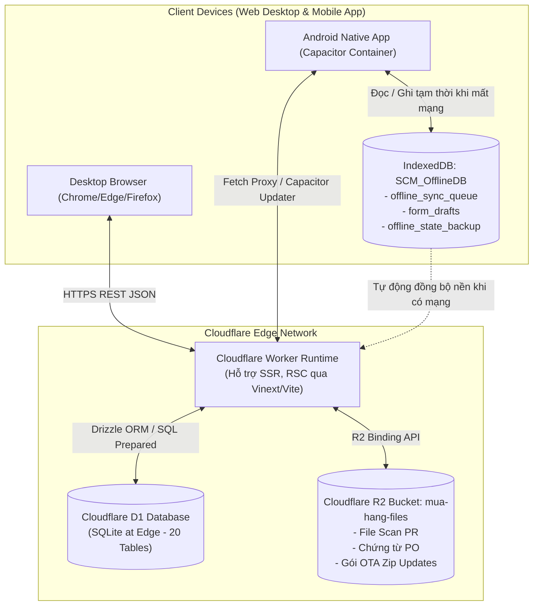
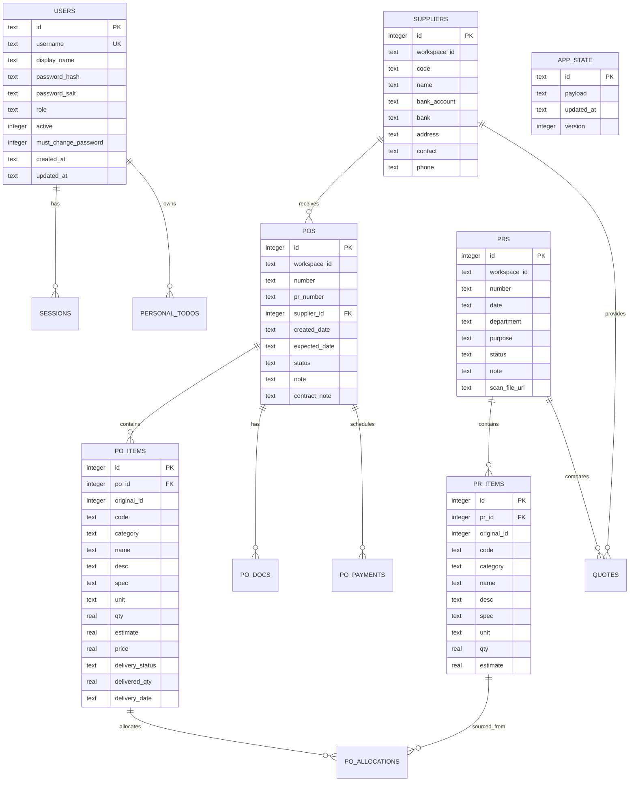
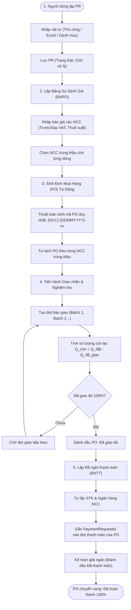
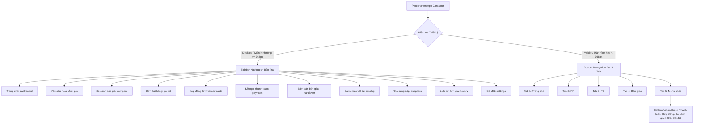
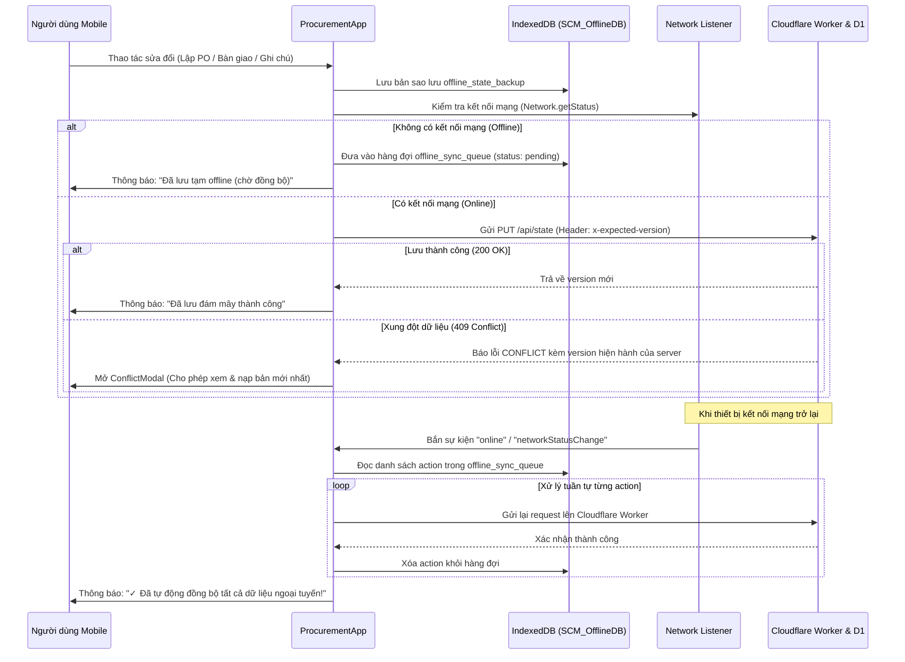

# ĐẶC TẢ KỸ THUẬT VÀ KIẾN TRÚC TOÀN DIỆN HỆ THỐNG QUẢN LÝ MUA HÀNG (PHENIKAA SCMH)

> **Tài liệu bàn giao kiến trúc kỹ thuật & quy trình nghiệp vụ**  
> **Dự án:** Hệ thống Quản lý Mua sắm & Thanh toán Vật tư (Phenikaa Procurement Management System)  
> **Phiên bản tài liệu:** 1.1.2  
> **Mục tiêu:** Cung cấp đầy đủ 100% đặc tả cấu trúc dữ liệu, các bảng Cloudflare D1, toàn bộ API endpoints, thuật toán tính toán và 6 luồng nghiệp vụ cốt lõi để bất kỳ kỹ sư phần mềm hoặc AI nào cũng có thể tái hiện chính xác hệ thống từ đầu mà không cần tham chiếu mã nguồn cũ.

---

## MỤC LỤC
1. [TỔNG QUAN HỆ THỐNG & TECH STACK](#1-tổng-quan-hệ-thống--tech-stack)
2. [LƯỢC ĐỒ CƠ SỞ DỮ LIỆU TOÀN DIỆN (DATABASE SCHEMA - CLOUDFLARE D1)](#2-lược-đồ-cơ-sở-dữ-liệu-toàn-diện-database-schema---cloudflare-d1)
3. [ĐẶC TẢ TẤT CẢ ENDPOINT API](#3-đặc-tả-tất-cả-endpoint-api)
4. [CHI TIẾT CÁC LUỒNG NGHIỆP VỤ CỐT LÕI (CORE BUSINESS WORKFLOWS)](#4-chi-tiết-các-luồng-nghiệp-vụ-cốt-lõi-core-business-workflows)
5. [ĐẶC TẢ GIAO DIỆN & CẤU TRÚC COMPONENT (UI/UX ARCHITECTURE)](#5-đặc-tả-giao-diện--cấu-trúc-component-uiux-architecture)
6. [CÁC CƠ CHẾ NÂNG CAO (ADVANCED MECHANISMS)](#6-các-cơ-chế-nâng-cao-advanced-mechanisms)

---

# 1. TỔNG QUAN HỆ THỐNG & TECH STACK

### 1.1. Mục đích sử dụng & Vai trò hệ thống
Hệ thống **Phenikaa SCMH (Supply Chain & Procurement Management Hub)** là giải pháp phần mềm quản trị toàn diện chu trình mua sắm nội bộ doanh nghiệp theo vòng đời khép kín:
$$\text{PR (Yêu cầu mua sắm)} \longrightarrow \text{ĐNPD (So sánh giá)} \longrightarrow \text{PO (Đơn mua hàng)} \longrightarrow \text{Bàn giao \& Nghiệm thu} \longrightarrow \text{ĐNTT (Thanh toán)}$$

Hệ thống đóng vai trò trung tâm kiểm soát tính minh bạch, hạn mức ngân sách, tiến độ giao hàng và dòng tiền công nợ giữa các phòng ban nội bộ và các đối tác/nhà cung cấp bên ngoài.

### 1.2. Kiến trúc giải pháp (Edge Cloud + Offline-First + Hybrid Mobile)


### 1.3. Chi tiết Tech Stack
1. **Frontend Core:**
   - **React 19.2.6** kết hợp kiến trúc React Server Components (RSC) và SSR biên dịch bằng **Vinext 0.0.50** (nền tảng Vite 8.0.13 cho Cloudflare Workers).
   - **Styling:** CSS3 variables, Tailwind CSS logic, phong cách thiết kế chuyên biệt cho ERP (Clean Enterprise Design System).
   - **Biểu tượng:** `lucide-react` (phiên bản v1.61.0).
   - **Xử lý bảng tính Excel:** `xlsx` (SheetJS v0.18.5) cho chức năng đọc/xuất biểu mẫu báo giá và bàn giao.
   - **Đa ngôn ngữ:** Tích hợp bộ chuyển ngữ i18n hỗ trợ 3 ngôn ngữ: Tiếng Việt (`vi`), Tiếng Anh (`en`), Tiếng Trung (`zh`).
2. **Backend & Cloud Services (Edge Computing):**
   - **Runtime:** Cloudflare Workers (V8 isolates execution environment, Cold start $\approx 0\text{ms}$).
   - **Cơ sở dữ liệu chính:** Cloudflare D1 (Serverless Distributed SQLite Engine).
   - **ORM & Data Mapping:** Drizzle ORM (`drizzle-orm` v0.45.2, `drizzle-kit` v0.31.10).
   - **Lưu trữ tệp & Bản cập nhật:** Cloudflare R2 Object Storage (Bucket: `mua-hang-files`).
   - **Cơ chế xác thực (Auth):** Cookie HTTP-Only `scm_session`, thuật toán băm bảo mật `PBKDF2` (SHA-256, 50,000 vòng lặp) kèm khóa ngẫu nhiên Salt 16 bytes.
3. **Nền tảng Di động (Mobile Native Wrapper):**
   - **Capacitor 8.5.3:** Đóng gói ứng dụng web thành ứng dụng Android Native thuần túy.
   - **Capacitor Plugins:**
     * `@capacitor/app` (v8.1.2): Quản lý vòng đời app, nút Back phần cứng của Android.
     * `@capacitor/network` (v8.0.1): Lắng nghe trạng thái kết nối mạng thực thời (Online/Offline).
     * `@capgo/capacitor-updater` (v8.54.0): Cơ chế cập nhật từ xa OTA (Over-The-Air) tức thì không cần phân phối lại APK qua CH Play.

---

# 2. LƯỢC ĐỒ CƠ SỞ DỮ LIỆU TOÀN DIỆN (DATABASE SCHEMA - CLOUDFLARE D1)

Hệ thống sử dụng cơ chế lưu trữ lai (Hybrid Storage Architecture):
- **Phần 1 - Document Store:** Bảng `app_state` lưu trữ toàn vẹn trạng thái dưới dạng JSON tài liệu có phân vùng (`main` và `history`) nhằm phục vụ giao diện phản ứng nhanh (reactive UI), hỗ trợ Undo/Redo và đồng bộ đa thiết bị.
- **Phần 2 - Relational Tables (Dual-Write):** Hệ thống đồng thời ghi dữ liệu quan hệ vào 19 bảng SQLite trực thuộc để phục vụ báo cáo phân tích, truy vấn SQL trực tiếp và khả năng dự phòng dữ liệu độc lập.



---

### Chi tiết 20 Bảng Cơ sở dữ liệu:

#### 1. Bảng `app_state` (Trạng thái ứng dụng cốt lõi & Cơ chế Phân vùng)
* **Ý nghĩa:** Lưu trữ toàn bộ cây dữ liệu làm việc (Workspaces) dưới dạng JSON. Để tránh lỗi giới hạn kích thước dòng SQLite (`row-size overflow`) khi khối lượng lịch sử mua hàng lớn, `purchaseHistory` được phân tách thành bản ghi riêng có hậu tố `:history`.
* **Cột:**
  - `id` (TEXT, PK): Mã định danh trạng thái. Giá trị mặc định của workspace chính là `b7f7f770-898b-4e2d-983f-9e640a42950d:state` và phân vùng lịch sử là `b7f7f770-898b-4e2d-983f-9e640a42950d:state:history`.
  - `payload` (TEXT, NOT NULL): Chuỗi JSON chứa danh sách PR, PO, ĐNPD, ĐNTT, Bàn giao, Nhà cung cấp, Hàng hóa, Thùng rác.
  - `updated_at` (TEXT, NOT NULL): Mốc thời gian ISO 8601 cập nhật lần cuối.
  - `version` (INTEGER, NOT NULL, DEFAULT 1): Số thứ tự phiên bản nguyên tử (dùng cho khóa lạc quan Optimistic Locking).

#### 2. Bảng `users` (Tài khoản người dùng & Phân quyền)
* **Ý nghĩa:** Quản lý danh sách nhân sự truy cập hệ thống.
* **Cột:**
  - `id` (TEXT, PK): UUID định danh người dùng.
  - `username` (TEXT, NOT NULL, UNIQUE): Tên đăng nhập (ví dụ: `bosmile`, `admin`, `nhanvien`).
  - `display_name` (TEXT, NOT NULL): Họ và tên hiển thị.
  - `password_hash` (TEXT, NOT NULL): Mã băm PBKDF2 của mật khẩu (256-bit Hex).
  - `password_salt` (TEXT, NOT NULL): Chuỗi Salt ngẫu nhiên 16 bytes.
  - `role` (TEXT, NOT NULL): Quyền truy cập: `master` (Toàn quyền quản trị), `admin` (Quản trị viên), `user` (Nhân viên mua sắm).
  - `active` (INTEGER, NOT NULL, DEFAULT 1): Trạng thái tài khoản (1: Kích hoạt, 0: Khóa).
  - `must_change_password` (INTEGER, NOT NULL, DEFAULT 0): Cờ bắt buộc đổi mật khẩu ở lần đăng nhập tới (1: Bắt buộc).
  - `created_at` (TEXT, NOT NULL): Ngày tạo tài khoản.
  - `updated_at` (TEXT, NOT NULL): Ngày cập nhật gần nhất.

#### 3. Bảng `sessions` (Phiên đăng nhập người dùng)
* **Ý nghĩa:** Quản lý phiên làm việc đã xác thực qua Cookie.
* **Cột:**
  - `token_hash` (TEXT, PK): Giá trị SHA-256 của Session Token gửi về cookie.
  - `user_id` (TEXT, NOT NULL, FK $\rightarrow$ `users.id` ON DELETE CASCADE): ID người dùng sở hữu phiên.
  - `created_at` (TEXT, NOT NULL): Thời điểm đăng nhập.
  - `expires_at` (TEXT, NOT NULL): Thời điểm hết hạn (mặc định sau 30 ngày).

#### 4. Bảng `suppliers` (Hồ sơ Nhà cung cấp)
* **Ý nghĩa:** Danh mục các đối tác bán hàng, thông tin thanh toán ngân hàng.
* **Cột:**
  - `id` (INTEGER, PK): Mã số nguyên duy nhất.
  - `workspaceId` (TEXT, NOT NULL): Mã không gian làm việc sở hữu.
  - `code` (TEXT, NOT NULL): Mã ký hiệu NCC (ví dụ: `VIETLAB`, `PHUCVINH`).
  - `name` (TEXT, NOT NULL): Tên pháp nhân đầy đủ của NCC.
  - `bank_account` (TEXT): Số tài khoản ngân hàng.
  - `bank` (TEXT): Tên ngân hàng & chi nhánh (ví dụ: `Vietcombank - CN Hà Nội`).
  - `address` (TEXT): Địa chỉ trụ sở / xuất hóa đơn.
  - `contact` (TEXT): Tên người liên hệ / nhân viên kinh doanh.
  - `phone` (TEXT): Số điện thoại liên hệ.

#### 5. Bảng `products` (Danh mục Hàng hóa Chuẩn)
* **Ý nghĩa:** Danh mục hàng hóa mẫu dùng để gợi ý và chuẩn hóa dữ liệu khi tạo PR.
* **Cột:**
  - `id` (INTEGER, PK): Mã hàng hóa.
  - `workspaceId` (TEXT, NOT NULL): Mã workspace.
  - `code` (TEXT, NOT NULL): Mã vật tư nội bộ.
  - `category` (TEXT): Nhóm/phân loại hàng hóa (ví dụ: `Hóa chất`, `Thiết bị`, `Văn phòng phẩm`).
  - `name` (TEXT, NOT NULL): Tên hàng hóa, quy cách chi tiết.
  - `desc` (TEXT): Mô tả bổ sung.
  - `spec` (TEXT): Thông số kỹ thuật chi tiết.
  - `unit` (TEXT): Đơn vị tính (ví dụ: `Cái`, `Hộp`, `Lọ`, `Kg`).
  - `estimate` (REAL): Đơn giá dự toán tham chiếu (VNĐ).

#### 6. Bảng `prs` (Yêu cầu mua sắm - Purchase Request)
* **Ý nghĩa:** Bản ghi yêu cầu mua hàng từ các phòng ban.
* **Cột:**
  - `id` (INTEGER, PK): ID định danh số nguyên.
  - `workspaceId` (TEXT, NOT NULL): Mã workspace.
  - `number` (TEXT, NOT NULL): Mã số PR (ví dụ: `RD20261026002`, `EM2710`).
  - `date` (TEXT): Ngày lập phiếu PR (định dạng `YYYY-MM-DD`).
  - `department` (TEXT): Phòng ban đề xuất (ví dụ: `RD`, `Cơ điện`, `Hành chính`).
  - `purpose` (TEXT): Mục đích mua sắm.
  - `status` (TEXT): Trạng thái xử lý (`Chờ xử lý`, `Đang lấy báo giá`, `Hoàn thành`).
  - `note` (TEXT): Ghi chú chung PR.
  - `scan_file_url` (TEXT): Đường dẫn file scan hoặc ảnh phiếu đề xuất gốc.

#### 7. Bảng `pr_items` (Chi tiết Mặt hàng trong PR)
* **Ý nghĩa:** Từng dòng hàng hóa trong một phiếu yêu cầu mua sắm.
* **Cột:**
  - `id` (INTEGER, PK AUTOINCREMENT): Mã dòng hàng.
  - `prId` (INTEGER, NOT NULL, FK $\rightarrow$ `prs.id` ON DELETE CASCADE): Thuộc phiếu PR nào.
  - `original_id` (INTEGER): ID tham chiếu ban đầu.
  - `code` (TEXT): Mã hàng hóa.
  - `category` (TEXT): Nhóm hàng.
  - `name` (TEXT): Tên chi tiết hàng hóa.
  - `desc` (TEXT): Mô tả hàng.
  - `spec` (TEXT): Quy cách kỹ thuật.
  - `unit` (TEXT): Đơn vị tính.
  - `qty` (REAL): Số lượng đề xuất mua.
  - `estimate` (REAL): Giá dự toán một đơn vị.

#### 8. Bảng `quotes` (Báo giá Nhà cung cấp theo PR)
* **Ý nghĩa:** Ma trận giá báo từ các nhà cung cấp cho từng phiếu PR.
* **Cột:**
  - `prId` (INTEGER, NOT NULL): Thuộc PR nào.
  - `supplierId` (INTEGER, NOT NULL): Của nhà cung cấp nào.
  - `price` (TEXT): Chuỗi JSON hoặc danh sách đơn giá chào thầu.
  - `note` (TEXT): Điều khoản báo giá, bảo hành, thời gian giao hàng.
  - `price_mode` (TEXT): Chế độ báo giá (`before-vat` hoặc `after-vat`).
  - `vat_rate` (TEXT): Tỷ lệ thuế VAT áp dụng (`0%`, `5%`, `8%`, `10%`).

#### 9. Bảng `pos` (Đơn đặt hàng mua - Purchase Order)
* **Ý nghĩa:** Hợp đồng/Đơn đặt hàng phát hành chính thức cho nhà cung cấp.
* **Cột:**
  - `id` (INTEGER, PK): ID đơn hàng.
  - `workspaceId` (TEXT, NOT NULL): Mã workspace.
  - `number` (TEXT, NOT NULL): Số PO định danh tự động duy nhất (ví dụ: `VIETHONG-27102026`).
  - `pr_number` (TEXT): Căn cứ số PR gốc (hoặc rỗng nếu là Đơn mua trực tiếp).
  - `supplier_id` (INTEGER, FK $\rightarrow$ `suppliers.id`): Nhà cung cấp trúng thầu.
  - `created_date` (TEXT): Ngày lập PO (`YYYY-MM-DD`).
  - `expected_date` (TEXT): Ngày cam kết giao hàng (`YYYY-MM-DD`).
  - `status` (TEXT): Trạng thái (`Mới tạo`, `Đang giao hàng`, `Đã giao đủ`, `Đã hoàn thành`, `Đã hủy`).
  - `note` (TEXT): Ghi chú chung của đơn hàng.
  - `contract_note` (TEXT): Ghi chú riêng về điều khoản hợp đồng kinh tế.

#### 10. Bảng `po_items` (Mặt hàng chi tiết trong PO)
* **Ý nghĩa:** Các dòng hàng hóa cam kết mua trong đơn đặt hàng.
* **Cột:**
  - `id` (INTEGER, PK AUTOINCREMENT): Mã dòng hàng.
  - `poId` (INTEGER, NOT NULL, FK $\rightarrow$ `pos.id` ON DELETE CASCADE): Thuộc đơn hàng PO nào.
  - `original_id` (INTEGER): ID dòng hàng ban đầu.
  - `code` (TEXT): Mã hàng hóa.
  - `category` (TEXT): Nhóm hàng.
  - `name` (TEXT): Tên hàng hóa thực tế.
  - `desc` (TEXT): Mô tả.
  - `spec` (TEXT): Thông số kỹ thuật.
  - `unit` (TEXT): Đơn vị tính.
  - `qty` (REAL): Số lượng đặt mua ($Q_{\text{ordered}}$).
  - `estimate` (REAL): Đơn giá dự toán.
  - `price` (REAL): Đơn giá mua chốt thực tế (chưa thuế hoặc có thuế).
  - `delivery_status` (TEXT): Tiến độ giao (`Chưa giao`, `Giao một phần`, `Đã giao`).
  - `delivered_qty` (REAL): Số lượng lũy kế đã bàn giao ($Q_{\text{delivered}}$).
  - `delivery_date` (TEXT): Ngày giao hàng đợt gần nhất.

#### 11. Bảng `po_allocations` (Phân bổ Xuất xứ PR sang PO)
* **Ý nghĩa:** Lưu vết xuất xứ xem dòng hàng trong PO được lấy từ dòng hàng nào của PR nào.
* **Cột:**
  - `id` (INTEGER, PK AUTOINCREMENT): Khóa chính.
  - `po_item_id` (INTEGER, NOT NULL, FK $\rightarrow$ `po_items.id` ON DELETE CASCADE): Dòng hàng PO.
  - `pr_id` (INTEGER): ID PR gốc.
  - `pr_number` (TEXT): Số hiệu PR gốc.
  - `pr_item_id` (INTEGER): ID dòng hàng trong PR gốc.
  - `qty` (REAL): Số lượng phân bổ từ PR vào PO này.

#### 12. Bảng `po_docs` (Hồ sơ Chứng từ & Hợp đồng PO)
* **Ý nghĩa:** Theo dõi tình trạng đủ/thiếu của các chứng từ đi kèm (Hợp đồng, Biên bản bàn giao, CO/CQ, Hóa đơn VAT).
* **Cột:**
  - `id` (INTEGER, PK): ID chứng từ.
  - `poId` (INTEGER, NOT NULL, FK $\rightarrow$ `pos.id` ON DELETE CASCADE): Thuộc PO nào.
  - `name` (TEXT): Tên chứng từ (ví dụ: `Hợp đồng`, `Biên bản bàn giao`, `Hóa đơn GTGT`).
  - `status` (TEXT): Tình trạng (`Đã đủ`, `Còn thiếu`, `Chờ bổ sung`).
  - `note` (TEXT): Ghi chú tiến độ bổ sung hồ sơ.

#### 13. Bảng `po_payments` (Kế hoạch Đợt thanh toán PO)
* **Ý nghĩa:** Các đợt giải ngân được định nghĩa trong PO hoặc hợp đồng.
* **Cột:**
  - `id` (INTEGER, PK): Mã đợt thanh toán.
  - `poId` (INTEGER, NOT NULL, FK $\rightarrow$ `pos.id` ON DELETE CASCADE): Thuộc PO nào.
  - `phase` (TEXT): Tên đợt (ví dụ: `Tạm ứng đợt 1 (30%)`, `Thanh toán đợt 2 (70%)`).
  - `percent` (REAL): Tỷ lệ thanh toán (ví dụ: `30`, `50`, `100`).
  - `amount` (REAL): Số tiền kế hoạch phải trả (VNĐ).
  - `status` (TEXT): Trạng thái đợt (`Chưa thanh toán`, `Đang xử lý`, `Đã thanh toán`).
  - `date` (TEXT): Hạn thanh toán cam kết (`YYYY-MM-DD`).

#### 14. Bảng `purchase_history` (Lịch sử Mua hàng & Đơn giá Kế toán)
* **Ý nghĩa:** Kho dữ liệu các hóa đơn, phiếu nhập kho quá khứ để so sánh giá lịch sử.
* **Cột:**
  - `id` (TEXT, PK): Khóa duy nhất.
  - `workspaceId` (TEXT, NOT NULL): Mã workspace.
  - `warehouse_code`, `warehouse_name` (TEXT): Mã và tên kho nhập.
  - `item_code`, `item_name` (TEXT): Mã và tên vật tư.
  - `accounting_date`, `document_date`, `invoice_date` (TEXT): Các mốc ngày kế toán.
  - `document_no`, `invoice_no` (TEXT): Số chứng từ, số hóa đơn đỏ.
  - `description`, `unit` (TEXT): Nội dung diễn giải, đơn vị tính.
  - `unit_price`, `quantity`, `value` (REAL): Đơn giá, số lượng, thành tiền.
  - `supplier_code`, `supplier_name`, `supplier_id` (TEXT/INTEGER): Thông tin NCC đã cung cấp.
  - `department` (TEXT): Phòng ban tiêu thụ.

#### 15. Bảng `personal_todos` (Sổ tay Công việc Cá nhân)
* **Ý nghĩa:** Quản lý công việc cá nhân của cán bộ mua sắm, đồng bộ trực tiếp với Cloudflare D1.
* **Cột:**
  - `id` (TEXT, PK): Mã công việc (ví dụ: `todo-1730000000000`).
  - `user_id` (TEXT, NOT NULL, DEFAULT `'admin'`): ID chủ sở hữu.
  - `content` (TEXT, NOT NULL): Nội dung công việc (hỗ trợ tag `@` liên kết).
  - `is_completed` (INTEGER, NOT NULL, DEFAULT 0): Cờ hoàn thành (0: Chưa xong, 1: Đã xong).
  - `is_priority` (INTEGER, NOT NULL, DEFAULT 0): Cờ ưu tiên cao (0: Bình thường, 1: Khẩn).
  - `tags` (TEXT): Mảng JSON lưu nhãn phân loại (ví dụ: `["PO", "Thanh toán"]`).
  - `created_at`, `updated_at` (TEXT): Thời điểm tạo và cập nhật.
  - `is_deleted` (INTEGER, NOT NULL, DEFAULT 0): Xóa mềm (1: Đã xóa vào thùng rác).

#### 16. Bảng `trash_items` (Thùng rác Lưu trữ Phục hồi)
* **Ý nghĩa:** Lưu trữ các phiếu PR, PO, Hợp đồng đã bị xóa nhằm chống mất dữ liệu do thao tác nhầm.
* **Cột:**
  - `id` (TEXT, PK): Mã rác.
  - `workspaceId` (TEXT, NOT NULL): Mã workspace.
  - `type` (TEXT): Phân loại mục bị xóa (`PR`, `PO`, `CONTRACT`).
  - `label` (TEXT): Nhãn đại diện (ví dụ: `Đơn hàng VIETHONG-27102026`).
  - `deleted_at` (TEXT): Thời điểm đưa vào thùng rác.
  - `expires_at` (TEXT): Thời điểm tự động hủy vĩnh viễn (thường sau 30 ngày).
  - `data` (TEXT): Chuỗi JSON chứa toàn bộ dữ liệu gốc của thực thể bị xóa.

#### 17. Bảng `files` (Quản lý Tệp tin & Binding Cloudflare R2)
* **Ý nghĩa:** Danh mục quản lý metadata tệp đính kèm lưu trên Cloudflare R2.
* **Cột:**
  - `id` (TEXT, PK): Mã file duy nhất.
  - `entity_type` (TEXT, NOT NULL): Thực thể liên kết (`pr`, `po`, `scan`, `contract`).
  - `entity_id` (TEXT, NOT NULL): Mã của thực thể liên kết.
  - `file_name` (TEXT, NOT NULL): Tên file gốc người dùng tải lên.
  - `object_key` (TEXT, NOT NULL): Khóa định danh tệp trong Cloudflare R2 bucket.
  - `content_type` (TEXT, NOT NULL): Loại MIME (ví dụ: `application/pdf`, `image/png`).
  - `size` (INTEGER, NOT NULL): Kích thước file theo bytes.
  - `uploaded_at` (TEXT, NOT NULL): Thời gian upload.

#### 18. Bảng `audit_logs` (Nhật ký Kiểm toán Hệ thống)
* **Ý nghĩa:** Lưu vết các thao tác quan trọng (tạo mới, chỉnh sửa, xóa, duyệt).
* **Cột:**
  - `id` (INTEGER, PK AUTOINCREMENT): Mã log.
  - `action` (TEXT, NOT NULL): Hành vi thực hiện (`CREATE`, `UPDATE`, `DELETE`, `APPROVE`).
  - `entity_type` (TEXT, NOT NULL): Đối tượng tác động (`PR`, `PO`, `PAYMENT`, `USER`).
  - `entity_id` (TEXT, NOT NULL): ID của đối tượng.
  - `created_at` (TEXT, NOT NULL): Thời điểm phát sinh thao tác.

#### 19. Bảng `share_links` (Liên kết Chia sẻ Báo cáo Bên ngoài)
* **Ý nghĩa:** Cho phép tạo liên kết token chia sẻ bảng tiến độ mua sắm cho lãnh đạo xem không cần tài khoản.
* **Cột:**
  - `token` (TEXT, PK): Chuỗi mã ngẫu nhiên an toàn (64 ký tự Hex).
  - `label` (TEXT, NOT NULL): Tiêu đề mô tả liên kết.
  - `created_at`, `expires_at` (TEXT, NOT NULL): Thời điểm tạo và hết hạn.
  - `revoked_at` (TEXT): Thời điểm bị thu hồi chủ động.
  - `last_viewed_at` (TEXT): Lần xem gần nhất.
  - `view_count` (INTEGER, NOT NULL, DEFAULT 0): Số lần đã truy cập.

#### 20. Bảng `system_configs` (Cấu hình Hệ thống & Phiên bản Ứng dụng)
* **Ý nghĩa:** Lưu cấu hình động của Worker, trong đó có metadata phiên bản app di động phục vụ cập nhật OTA.
* **Cột:**
  - `key` (TEXT, PK): Tên khóa cấu hình (ví dụ: `app_version`).
  - `value` (TEXT, NOT NULL): Giá trị cấu hình (chuỗi JSON chứa `latestVersion`, `downloadUrl`, `releaseNotes`...).
  - `updated_at` (TEXT, DEFAULT `CURRENT_TIMESTAMP`): Thời điểm cập nhật.

---

# 3. ĐẶC TẢ TẤT CẢ ENDPOINT API

Tất cả các API đều chạy tại Edge trên Cloudflare Workers. Định dạng trao đổi dữ liệu chuẩn là `application/json; charset=utf-8`.

### 3.1. Bảng Tổng hợp Endpoints

| Nhóm chức năng | Phương thức | Đường dẫn API | Mục đích xử lý |
| :--- | :--- | :--- | :--- |
| **Trạng thái Cốt lõi** | `GET` | `/api/state` | Nạp toàn bộ cây dữ liệu workspace từ D1 (kèm auto-recovery) |
| | `PUT` | `/api/state` | Lưu trạng thái với khóa lạc quan `x-expected-version` & dual-write |
| **Công việc Cá nhân** | `GET` | `/api/todos` | Lấy danh sách việc cần làm của user chưa bị xóa |
| | `POST` | `/api/todos` | Thêm mới 1 việc vào D1 |
| | `PUT` | `/api/todos` | Cập nhật trạng thái/nội dung hoặc Bulk Sync mảng việc |
| | `DELETE` | `/api/todos` | Xóa mềm một việc hoặc dọn dẹp danh sách |
| **Cập nhật OTA Mobile**| `GET` | `/api/app-version` | Lấy thông tin phiên bản app mới nhất |
| | `POST` | `/api/app-version` | Đẩy bản cập nhật ZIP và cấu hình phiên bản mới |
| | `GET` | `/api/app-version/download` | Stream tải gói bundle `.zip` cập nhật từ Cloudflare R2 |
| **Xác thực Người dùng**| `POST` | `/api/auth/login` | Đăng nhập hệ thống, cấp phát session cookie |
| | `POST` | `/api/auth/logout` | Đăng xuất, hủy session trong D1 |
| | `POST` | `/api/auth/verify-password`| Kiểm tra mật khẩu hiện tại trước các tác vụ nhạy cảm |
| **Quản lý Tài khoản** | `GET` | `/api/users` | Lấy danh sách thành viên (Chỉ Admin/Master) |
| | `POST` | `/api/users` | Tạo tài khoản người dùng mới |
| | `GET` | `/api/users/[id]` | Lấy thông tin chi tiết một tài khoản |
| | `PUT` | `/api/users/[id]` | Cập nhật thông tin / đổi mật khẩu / phân quyền |
| | `DELETE` | `/api/users/[id]` | Vô hiệu hóa tài khoản |
| **File & OCR Scan** | `GET` | `/api/files` | Lấy danh sách tệp đính kèm theo thực thể |
| | `POST` | `/api/files` | Tải file đính kèm lên R2 Bucket |
| | `GET` | `/api/files/[id]` | Tải trực tiếp nội dung tệp từ R2 |
| | `DELETE` | `/api/files/[id]` | Xóa tệp khỏi R2 và metadata trong D1 |
| | `POST` | `/api/upload-scan` | Upload ảnh/scan phiếu PR với nén tự động |
| **Chia sẻ & Khách xem**| `POST` | `/api/share` | Tạo link chia sẻ báo cáo xem công khai |
| | `GET` | `/api/share` | Lấy danh sách các liên kết chia sẻ đang hoạt động |
| | `GET` | `/api/report-state` | Lấy dữ liệu báo cáo an toàn qua token chia sẻ |
| **Quản trị & Dự phòng**| `GET` | `/api/admin/snapshots` | Lấy danh sách bản sao lưu hệ thống |
| | `POST` | `/api/admin/snapshots` | Tạo snapshot sao lưu tức thời |
| | `GET` | `/api/admin/audit-logs` | Truy vấn lịch sử thao tác kiểm toán |
| | `GET` | `/api/admin/usage` | Đo lường dung lượng D1 và số lượng bản ghi |
| | `POST` | `/api/admin/sync-backup` | Đồng bộ cưỡng bức dữ liệu sang file sao lưu |
| | `POST` | `/api/admin/migrate-json` | Nạp đè dữ liệu JSON mẫu vào D1 |

---

### 3.2. Đặc tả Chi tiết các Endpoint Quan trọng

#### 1. Endpoint: `GET /api/state`
* **Mô tả:** Lấy toàn bộ cây dữ liệu của Workspace hiện tại.
* **Tham số Query:**
  - `workspace` (tùy chọn): ID workspace cần truy vấn. Mặc định là Master workspace `b7f7f770-898b-4e2d-983f-9e640a42950d`.
* **Logic ngầm:**
  1. Kiểm tra xác thực qua session cookie hoặc quyền truy cập của App Android/Localhost.
  2. Đọc bản ghi chính `id = workspaceId:state` và bản ghi lịch sử `id = workspaceId:state:history`.
  3. **Cơ chế Tự động Phục hồi (Auto-Recovery):** Nếu `app_state` bị rỗng hoặc thiếu danh sách PO/PR/Nhà cung cấp, hệ thống tự động đọc từ 12 bảng quan hệ (`suppliers`, `products`, `prs`, `pr_items`, `pos`, `po_items`, `po_allocations`, `quotes`, `purchase_history`, `trash_items`) để hợp nhất và cập nhật lại vào `app_state`.
* **Phản hồi thành công (`200 OK`):**
```json
{
  "data": {
    "prs": [ /* mảng danh sách PR */ ],
    "pos": [ /* mảng danh sách PO */ ],
    "suppliers": [ /* mảng nhà cung cấp */ ],
    "products": [ /* mảng sản phẩm mẫu */ ],
    "quotes": { /* ma trận báo giá */ },
    "paymentRequests": [ /* đề nghị thanh toán */ ],
    "paymentHandovers": [ /* biên bản bàn giao */ ],
    "approvalRequests": [ /* đề nghị phê duyệt */ ],
    "trash": [ /* các mục đã xóa */ ]
  },
  "updatedAt": "2026-10-29T14:38:20.123Z",
  "version": 42,
  "workspaceId": "b7f7f770-898b-4e2d-983f-9e640a42950d"
}
```

#### 2. Endpoint: `PUT /api/state`
* **Mô tả:** Lưu trạng thái dữ liệu làm việc từ Frontend xuống máy chủ.
* **Headers:**
  - `Content-Type: application/json`
  - `x-expected-version`: Phiên bản client đang nắm giữ trước khi chỉnh sửa.
* **Request Body:** Đối tượng `Partial<StoredState>` chứa các trường cần cập nhật.
* **Logic ngầm & Cơ chế An toàn:**
  1. **Kiểm tra Xung đột Phiên bản (Optimistic Concurrency Control):** Nếu bảng `app_state` trong D1 có `version > x-expected-version`, Worker lập tức trả về `409 Conflict`, ngăn chặn ghi đè dữ liệu của phiên làm việc khác.
  2. **Tách phân vùng Lịch sử (Partitioning):** Trường `purchaseHistory` được tách khỏi bản ghi chính và lưu vào `id = workspaceId:state:history` để bảo đảm dung lượng một dòng SQLite không vượt ngưỡng cho phép.
  3. **Dual-Write Quan hệ:** Song song với việc lưu JSON, Worker tự động cập nhật dữ liệu bảng quan hệ `prs`, `pr_items`, `pos`, `po_items` để bảo đảm tính toàn vẹn và khả năng truy vấn SQL trực tiếp.
* **Phản hồi thành công (`200 OK`):**
```json
{
  "ok": true,
  "version": 43,
  "updatedAt": "2026-10-29T14:40:15.000Z"
}
```
* **Phản hồi khi có xung đột (`409 Conflict`):**
```json
{
  "error": "CONFLICT",
  "currentVersion": 43,
  "message": "Dữ liệu đã được cập nhật từ một phiên làm việc khác. Vui lòng tải lại trang để tránh ghi đè dữ liệu mới."
}
```

#### 3. Endpoint: `GET /api/todos` & `POST /api/todos` & `PUT /api/todos`
* **Mục đích:** Đồng bộ hóa danh sách việc cần làm cá nhân giữa Web và App Di động vào bảng `personal_todos`.
* **Cấu trúc DTO Công việc (Todo Item):**
```json
{
  "id": "todo-1730212000000",
  "text": "Liên hệ @NCC VIETLAB chốt lịch giao đơn @PO VIETHONG-27102026",
  "completed": false,
  "priority": "high",
  "tags": ["PO", "Giao hàng"],
  "createdAt": "2026-10-29T14:00:00.000Z"
}
```
* **Hỗ trợ Bulk Sync trong `PUT /api/todos`:** Body gửi lên có dạng `{ "todos": [...] }`. Máy chủ sẽ thực hiện Upsert các việc có trong mảng và tự động cập nhật `is_deleted = 1` cho các việc đã bị xóa khỏi client.

#### 4. Endpoint: `GET /api/app-version`
* **Mục đích:** Được gọi bởi plugin Capacitor Updater để thăm dò bản cập nhật OTA.
* **Phản hồi chuẩn:**
```json
{
  "latestVersion": "1.1.2",
  "versionName": "Phenikaa SCMH v1.1.2 (Bản tối ưu PO & Tên hàng)",
  "buildNumber": "112",
  "buildDate": "29/10/2026, 21:36:00",
  "minSupportedVersion": "1.0.0",
  "downloadUrl": "https://quan-ly-mua-hang.sc-pnk.workers.dev/api/app-version/download?version=1.1.2",
  "checksum": "",
  "releaseNotes": "Tối ưu thu gọn thông tin NCC và đợt thanh toán; Khắc phục triệt để hiển thị tên hàng hóa trên APK."
}
```

---

# 4. CHI TIẾT CÁC LUỒNG NGHIỆP VỤ CỐT LÕI (CORE BUSINESS WORKFLOWS)



---

### 4.1. Luồng 1: Tạo và duyệt Yêu cầu mua sắm (PR)
1. **Đầu vào:** Phòng ban lập phiếu đề xuất vật tư cần mua.
2. **Phương thức nhập liệu:**
   - *Cách 1: Nhập trực tiếp:* Gõ từng dòng hàng (Tên, Quy cách, Số lượng, Đơn vị tính, Đơn giá dự toán).
   - *Cách 2: Chọn từ Cây danh mục sản phẩm:* Dùng component `TreeProductPickerModal` duyệt theo cây chuyên mục để chọn hàng hóa chuẩn.
   - *Cách 3: Tải từ bảng tính Excel:* Import file Excel danh sách vật tư (`.xlsx`) sử dụng thư viện SheetJS, tự động nhận diện các cột Tên hàng, Số lượng, ĐVT, Dự toán.
   - *Cách 4: Đính kèm Scan phiếu trình gốc:* Upload file scan PDF/JPG qua `/api/upload-scan`.
3. **Tính toán tự động:**
   $$\text{Thành tiền dự toán từng mặt hàng} = \text{Số lượng} \times \text{Đơn giá dự toán}$$
   $$\text{Tổng giá trị dự toán PR} = \sum_{i=1}^{n} (\text{qty}_i \times \text{estimate}_i)$$
4. **Đầu ra:** Phiên PR được lưu vào hệ thống với số hiệu PR (ví dụ: `RD20261026002`) và trạng thái ban đầu là `Chờ xử lý`.

---

### 4.2. Luồng 2: Lập Đề nghị phê duyệt (ĐNPD) & So sánh giá Nhà cung cấp
1. **Mục đích:** Đối chiếu báo giá giữa tối thiểu 2 đến 3 nhà cung cấp để chọn đối tác tối ưu về giá cả, thời gian giao hàng và điều khoản thanh toán.
2. **Quy tắc tính toán giá và chế độ thuế (VAT Mode):**
   - Hỗ trợ 2 chế độ báo giá:
     * `before-vat` (Giá chưa gồm VAT): Đơn giá nhập vào là giá gốc. Giá sau VAT được tính:
       $$\text{Giá sau thuế} = \text{Giá gốc} \times \left(1 + \frac{\text{VAT}}{100}\right)$$
     * `after-vat` (Giá đã gồm VAT): Đơn giá nhập vào đã có thuế. Giá trước VAT được tính:
       $$\text{Giá trước thuế} = \frac{\text{Giá đã thuế}}{1 + \frac{\text{VAT}}{100}}$$
   - Mức thuế VAT linh hoạt từng dòng hoặc toàn bảng: `0%`, `5%`, `8%`, `10%`.
3. **Lựa chọn trúng thầu:**
   - Người phụ trách tích chọn NCC thắng thầu trên từng dòng mặt hàng (`selectedSupplierId`) hoặc chọn trúng thầu toàn bộ theo nhà cung cấp có tổng giá thấp nhất.
4. **Đầu ra:** Phiếu Đề nghị phê duyệt được in ấn hoặc xuất trình lãnh đạo ký duyệt.

---

### 4.3. Luồng 3: Sinh Đơn mua hàng (PO) & Thuật toán sinh mã PO tự động
1. **Kích hoạt:** Bấm nút `Tạo Đơn Hàng` từ bảng so sánh ĐNPD hoặc lập PO trực tiếp từ danh mục.
2. **Quy tắc phân tách PO tự động:**
   - Nếu trong một phiếu so sánh có nhiều nhà cung cấp trúng thầu các mặt hàng khác nhau, hệ thống tự động gom nhóm theo từng NCC và sinh ra các đơn PO tương ứng độc lập.
3. **Thuật toán sinh mã PO duy nhất 100% (`generatePOCode`):**
   - **Bước 1 - Chuẩn hóa tiền tố NCC (ABCD):**
     * Lấy từ `supplier.shortName` nếu có.
     * Nếu không có, chuẩn hóa `supplier.name`: Loại bỏ dấu tiếng Việt, loại bỏ các từ định danh công ty (`CÔNG TY`, `TNHH`, `CỔ PHẦN`, `CP`, `TM`, `DV`), ghép 2 chữ cái đầu thành viết hoa (ví dụ: `CÔNG TY TNHH VIỆT HỒNG` $\rightarrow$ `VIETHONG`).
     * Nếu vẫn rỗng, fallback sang `supplier.code` hoặc mặc định `NCC`.
   - **Bước 2 - Chuẩn hóa chuỗi ngày (XYZ):** Lấy theo ngày tạo `DDMMYYYY` (ví dụ: ngày `27/10/2026` $\rightarrow$ `27102026`).
   - **Bước 3 - Sinh mã cơ sở (`baseCode`):**
     $$\text{baseCode} = \text{ABCD} - \text{XYZ} \quad (\text{ví dụ: } \texttt{VIETHONG-27102026})$$
   - **Bước 4 - Kiểm tra trùng lặp và sinh hậu tố tự tăng:**
     * Quét toàn bộ danh sách PO hiện hữu và PO trong thùng rác (`trash`).
     * Nếu `baseCode` chưa tồn tại: Dùng chính `baseCode`.
     * Nếu `baseCode` đã tồn tại: Tìm số thứ tự lớn nhất hiện có và cộng thêm 1:
       - Đơn thứ 2 trong ngày cùng NCC: `VIETHONG-27102026-02`
       - Đơn thứ 3 trong ngày cùng NCC: `VIETHONG-27102026-03`
4. **Quy tắc tính tổng tiền PO:**
   $$\text{Thành tiền dòng hàng} = \text{qty} \times \text{price}$$
   $$\text{Tổng tiền dòng sau VAT} = \text{Thành tiền dòng} \times \left(1 + \frac{\text{vatRate}}{100}\right)$$
   $$\text{Tổng giá trị PO} = \sum \text{Tổng tiền dòng sau VAT}$$

---

### 4.4. Luồng 4: Quy trình Bàn giao & Nghiệm thu hàng hóa (Delivery & Handover)
1. **Thuật toán kiểm soát số lượng còn lại:**
   Đối với từng mặt hàng trong đơn hàng PO, số lượng được theo dõi chặt chẽ:
   $$Q_{\text{ordered}} = \text{poItem.qty} \quad (\text{Số lượng đặt mua})$$
   $$Q_{\text{delivered}} = \min\left(Q_{\text{ordered}}, \sum \text{quantity\_pass}_{\text{các đợt}}\right) \quad (\text{Số lượng đã giao})$$
   $$Q_{\text{remaining}} = \max\left(0, Q_{\text{ordered}} - Q_{\text{delivered}}\right) \quad (\text{Số lượng còn lại chưa giao})$$
   > **Quy tắc an toàn:** Hệ thống áp dụng hàm $\min$ chống vượt số lượng đặt mua ($Q_{\text{delivered}} \le Q_{\text{ordered}}$), không cho phép giao thừa số lượng làm sai lệch giá trị hợp đồng.

2. **Quản lý Bàn giao theo Đợt (Batch Delivery):**
   - Mỗi lần hàng về kho, người dùng tạo một Đợt bàn giao mới (`Batch 1`, `Batch 2`...).
   - Hệ thống tự sinh mã `batch_id`:
     $$\texttt{BATCH\_\{PO\_NUMBER\}\_D\{BATCH\_INDEX\}\_\{TIMESTAMP\}\_\{RANDOM\}}$$
   - Người dùng nhập số lượng thực nhận cho từng món trong đợt này. Số lượng tối đa được phép nhập cho đợt hiện tại là:
     $$Q_{\text{max\_allowed}} = Q_{\text{ordered}} - Q_{\text{delivered\_từ\_các\_đợt\_khác}}$$

3. **Thuật toán sắp xếp mặt hàng trùng khớp thứ tự dòng PO (`sortHandoversByPOLineOrder`):**
   - Khi in biên bản bàn giao hoặc hiển thị danh sách kiểm đếm, các mặt hàng bàn giao được sắp xếp **chính xác 100% theo thứ tự dòng hàng của đơn PO gốc** (dựa theo `po_item_id` hoặc tên mặt hàng đã chuẩn hóa `normName`).
   - Giúp thủ kho và cán bộ giao nhận dễ dàng đối chiếu song song giữa Hóa đơn, PO và Biên bản thực tế mà không bị xáo trộn vị trí.

4. **Trạng thái giao hàng của PO:**
   - $\text{Tất cả mặt hàng có } Q_{\text{remaining}} = 0 \implies \text{Trạng thái PO: "Đã giao đủ (100\%)"}$.
   - $\text{Có ít nhất một mặt hàng đã giao và còn mặt hàng chưa đủ } \implies \text{"Giao một phần"}$.
   - $\text{Chưa có mặt hàng nào giao } \implies \text{"Chưa giao"}$.

---

### 4.5. Luồng 5: Luồng Đề nghị thanh toán (ĐNTT) & Đồng bộ giải ngân 2 chiều
1. **Khởi tạo ĐNTT:** Người dùng bấm `Tạo ĐNTT` từ danh sách PO hoặc từ chi tiết một đợt thanh toán (Milestone).
2. **Tự động điền thông tin Ngân hàng:**
   - Hệ thống tự động tra cứu nhà cung cấp của PO trong danh bạ `suppliers`: Lấy chính xác Số tài khoản (`bank_account`), Tên ngân hàng (`bank`), Người thụ hưởng (`name`), Địa chỉ.
3. **Sinh nội dung thanh toán tự động (`buildPOPaymentDescription`):**
   - *Nếu đơn có Hợp đồng kinh tế:*
     $$\text{"Thanh toán đợt \{N\} \{PCT\}\% hợp đồng số \{Số\_HĐ\} ngày \{Ngày\_ký\}"}$$
   - *Nếu đơn hàng thông thường:*
     $$\text{"Thanh toán đợt \{N\} \{PCT\}\% tiền vật tư hàng hóa"}$$
4. **Cơ chế Đồng bộ Hai Chiều Thực Thời (`syncPaymentCompletionToPO`):**
   - Đề nghị thanh toán có liên kết trực tiếp với một đợt trong mảng `po.payments` qua `paymentRequestId`.
   - **Khi kế toán chuyển trạng thái ĐNTT sang "Đã thanh toán":**
     * Đợt thanh toán tương ứng trong PO tự động chuyển sang `status = "Đã thanh toán"`.
     * Thuộc tính `paidAt` được gắn mốc thời gian ISO hiện tại.
     * **Điều kiện hoàn tất đơn hàng:** Nếu tất cả các đợt thanh toán của PO đều đã trả ($100\%$) VÀ tất cả hàng hóa đã giao đủ ($100\%$), đơn hàng PO sẽ **tự động chuyển sang trạng thái "Đã hoàn thành"**.
   - **Khi bỏ tích (Revert):** Đợt thanh toán trong PO tự động hoàn tác về `"Chưa thanh toán"` và trạng thái PO trở về `"Đang thực hiện"`.

---

### 4.6. Luồng 6: Dashboard Dòng tiền, Theo dõi thanh toán & Công việc cá nhân
1. **Bộ theo dõi dòng tiền khẩn cấp (Cash Flow & Milestone Tracker):**
   - Tự động quét toàn bộ các đợt thanh toán chưa trả của các PO đang hoạt động.
   - Phân loại mức độ khẩn trương theo hạn trả (`urgency`):
     * `overdue` (Quá hạn): $\text{diffDays} < 0$ hoặc đợt Tạm ứng chưa trả làm đình trệ giao hàng.
     * `due_soon` (Đến hạn): $0 \le \text{diffDays} \le 3$.
     * `normal` (Trong hạn): $\text{diffDays} > 3$.
2. **Logic quản lý dòng tiền thanh toán trong ngày (Ẩn sau 23:59:59):**
   - Khi một khoản thanh toán được duyệt hoàn thành vào ngày $T$, khoản này sẽ trượt xuống khu vực **"Đã thanh toán hôm nay"** trên Dashboard để cán bộ mua sắm dễ theo dõi tiến độ trong ngày làm việc.
   - **Thuật toán tự động dọn dẹp:**
     $$\text{Hiển thị trên Dashboard} \iff \text{Chưa hoàn thành} \quad \mathbf{HOẶC} \quad (\text{Đã hoàn thành} \ \land \ \text{paidAt.slice}(0, 10) = \text{todayStr})$$
   - Khi đồng hồ bước qua nửa đêm (sau 23:59:59 sang ngày $T+1$), giá trị `todayStr` thay đổi, điều kiện $\text{paidAt} = \text{todayStr}$ không còn thỏa mãn $\implies$ Khoản tiền này tự động ẩn khỏi Dashboard và chỉ còn lưu trong sổ cái báo cáo lịch sử. Dashboard luôn sạch sẽ, chỉ tập trung vào việc của ngày mới.
3. **Sổ tay Công việc Cá nhân (Personal Todo) kèm tính năng Nhắc việc thông minh (@Mention):**
   - Hỗ trợ gõ ký tự `@` để liên kết nhanh: `@PO [Số PO]`, `@PR [Số PR]`, `@NCC [Tên NCC]`.
   - Bấm vào tag `@` sẽ tự động chuyển hướng màn hình đến đúng đối tượng để xử lý ngay lập tức.
   - Dữ liệu todo lưu vào bảng `personal_todos` của D1, hỗ trợ ngoại tuyến qua IndexedDB.

---

# 5. ĐẶC TẢ GIAO DIỆN & CẤU TRÚC COMPONENT (UI/UX ARCHITECTURE)

### 5.1. Bản đồ điều hướng (Navigation Map)
Hệ thống sử dụng cơ chế điều hướng dựa trên URL Hash (`#view={VIEW_NAME}&id={ID}`), tương thích 100% với WebView của Android và hỗ trợ nút Back phần cứng.



### 5.2. Danh mục Component cốt lõi và Trách nhiệm
1. [`ProcurementApp.tsx`](file:///D:/SCMH/app/ProcurementApp.tsx): Component gốc toàn cục. Quản lý State tập trung, Router hash, lưu trữ nền tự động (Auto-save debounced), lắng nghe xung đột phiên bản, điều phối banner Offline và OTA.
2. [`Dashboard.tsx`](file:///D:/SCMH/app/components/Dashboard.tsx) & [`MobileDashboard.tsx`](file:///D:/SCMH/app/components/MobileDashboard.tsx): Bảng điều khiển trung tâm hiển thị chỉ số KPI, cảnh báo hạn thanh toán, danh sách việc cần làm (Todo) và dòng tiền trong ngày.
3. [`PRList.tsx`](file:///D:/SCMH/app/components/PRList.tsx): Danh sách các yêu cầu mua sắm. Trên di động hiển thị card có khối xem trước tên mặt hàng và trạng thái lấy báo giá.
4. [`CreatePRCatalog.tsx`](file:///D:/SCMH/app/components/CreatePRCatalog.tsx): Wizard tạo PR nhiều bước với chức năng chọn vật tư theo cây thư mục, nhập Excel và đính kèm bản scan. Ô ghi chú chung ẩn mặc định, mở khi người dùng bấm nút `+ Thêm Ghi chú chung PR`.
5. [`POList.tsx`](file:///D:/SCMH/app/components/POList.tsx): Danh mục đơn hàng PO. Trên di động có preview 2 tên hàng tiêu biểu, trạng thái bàn giao và thanh toán. Bỏ ghi chú mặc định, ẩn ô ghi chú khi tạo PO mới.
6. [`PODetail.tsx`](file:///D:/SCMH/app/components/PODetail.tsx): Màn hình chi tiết đơn đặt hàng. Tối ưu thu gọn khối Nhà cung cấp (bấm nút mới xổ thông tin chi tiết), thu gọn khối Các đợt thanh toán, ẩn ô ghi chú chung nếu rỗng.
7. [`ApprovalManagement.tsx`](file:///D:/SCMH/app/components/ApprovalManagement.tsx) & [`ApprovalSheet.tsx`](file:///D:/SCMH/app/components/ApprovalSheet.tsx): Quản lý phiếu Đề nghị phê duyệt và bảng ma trận so sánh giá nhiều nhà cung cấp.
8. [`HandoverManagement.tsx`](file:///D:/SCMH/app/components/HandoverManagement.tsx) & [`PODeliveryMobileSheet.tsx`](file:///D:/SCMH/app/components/PODeliveryMobileSheet.tsx): Quản lý biên bản bàn giao, giao nhận nhiều đợt và kiểm đếm thực tế theo số lượng còn lại.
9. [`PaymentManagement.tsx`](file:///D:/SCMH/app/components/PaymentManagement.tsx): Quản lý danh sách Đề nghị thanh toán, in ấn phiếu ĐNTT theo mẫu chuẩn A4, đồng bộ trạng thái thanh toán hai chiều về PO.
10. [`ErrorBoundary.tsx`](file:///D:/SCMH/app/components/ErrorBoundary.tsx): Bọc toàn bộ ứng dụng, hứng mọi ngoại lệ runtime JavaScript để hiển thị giao diện phục hồi thân thiện, tuyệt đối không để ứng dụng rơi vào màn hình xanh/trắng vô tận.

### 5.3. Quy chuẩn Responsive & Mobile First Adaptation
- **Màn hình Desktop ($\ge 768\text{px}$):** Sử dụng các bảng dữ liệu mở rộng (`table`), hỗ trợ sắp xếp đa cột, lọc nâng cao, thanh Sidebar cố định bên trái, cửa sổ Spotlight mở nhanh bằng phím tắt `Ctrl + K`.
- **Màn hình Mobile ($< 768\text{px}$):**
  * Tự động ẩn thanh bảng biểu phức tạp, chuyển sang định dạng **Thẻ thông tin bo góc (Card View)** có kích thước vùng bấm tối thiểu $44\text{px}$ theo tiêu chuẩn Apple HIG và Google Material Design.
  * Các form chọn nhanh, thao tác bàn giao được mở bằng **Trang trượt từ đáy lên (Bottom Sheet / Action Sheet)**.
  * Hỗ trợ vùng đệm an toàn tai thỏ/thanh điều hướng ảo (`safe-area-inset-top`, `safe-area-inset-bottom`).

### 5.4. Chuẩn hóa In ấn Khổ A4 (`@media print`)
Hệ thống tích hợp stylesheet in ấn chuyên biệt cho các chứng từ (Phiếu Đề nghị phê duyệt, Đơn PO, Biên bản giao nhận hàng hóa, Phiếu Đề nghị thanh toán):
```css
@media print {
  /* 1. Ẩn toàn bộ thanh điều hướng, nút bấm nổi, modal, chatbot */
  .sidebar, .mobile-bottom-nav, .m-card-footer, button, .no-print {
    display: none !important;
  }
  /* 2. Thiết lập khổ giấy và lề in tiêu chuẩn ISO A4 */
  @page {
    size: A4 portrait;
    margin: 15mm 12mm 15mm 15mm;
  }
  /* 3. Chuẩn hóa bảng in sắc nét, không bị ngắt dòng giữa trang */
  table {
    width: 100% !important;
    border-collapse: collapse !important;
    page-break-inside: auto;
  }
  tr {
    page-break-inside: avoid;
    page-break-after: auto;
  }
  /* 4. Tăng độ tương phản chữ in, nền trắng thuần túy */
  body {
    background: #ffffff !important;
    color: #000000 !important;
    font-size: 11pt !important;
  }
}
```

---

# 6. CÁC CƠ CHẾ NÂNG CAO (ADVANCED MECHANISMS)

### 6.1. Cơ chế Ngoại tuyến (Offline-First Architecture)



1. **Cấu trúc Cơ sở dữ liệu IndexedDB (`SCM_OfflineDB`):**
   - Phiên bản: `1`.
   - Các Object Store:
     * `offline_sync_queue` (KeyPath: `id`): Lưu trữ danh sách các thao tác HTTP (`PUT`, `POST`) cần gửi lên máy chủ khi có mạng.
     * `form_drafts` (KeyPath: `key`): Tự động lưu nháp các form nhập liệu dài dở dang (ví dụ khi đang lập PR nửa chừng thì thoát app).
     * `offline_state_backup` (KeyPath: `workspaceId`): Lưu toàn bộ bản chụp dữ liệu gần nhất để app vẫn mở lên đọc và thao tác bình thường khi vào vùng không có sóng 4G/Wifi.
2. **Khởi tạo an toàn chống treo app:**
   - Hàm `initOfflineDB` được bọc cơ chế `Promise.race` với thời gian chờ tối đa 2000ms. Nếu IndexedDB của WebView bị khóa hoặc lỗi quyền, ứng dụng tự động chuyển sang fallback an toàn bằng `localStorage` mà không bao giờ chặn màn hình Splash.

---

### 6.2. Cơ chế Cập nhật từ xa không cần cài lại APK (OTA Updates)
Hệ thống tích hợp giải pháp **Capgo Capacitor Updater** kết hợp với lưu trữ **Cloudflare R2** để phân phối tức thời các cải tiến giao diện và logic:

1. **Quy trình Phát hành Bản cập nhật (Release Workflow):**
   ```powershell
   # 1. Biên dịch web assets mới nhất
   npm run build
   # 2. Đóng gói thư mục dist thành file ZIP và đẩy lên Cloudflare R2
   node scripts/release-ota.mjs 1.1.2
   ```
   Script sẽ tự động:
   - Nén thư mục `dist/client` thành `update-v1.1.2.zip`.
   - Đẩy file ZIP vào bucket `mua-hang-files/updates/v1.1.2.zip`.
   - Ghi đè cấu hình `app_version` trong bảng `system_configs` của D1: `latestVersion = "1.1.2"`.

2. **Quy trình Thăm dò & Nạp ngầm trên Thiết bị Di động:**
   - Khi mở app, hàm `initOTAUpdates()` được gọi ngầm với cơ chế timeout an toàn 2500ms.
   - App gọi `fetchRemoteVersion()` tới `GET /api/app-version`.
   - Thuật toán `isNewerVersion(remote, local)` so sánh semver giữa máy chủ và phiên bản đang chạy.
   - Nếu có phiên bản mới hơn:
     * App kích hoạt hàm `CapacitorUpdater.download({ url, version })` tải gói ZIP ngầm về bộ nhớ đệm.
     * Gọi `CapacitorUpdater.set(versionData)` giải nén sẵn sàng.
     * Khi người dùng khởi động lại ứng dụng hoặc bấm nút "Nạp ngay", ứng dụng sẽ chuyển sang phiên bản mới chỉ trong 0.5 giây.
3. **Cơ chế Bảo vệ Chống Treo Splash (Self-Healing Rollback):**
   - Khi phiên bản mới được nạp, app bắt buộc phải chạy thành công đến giai đoạn mount React DOM và gọi `CapacitorUpdater.notifyAppReady()`.
   - Nếu bản cập nhật bị crash nghiêm trọng ở tầng khởi động trước khi gọi được `notifyAppReady`, plugin sẽ tự động hoàn tác (rollback) về bản build gốc an toàn đi kèm file APK, bảo đảm ứng dụng không bao giờ bị biến thành "cục gạch".
4. **Cơ chế Proxy API toàn cục (`initCapacitorFetchProxy`):**
   - Trên WebView của Android, các tệp web được nạp cục bộ qua giao thức nội bộ (`capacitor://localhost` hoặc `http://localhost`).
   - Hàm proxy tự động phát hiện mọi lệnh gọi tương đối dạng `fetch("/api/...")` và điều hướng về máy chủ đám mây chính thức `https://quan-ly-mua-hang.sc-pnk.workers.dev/api/...`, giúp toàn bộ logic giao tiếp mạng hoạt động trơn tru mà không cần chỉnh sửa đường dẫn cứng trong code.

---

## 7. KẾT LUẬN & HƯỚNG DẪN BÀN GIAO CHO KỸ SƯ KẾ NHIỆM

Tài liệu này bao quát 100% các thành phần cấu tạo nên hệ thống Quản lý Mua hàng Phenikaa SCMH:
- **Nếu cần dựng lại Backend:** Tạo tài khoản Cloudflare, tạo 1 cơ sở dữ liệu D1 (`mua-hang-db`) áp dụng 20 bảng từ [Mục 2](#2-lược-đồ-cơ-sở-dữ-liệu-toàn-diện-database-schema---cloudflare-d1), tạo 1 bucket R2 (`mua-hang-files`), và triển khai Worker với các endpoint tại [Mục 3](#3-đặc-tả-tất-cả-endpoint-api).
- **Nếu cần dựng lại Frontend:** Khởi tạo dự án React 19 với Vinext/Vite, cấu hình Tailwind CSS, sao chép cấu trúc Component và Route tại [Mục 5](#5-đặc-tả-giao-diện--cấu-trúc-component-uiux-architecture), áp dụng đúng các công thức tính toán và thuật toán sinh mã tại [Mục 4](#4-chi-tiết-các-luồng-nghiệp-vụ-cốt-lõi-core-business-workflows).
- **Nếu cần build Mobile Android:** Cài đặt Capacitor 8, add platform Android, cấu hình các plugin Network và Capgo Updater theo [Mục 6](#6-các-cơ-chế-nâng-cao-advanced-mechanisms).
